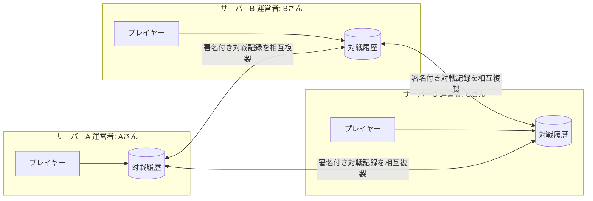

# Smash-hub

**日本語** | [English](README.en.md)

**サーバーが1台止まっても、対戦の記録は残る。**
Smash-hub は、大乱闘スマッシュブラザーズ SPECIAL のプレイヤー同士が対戦相手を探し、結果を報告し、レーティングを競うための **分散型・非営利・オープンソース** の対戦プラットフォームです。

> [!IMPORTANT]
> Smash-hub は有志による非公式のファンプロジェクトです。任天堂株式会社および関連各社とは一切関係ありません。
> 「大乱闘スマッシュブラザーズ」は任天堂株式会社の登録商標です。

> [!NOTE]
> 現在は **開発初期** です。1台のサーバーで対戦の一連の流れ（ログイン → マッチング → 結果報告 → レート反映）が動く段階で、分散（連合）の機能はこれからです。開発に参加してくれる仲間を募集しています → [コントリビューションガイド](CONTRIBUTING.md)

## ローカルで動かす

Docker があれば、次のコマンドで起動できます。

```bash
make up   # http://localhost:8080
```

開発用ログイン（名前を入れるだけ）で複数の利用者を試せます。なお、現在の画面は **動作検証用の仮 UI** です（正式なデザインは [#10](https://github.com/tacky0612/smash-hub/issues/10)）。詳しくは [CONTRIBUTING.md](CONTRIBUTING.md#開発環境) を参照してください。

---

## 背景

2026年10月25日、多くのプレイヤーに利用されてきたスマブラSPのファンサイト「スマメイト」が、運営者の負担の大きさを理由に閉鎖されました。

個人が運営するサイトには共通の弱点があります。

- 運営者が運営をやめると、**サービスそのものが使えなくなる**
- 同時に、**積み重ねてきた対戦履歴やレートも失われる**
- 運営の負担（サーバー費用・障害対応・モデレーション）が **1人に集中する**

Smash-hub はこの問題を、[Mastodon](https://joinmastodon.org/) のような **分散（連合）型のアーキテクチャ** で解決することを目指します。
なお、Smash-hub はスマメイトの公式な後継サービスではありません。

## Smash-hub の特徴

| | 従来の個人運営サイト | Smash-hub |
|---|---|---|
| サーバー | 1つ | 複数の独立した運営者が立てる |
| 運営者が撤退したら | サービス終了・履歴消失 | 他のサーバーでサービスも履歴も継続 |
| 対戦履歴 | 運営者のDBにだけ存在 | 複数サーバーに複製され、署名により改ざんを検知できる |
| レーティング | 運営者のDBの値が正 | 対戦履歴から誰でも同じ値を再計算できる |
| アカウント | サイトに紐づく | 別サーバーへ引っ越しできる（予定） |
| 運営負担 | 1人に集中 | 運営者間で分散 |

### 仕組みのイメージ



1. プレイヤーは好きなサーバーにアカウントを作り、対戦を募集・報告します。
2. 対戦結果は **対戦した両プレイヤーの署名** 付きの記録として確定します。
3. 確定した記録は連携しているサーバー間で複製されます。
4. レーティングは記録から **決定的に（誰が計算しても同じ値に）** 算出されます。
5. サーバーAが閉鎖しても、BとCに記録が残り、プレイヤーはBやCへ移って続けられます。

詳しくは [アーキテクチャ概要](docs/architecture/overview.md) を参照してください。

## ポリシー（要約）

- **任天堂の利用許可が出ている素材以外は使いません。** ゲーム画面・キャラクター画像・公式ロゴ・公式アイコン等はリポジトリにもサービス上にも含めません。
- **プロジェクトはサイト運営で収益を得ません。** 広告・有料プラン・課金機能はソフトウェアに実装しません。なお連合には、営利・非営利を問わず、約束事に同意したサイトが参加できます（各運営者の営利活動について、プロジェクトは責任を負いません）。
- **個人情報を保持しません。** ログインは Discord / Google の外部認証に任せ、メールアドレスやパスワードはサーバーに保存しません。
- **プレイヤーのデータはプレイヤーのものです。** 対戦履歴はいつでもエクスポートでき、特定の運営者に囲い込まれません。

全文は [運営ポリシー](docs/policy.md) を参照してください。

## リポジトリ構成

```
smash-hub/
├── README.md          このファイル（英語版: README.en.md）
├── LICENSE            ライセンス（AGPL-3.0）
├── CONTRIBUTING.md    コントリビューションガイド
├── CODE_OF_CONDUCT.md 行動規範
├── SECURITY.md        脆弱性の報告方法
├── AGENTS.md          AI エージェント向けガイド（CLAUDE.md から参照）
├── .claude/skills/    Claude Code のスキル（docs-check: ドキュメントの整合性・リンク切れチェック）
├── docs/              設計・ポリシー・ロードマップなどのドキュメント
├── compose.yaml       ローカル環境（Docker Compose）
├── Makefile           起動・テストのコマンド
├── frontend/          Web UI（React SPA）
└── backend/           対戦募集・結果報告・レーティング・アカウント管理・サーバー間連携（Go）
```

## ドキュメント

| ドキュメント | 内容 |
|---|---|
| [docs/README.md](docs/README.md) | ドキュメント目次 |
| [ビジョン](docs/vision.md) | なぜ作るのか、何を作らないのか |
| [運営ポリシー](docs/policy.md) | 商標・素材・非営利・プライバシーの方針 |
| [ロードマップ](docs/roadmap.md) | スモールスタートで分散システムに育てる計画 |
| [アーキテクチャ概要](docs/architecture/overview.md) | 分散システム全体像 |
| [連合プロトコル](docs/architecture/federation.md) | サーバー間で記録を共有する仕組み |
| [バックエンド設計](docs/architecture/backend.md) | クリーンアーキテクチャ + DDD |
| [フロントエンド設計](docs/architecture/frontend.md) | UI の方針 |
| [ドメインモデル](docs/domain/README.md) | ユビキタス言語・境界づけられたコンテキスト |
| [対戦ルール](docs/domain/match-rules.md) | レーティング対戦のルール（スマメイトのルールを踏襲） |
| [レーティング](docs/domain/rating.md) | 分散環境でのレート算出 |
| [セキュリティ](docs/security/README.md) | セキュリティポリシー・認証・データ保護・脅威モデル |
| [技術選定](docs/tech-selection.md) | 選定基準と候補 |
| [ADR](docs/adr/README.md) | 設計判断の記録 |

## コントリビュート

設計の議論、技術選定、実装、ドキュメント、UI デザイン、サーバー運用の知見など、どんな形の参加も歓迎します。
まずは [CONTRIBUTING.md](CONTRIBUTING.md) を読んで、Issue や Discussion で気軽に声をかけてください。

## セキュリティ

脆弱性を見つけた場合は、公開の Issue ではなく [SECURITY.md](SECURITY.md) の手順で報告してください。

## ライセンス

Smash-hub は [GNU Affero General Public License v3.0（AGPL-3.0）](LICENSE) のもとで公開しています。ソースコードとドキュメントを含むリポジトリ全体が対象です。

- Smash-hub を改変してインスタンスを運営する場合は、その利用者に改変後のソースコードを公開する必要があります。
- 選定の理由は [ADR 0003](docs/adr/0003-license-agpl-3.0.md) を参照してください。

「大乱闘スマッシュブラザーズ」は任天堂株式会社の登録商標です。このライセンスは Smash-hub のコードとドキュメントにのみ適用され、任天堂株式会社および関連する権利者の商標・著作物には適用されません。
