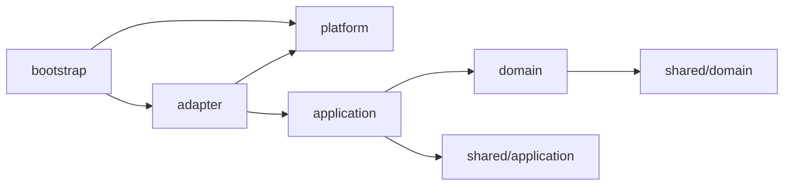

# バックエンド設計

> ステータス: **Draft**。言語・フレームワークは [技術選定](../tech-selection.md) で決定します。本ドキュメントは言語に依存しない構成方針です。

## 1. 方針

- **クリーンアーキテクチャ** — 依存は常に内側（ドメイン）へ向ける。フレームワーク・DB・連合の通信方式はすべて外側の詳細として差し替え可能にする。
- **ドメイン駆動設計（DDD）** — [境界づけられたコンテキスト](../domain/README.md) ごとにモジュールを分け、ユビキタス言語をコードの名前にそのまま使う。
- **モジュラーモノリス** — 1つのプロセスとしてデプロイする（個人運営で扱いやすくするため）。マイクロサービス化はしない。モジュール間の境界はコード上で厳格に守る。

## 2. ディレクトリ構成

```
backend/
├── src/
│   ├── modules/                    # 境界づけられたコンテキストごとのモジュール
│   │   ├── account/                # アカウント・鍵・プロフィール
│   │   ├── matchmaking/            # 対戦募集・マッチング
│   │   ├── match/                  # 対戦記録・結果報告・中止・期限切れ
│   │   ├── rating/                 # レーティング算出・ランキング
│   │   └── federation/             # インスタンス間連携・ログ複製・連合ポリシー
│   │
│   │   # 各モジュールの内部構成（全モジュール共通）
│   │   └── <module>/
│   │       ├── domain/             # ① エンティティ層（最内側・何にも依存しない）
│   │       │   ├── model/          #    集約・エンティティ・値オブジェクト
│   │       │   ├── event/          #    ドメインイベント
│   │       │   ├── repository/     #    リポジトリのインターフェース
│   │       │   └── service/        #    ドメインサービス
│   │       ├── application/        # ② ユースケース層（domain にのみ依存）
│   │       │   ├── command/        #    更新系ユースケース
│   │       │   ├── query/          #    参照系ユースケース
│   │       │   └── port/           #    外部への出口のインターフェース（通知・他モジュール等）
│   │       └── adapter/            # ③ インターフェースアダプター層（application に依存）
│   │           ├── inbound/
│   │           │   ├── http/       #    フロントエンド向け API のハンドラ
│   │           │   └── federation/ #    他インスタンスからの受信ハンドラ
│   │           └── outbound/
│   │               ├── persistence/#    リポジトリの実装（DB）
│   │               └── federation/ #    他インスタンスへの送信の実装
│   │
│   ├── shared/                     # 共有カーネル（全モジュールが使う最小限の概念）
│   │   ├── domain/                 #    AccountId, InstanceId, Signature, Timestamp 等
│   │   └── application/            #    トランザクション境界・イベントバスのインターフェース
│   │
│   ├── platform/                   # ④ フレームワーク & ドライバー層
│   │   ├── config/                 #    設定読み込み
│   │   ├── database/               #    DB 接続・マイグレーション
│   │   ├── http/                   #    HTTP サーバー・ミドルウェア・セッション
│   │   ├── auth/                   #    外部認証プロバイダー（Discord / Google）の OAuth / OIDC クライアント
│   │   ├── crypto/                 #    署名・ハッシュの実装
│   │   └── logging/                #    ログ・メトリクス
│   │
│   └── bootstrap/                  # コンポジションルート（依存の組み立て・起動）
│
└── tests/
    ├── unit/                       # domain / application の単体テスト
    ├── integration/                # adapter と DB 等を組み合わせたテスト
    └── e2e/                        # 複数インスタンスを立てた連合のテスト
```

## 3. 依存のルール



| 層 | 依存してよいもの | 依存してはいけないもの |
|---|---|---|
| `domain` | 同じモジュールの `domain`、`shared/domain` | application / adapter / platform、フレームワーク、DB、HTTP |
| `application` | 同じモジュールの `domain`・`application`、`shared` | adapter / platform、他モジュールの内部 |
| `adapter` | 同じモジュールの `application`・`domain`、`platform` | 他モジュールの `domain`・`adapter` |
| `platform` | 外部ライブラリ | modules |
| `bootstrap` | すべて | — |

### モジュール間の連携

- 他モジュールの `domain` を直接参照しません。
- 連携は次のどちらかで行います。
  1. **ドメインイベント** — 例: `match` が `MatchConfirmed` を発行し、`rating` と `federation` が購読する。
  2. **公開されたユースケース（port 経由）** — 例: `matchmaking` が対戦成立時に `match` の「対戦開始」ユースケースを呼ぶ。呼び出し側は自モジュールの `application/port` にインターフェースを定義し、`bootstrap` で接続する。
- これらのルールは技術選定後、静的解析（import 制約のリンター等）で CI により強制します。

## 4. モジュールの責務

| モジュール | 主な集約 | 主なユースケース | 発行するイベント |
|---|---|---|---|
| `account` | `Account`, `ExternalIdentity`（識別子ハッシュ）, `Session` | 外部プロバイダーでのログイン、登録、プロバイダーの紐づけ、プロフィール編集、鍵管理、エクスポート、移行、削除 | `AccountRegistered`, `AccountMoved`, `AccountPseudonymized` |
| `matchmaking` | `MatchRequest`（対戦募集）, `MatchingQueue`, `MatchmakingPreference`, `StageBanList`, `BlockList` | 対戦相手を探す（募集作成・自動マッチング）、キャンセル、マッチング条件・拒否ステージ・スイッチ・ブロックの設定 | `MatchMade` |
| `match` | `Match`（対戦） | 対戦開始、ゲームの記録（ステージ・ファイター）、結果報告（両者）、期限切れ処理、無効化 | `MatchConfirmed`, `MatchCancelled`, `MatchExpired`, `MatchVoided` |
| `rating` | `RatingLedger`, `Season` | レート再計算、ランキング取得、レート履歴取得 | `RatingUpdated` |
| `federation` | `Peer`（連合先）, `LogEntry`, `FederationPolicy` | ログ追記、ログ提供、ログ取り込み・検証、連合先管理 | `RemoteEntryImported` |

## 5. 設計上の約束

- **ドメイン層は純粋に保つ** — 時刻・乱数・ID 生成は `shared/domain` のインターフェース越しに受け取り、テストで固定できるようにする。
- **レート計算は副作用のない関数として実装する** — 同じ入力（対戦記録の集合）から必ず同じ出力になること。浮動小数点の扱いもこの観点で決める（→ [レーティング](../domain/rating.md)）。
- **永続共有データはイベントとして保存する** — 連合で共有するデータは更新・削除せず、イベントの追記で状態を表す。ローカルデータは通常の CRUD でよい。
- **ユースケースの入力と出力は DTO にする** — adapter にドメインモデルを直接漏らさない。
