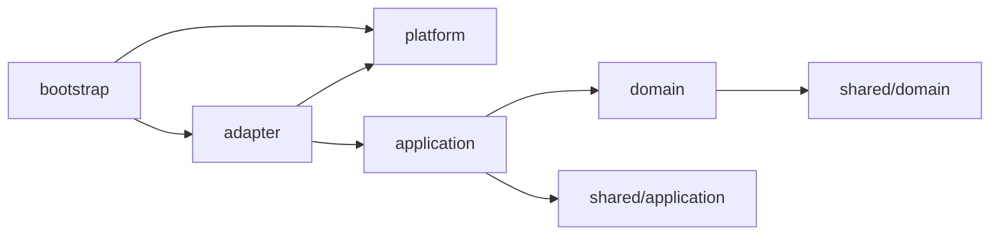

# バックエンド設計

> ステータス: **Draft**。言語・フレームワークは [技術選定](../tech-selection.md) で決定します。本ドキュメントは言語に依存しない構成方針です。

## 1. 方針

- **クリーンアーキテクチャ** — 依存は常に内側（ドメイン）へ向ける。フレームワーク・DB・連合の通信方式はすべて外側の詳細として差し替え可能にする。
- **ドメイン駆動設計（DDD）** — [境界づけられたコンテキスト](../domain/README.md) ごとにモジュールを分け、ユビキタス言語をコードの名前にそのまま使う。
- **モジュラーモノリス** — 1つのプロセスとしてデプロイする（個人運営で扱いやすくするため）。マイクロサービス化はしない。モジュール間の境界はコード上で厳格に守る。

## 2. ディレクトリ構成

言語は **Go**、DB は **PostgreSQL** です（[ADR 0005](../adr/0005-tech-stack.md)）。Go の慣習に合わせ、外部から import させないコードは `internal/` に置きます。

```
backend/
├── cmd/server/                     # エントリーポイント（設定の読み込み・DB 接続・HTTP サーバーの起動）
└── internal/
    ├── modules/                    # 境界づけられたコンテキストごとのモジュール
    │   ├── account/                # アカウント・外部認証との紐づけ・セッション
    │   ├── matchmaking/            # 対戦相手を探す（対戦募集・自動マッチング）
    │   ├── match/                  # 対戦・結果報告・中止・期限切れ
    │   ├── rating/                 # レーティング算出（スマメイト式）・ランキング
    │   ├── federation/             # 連合: 署名付き追記専用ログ・pull 同期・検証・インスタンス間の対戦の受け口
    │   └── moderation/             # 通報・処分（注意・イエローカード・レッドカード）・対戦記録の無効化の指示
    │
    │   # 各モジュールの内部構成（全モジュール共通）
    │   └── <module>/
    │       ├── domain/             # ① エンティティ層: 集約・値オブジェクト・リポジトリのインターフェース
    │       ├── application/        # ② ユースケース層: ユースケースと、他モジュール・外部への port（インターフェース）
    │       └── adapter/            # ③ インターフェースアダプター層: HTTP ハンドラ・PostgreSQL のリポジトリ実装
    │
    ├── shared/                     # 共有カーネル
    │   ├── domain/                 #    AccountID・MatchID・FighterID・Clock・共通エラー
    │   └── application/            #    トランザクション境界（TxManager）
    ├── platform/                   # ④ フレームワーク & ドライバー層
    │   ├── config/                 #    環境変数からの設定読み込み
    │   ├── database/               #    接続プール・トランザクション・マイグレーション（SQL を埋め込み）
    │   ├── httpx/                  #    JSON 入出力・エラー変換・CSRF・接続元 IP などのミドルウェア
    │   ├── ratelimit/              #    レート制限（アカウント / IP アドレスごとのトークンバケット）
    │   ├── accesslog/              #    アクセスログの記録（DB）と保持期間を過ぎたものの削除
    │   ├── auth/                   #    外部認証プロバイダー（Discord）の OAuth 2.0 クライアント
    │   ├── crypto/                 #    識別子ハッシュ（HMAC）・トークン・PKCE
    │   └── terms/                  #    利用規約の読み込み（プロジェクト共通のひな形を埋め込み、ファイルで差し替え）
    ├── bootstrap/                  # コンポジションルート（各モジュールの組み立て、port の接続）
    └── integrationtest/            # PostgreSQL と結合したテスト（build tag: integration）
e2e/                                # 2つのインスタンスを Docker で立てた E2E テスト（build tag: e2e）
```

- 単体テストは各パッケージの `*_test.go` に置きます（DB 不要）。
- 結合テストは `internal/integrationtest/` に置き、`go test -tags=integration` で実行します（→ [backend/README.md](../../backend/README.md)）。
- 1つのモジュールが大きくなったら、層の下を `domain/model`・`application/command` のように分割します。

## 3. 依存のルール



| 層 | 依存してよいもの | 依存してはいけないもの |
|---|---|---|
| `domain` | 同じモジュールの `domain`、`shared/domain` | application / adapter / platform、フレームワーク、DB、HTTP |
| `application` | 同じモジュールの `domain`・`application`、`shared` | adapter / platform、他モジュールの内部 |
| `adapter` | 同じモジュールの `application`・`domain`、`platform` | 他モジュールの `domain`・`adapter` |
| `platform` | 外部ライブラリ | modules |
| `bootstrap` | すべて | — |

### モジュール間の連携

- 他モジュールの `domain` を直接参照しません。
- 連携は次のどちらかで行います。
  1. **ドメインイベント** — 例: `match` が `MatchConfirmed` を発行し、`rating` と `federation` が購読する。
  2. **公開されたユースケース（port 経由）** — 例: `matchmaking` が対戦成立時に `match` の「対戦開始」ユースケースを呼ぶ。呼び出し側は自モジュールの `application/port` にインターフェースを定義し、`bootstrap` で接続する。
- これらのルールは技術選定後、静的解析（import 制約のリンター等）で CI により強制します。

## 4. モジュールの責務

| モジュール | 主な集約 | 主なユースケース | 発行するイベント |
|---|---|---|---|
| `account` | `Account`, `ExternalIdentity`（識別子ハッシュ）, `Session` | 外部プロバイダーでのログイン、登録、プロバイダーの紐づけ、プロフィール編集、鍵管理、エクスポート、移行、削除 | `AccountRegistered`, `AccountMoved`, `AccountPseudonymized` |
| `matchmaking` | `MatchRequest`（対戦募集）, `MatchingQueue`, `MatchmakingPreference`, `StageBanList`, `BlockList` | 対戦相手を探す（募集作成・自動マッチング）、キャンセル、マッチング条件・拒否ステージ・スイッチ・ブロックの設定 | `MatchMade` |
| `match` | `Match`（対戦） | 対戦開始、ゲームの記録（ステージ・ファイター）、結果報告（両者）、期限切れ処理、無効化された対戦の表示 | `MatchConfirmed`, `MatchCancelled`, `MatchExpired` |
| `rating` | `RatingLedger`, `Season` | レート再計算、ランキング取得、レート履歴取得 | `RatingUpdated` |
| `federation` | `Event`（ログのイベント）, `AccountPublished`, `MatchVoided`, `PeerState`（連合先と取り込み位置） | ログ追記（AccountPublished・MatchRecorded・MatchVoided）、ログ提供、pull 同期と検証（無効化は記録のホストが発行したものだけ受理）、募集の配信の受け付け、インスタンス間の対戦の受け口（申し込み・状態・報告の中継を matchmaking / match へ渡す） | `RecordsChanged`（rating の再計算） |
| `moderation` | `Report`（通報）, `Sanction`（処分） | 通報の受け付け、管理者による通報の確認・対応、処分（注意・イエローカード・レッドカード）と解除、利用停止の判定（matchmaking が参照）、対戦記録の無効化の指示（federation へ）、対応済みの通報の削除 | — |

## 5. 設計上の約束

- **ドメイン層は純粋に保つ** — 時刻・乱数・ID 生成は `shared/domain` のインターフェース越しに受け取り、テストで固定できるようにする。
- **レート計算は副作用のない関数として実装する** — 同じ入力（対戦記録の集合）から必ず同じ出力になること。計算は整数演算のみで行う（→ [レーティング](../domain/rating.md)）。
- **永続共有データはイベントとして保存する** — 連合で共有するデータは更新・削除せず、イベントの追記で状態を表す。ローカルデータは通常の CRUD でよい。
- **ユースケースの入力と出力は DTO にする** — adapter にドメインモデルを直接漏らさない。
