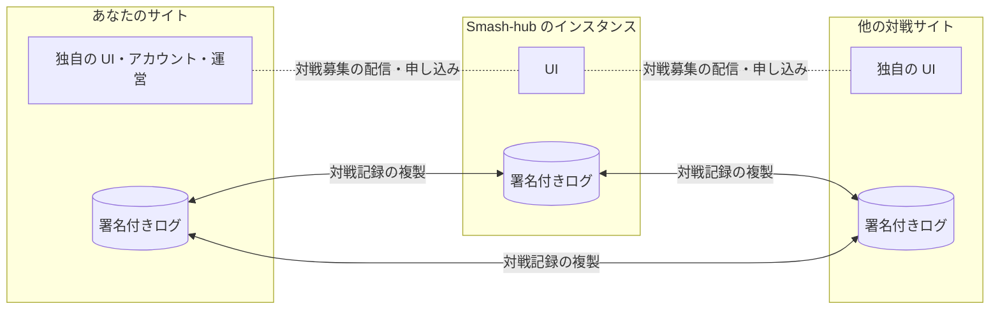
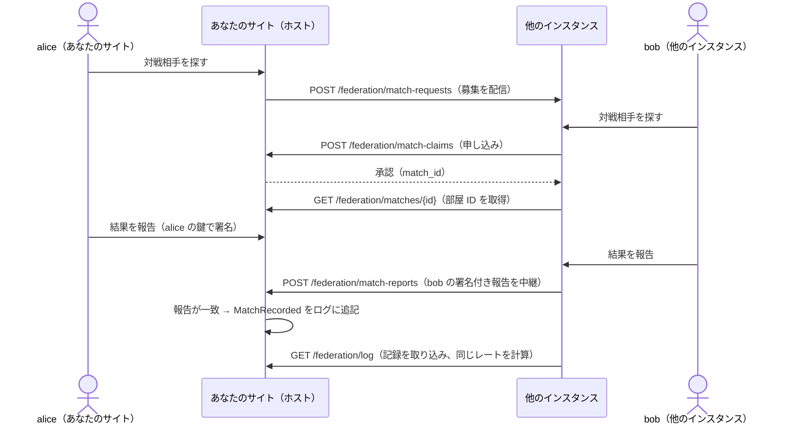

# 既存の対戦サイトのための連合プロトコル入門

> ステータス: **Draft**。プロトコル本体（[連合プロトコル](federation.md)）も Draft で、ワイヤーフォーマットは今後変わる可能性があります。参加を検討している方は、実装を始める前に [Discussion](https://github.com/tacky0612/smash-hub/discussions) で声をかけてください。

スマブラ SP の対戦募集サイト・レーティングサイトを運営・開発している Web エンジニアの方に向けた資料です。Smash-hub の連合プロトコルが何を解決し、既存のサイトに何を足せば参加できるのかを説明します。

- **今のサイトの UI・アカウント・運営方針はそのまま** で参加できます。共有するのは「確定した対戦記録」と「アカウントの公開情報」だけです。
- 参加すると、**他のサイトの利用者ともマッチングでき**、**サイトをまたいで同じ物差しのレート（連合レート）** を表示でき、**サイトを閉じても利用者の記録が残ります**。
- 営利・非営利を問わず参加できます（[ADR 0007](../adr/0007-federation-open-to-commercial-sites.md)）。
- 必要な技術は **Ed25519 署名・SHA-256・JSON の正規化・HTTP の pull** だけです。ブロックチェーンや特別なミドルウェアは使いません。

## 1. なぜ連合なのか

大きな対戦サイトが閉鎖すると、プレイヤーは複数の代替サイトに分かれます。どのサイトも、同じ問題にぶつかります。

| 問題 | サイトにとっての影響 |
|---|---|
| **過疎によるマッチング不成立** | 利用者が少ない時間帯・サイトでは、募集しても相手が見つからない。利用者は人の多いサイトに流れ、小さなサイトは続けられなくなる |
| **レートの分断** | レートがサイトの中だけの値になる。「A サイトの 1800」と「B サイトの 1800」は比べられず、強さの証明として弱い |
| **閉鎖で記録が消える** | 運営をやめると、利用者の何年分もの戦績が消える。運営者は「やめられない」重圧を抱え、それ自体が負担になる |

連合プロトコルは、この3つをサイトどうしの協力で解決します。



## 2. 参加すると得られるもの

| 得られるもの | 仕組み |
|---|---|
| **連合全体の利用者とマッチング** | 待機中の対戦募集を連合先に配信し、他のサイトの募集にも申し込める（→ [11.4](federation.md#114-インスタンスをまたぐ対戦phase-4)）。自サイトに相手がいなくても、連合全体から相手が見つかる |
| **サイトをまたいで比べられるレート** | すべての参加サイトが同じ対戦記録の集合から、同じ計算式（[スマメイト式](../domain/rating.md)）で同じレートを計算する。ランキングもどのサイトで見ても同じになる |
| **閉鎖しても記録が残る** | 確定した対戦記録は両プレイヤーの署名付きで連合先に複製される。サイトがなくなっても、記録は他の場所で検証可能なまま残る |
| **運営者を信頼しなくてよい記録** | 記録は両者の署名とハッシュチェーンで守られ、改ざんや欠落を誰でも検知できる。「あのサイトのレートは操作されている」と言われる余地が減る |
| **UI と運営の自由** | 画面・機能・コミュニティ運営・収益の得方は各サイトの自由。プロトコルが決めるのは共有する事実の形式だけ |

### 変わらないもの

- **ログイン方式とアカウント DB** — 利用者の認証はこれまでどおりサイトの中で行います。連合に出すのは公開情報だけです（→ 5.1）。
- **サイト独自の機能** — 大会・コミュニティ・配信連携など、連合に関係しない機能はそのまま使えます。
- **サイト独自のレート** — 併用してかまいません。ただし、連合レートと取り違えないよう、別の名前で表示します（→ [レーティング](../domain/rating.md) の「6. 連合レート」）。

## 3. 何を共有し、何を共有しないか

**このプロトコルは個人情報を取り扱いません**（[連合プロトコル](federation.md#44-個人情報を扱わない) の「4.4」）。イベントにも API にも、メールアドレス・パスワード・外部 SNS のアカウント・IP アドレスなどを入れる項目はありません。連合に出るのは、公開鍵から作るアカウント ID・利用者が決めた表示名・確定した対戦記録だけです。

| 連合で共有するもの | 共有しないもの |
|---|---|
| アカウント ID（公開鍵から作る `did:key`）・表示名・ホームのサイト | メールアドレス・パスワード・外部 SNS のアカウント・IP アドレス |
| 確定した対戦記録（日時・参加者のアカウント ID・使用ファイター・勝敗・ルール・署名） | 対戦ルームのメッセージ・通報・ブロック・マッチング条件の詳細 |
| 記録の無効化・アカウントの仮名化（削除）のイベント | サイト独自のレート・統計・アクセスログ |
| 待機中の対戦募集（30秒で失効する一時データ） | セッション・認証プロバイダーのトークン |

サイトの中でどんな情報を保存し、どの認証方式を使うかは、各運営者の責任です。参加の条件は「利用者の個人情報を連合で共有しないこと」「トラッキングを設置しないこと」などです（→ 7.）。

## 4. 仕組みの概要

詳しくは [図解](federation-walkthrough.md) にまとめています。ここでは要点だけを説明します。

### 4.1 署名付きの追記専用ログ

各サイト（連合では **インスタンス** と呼びます）は、自分が確定させた出来事を **イベント** として、連番（`seq`）と直前のイベントのハッシュ（`prev`）を付けて追記していきます。イベントにはインスタンスの Ed25519 署名を付けます。Git のコミットの連なりに近い構造です。

```text
seq=1  AccountPublished  (alice の公開情報。alice の鍵でも署名)   prev=""      sig=A
seq=2  AccountPublished  (bob の公開情報)                         prev=h(1)    sig=A
seq=3  MatchRecorded     (alice vs bob。両プレイヤーの署名付き)     prev=h(2)    sig=A
```

- 途中のイベントを消したり書き換えたりすると、`prev` のハッシュが合わなくなります。
- 欠落は `seq` の飛びで分かります。
- 対戦記録は **両プレイヤーの署名** を含みます。そのため、ホストのインスタンスでも、片方のプレイヤーに無断で記録を作れません。

### 4.2 pull で同期する

他のインスタンスは `GET /federation/log?since=<最後に取り込んだ seq>` で差分を取りに来ます。

- 取りに来る側が自分のタイミングで同期します。そのため、相手が止まっていても、復帰後に追いつけます。
- 受け取った側は、署名・連番・ハッシュチェーン・プレイヤーの署名を検証してから取り込みます。

### 4.3 記録から誰でも同じレートを計算する

レートはサイトの DB が持つ値ではなく、**共有された対戦記録から決定的に再計算される派生データ** です。

- 記録を `played_at` の順に並べ、整数演算だけのスマメイト式で1件ずつ適用します。
- そのため、記録の集合が同じなら、どの言語で実装しても同じ値になります（→ [レーティング](../domain/rating.md)）。

### 4.4 インスタンスをまたぐ対戦



- 先に待っていた側のインスタンスが **ホスト** になります。
- ホストだけが対戦記録を作れます。他のインスタンスから記録そのものを送り込む API はありません。

## 5. あなたのサイトに足すもの

一度に全部を実装する必要はありません。次の3段階で導入できます。

| 段階 | できるようになること | 実装するもの |
|---|---|---|
| **1. 記録の公開** | 自サイトの対戦記録が連合に複製され、閉鎖しても残る。他のサイトのランキングに自サイトの利用者が載る | アカウントの鍵、`AccountPublished`・`MatchRecorded` のログ、`GET /federation/instance`・`GET /federation/log` |
| **2. 取り込みと連合レート** | 他のサイトの記録を取り込み、連合レートとランキングを表示する | ログの pull と検証、連合レートの計算 |
| **3. インスタンスをまたぐ対戦** | 他のサイトの利用者とマッチングする | インスタンス間リクエストの署名、対戦募集の配信・申し込み・状態の取得・報告の中継 |

### 5.1 アカウント（段階 1）

連合の中では、利用者を **Ed25519 公開鍵から作るアカウント ID（`did:key`）** で識別します（[ADR 0008](../adr/0008-account-id-did-key.md)）。今のサイトのユーザー ID とは別に、次のものを用意します。

1. **鍵ペアを作る** — 連合に参加する利用者ごとに、サーバー側で Ed25519 の鍵ペアを作ります。秘密鍵は暗号化して保存し、暗号化の鍵は DB とは別に保管します。利用者に鍵の管理はさせません。
2. **アカウント ID を作る** — `did:key:z` + base58btc（`0xed 0x01` + 公開鍵 32 バイト）です。
3. **`AccountPublished` をログに追記する** — 表示名を登録・変更したときに発行します。payload には、利用者の鍵での署名（`account_sig`）を付けます（→ [11.6](federation.md#116-accountpublished-の-payload)）。

> [!IMPORTANT]
> 対戦記録は公開され、連合先に複製され、署名後は変更できません。既存の利用者を連合に参加させる前に、この点を説明して **利用者ごとに同意を得てください**（[運営ポリシー](../policy.md) の「3.1 対戦記録は公開・複製される」）。同意していない利用者は、これまでどおりサイトの中だけで遊べるようにしておくのが安全です。

### 5.2 対戦記録（段階 1）

両プレイヤーの報告が一致して対戦が確定したら、`MatchRecorded` を自サイトのログに追記します（例は [12](federation.md#12-例-matchrecorded)）。

- 両プレイヤーは、payload から `signatures` を除いた **対戦結果の内容** の正規化 JSON に、それぞれの鍵で署名します。
- 同じバイト列の SHA-256（小文字の16進）が **記録 ID** です。記録は `match_id` ではなく記録 ID で識別します（→ [12.1](federation.md#121-記録-id)）。
- 対戦は [標準ルール](../domain/match-rules.md)（`standard-1on1@1`：2本先取・3ストック・7分）で行ったものに限ります。今のところ、他のルールセットの記録は連合先で受け入れられません。サイト独自のルールの対戦は、連合に出さずにサイトの中だけで扱ってください。
- 表示名は記録に入れず、アカウント ID だけを入れます。
- ファイターは [ファイター ID](../domain/fighters.md)（`mario` 等の英小文字）で表します。画像や日本語名は入れません。

過去の対戦は連合に持ち込みません。

- 締め切りを過ぎた記録はレート計算に入りません。ホストがログに追記した日時と `played_at` の差が 7日を超える記録が該当します。
- 他のサービスのレートも引き継ぎません（[レーティング](../domain/rating.md) の「3. シーズン」）。

連合レートはシーズン開始時に全員 1500 から始まります。過去の戦績は、サイトの中の履歴として残してください。

### 5.3 ログの提供（段階 1）

| API | 内容 |
|---|---|
| `GET /federation/instance` | インスタンス ID（連合先から到達できるベース URL）・名前・公開鍵（base64） |
| `GET /federation/log?since=&limit=` | `since` の次の seq からのイベント（`limit` は既定 100・最大 500）。各要素は署名済みイベントの正規化 JSON そのもの |

どちらも認証なしの公開 API です。イベントは追記したときのバイト列のまま保存し、そのまま返すと、ハッシュの食い違いが起きません。

### 5.4 取り込みと連合レート（段階 2）

連合先ごとに「最後に取り込んだ seq とハッシュ」を持ち、定期的に `GET /federation/log` を呼びます。各イベントは次の順で検証し、成功したものだけを取り込みます（→ [6.3](federation.md#63-検証順序)）。

1. インスタンス署名が、初回に `/federation/instance` から取得して固定した公開鍵で正しいこと
2. `seq` が前回の続きで、`prev` が前回のイベントのハッシュと一致すること
3. `MatchRecorded` なら、両プレイヤーの署名が、それぞれのアカウント ID が示す公開鍵で正しいこと
4. `AccountPublished` なら、`account_sig` がそのアカウントの鍵で正しいこと
5. ルールセットが受け入れ可能であること

検証に失敗したら、そのイベント以降を取り込まずに理由を記録し、次回に再試行します。

取り込んだ記録と自サイトの記録を合わせて、[レーティング](../domain/rating.md) の「4. 決定性を守るための約束」に従って連合レートを計算します。テストベクタは同じドキュメントの「2.4」にあります。

### 5.5 インスタンスをまたぐ対戦（段階 3）

`/federation/instance` と `/federation/log` 以外の API は、送信元インスタンスの鍵で署名したリクエストだけを受け付けます（→ [11.3](federation.md#113-インスタンス間リクエストの署名)）。

```text
X-Smash-Hub-Instance:  送信元のインスタンス ID
X-Smash-Hub-Date:      送信日時（RFC 3339。受信側と 5分以上ずれたら拒否）
X-Smash-Hub-Signature: base64( Ed25519( "METHOD\n/path?query\n<日時>\n<本文の SHA-256 の16進>" ) )
```

対戦募集の配信・申し込み・状態の取得・報告の中継の流れは [11.4](federation.md#114-インスタンスをまたぐ対戦phase-4)・[11.5](federation.md#115-post-federationmatch-reportsphase-4) を参照してください。

## 6. 実装の要点（TypeScript の例）

Node.js の標準ライブラリ（`node:crypto`）だけで、署名・検証・ハッシュを扱えます。以下は考え方を示すための例です。参照実装は Go の [backend/internal/modules/federation/domain/event.go](../../backend/internal/modules/federation/domain/event.go) と [backend/internal/shared/domain/canonical.go](../../backend/internal/shared/domain/canonical.go) です。

### 6.1 正規化 JSON

署名とハッシュの対象は、**キーを昇順に並べ、空白を除いた JSON** です。

```ts
// キーを昇順に並べ、空白なしで出力する
export function canonicalize(v: unknown): string {
  if (Array.isArray(v)) return `[${v.map(canonicalize).join(",")}]`;
  if (v !== null && typeof v === "object") {
    const obj = v as Record<string, unknown>;
    const keys = Object.keys(obj).filter((k) => obj[k] !== undefined).sort();
    return `{${keys.map((k) => `${JSON.stringify(k)}:${canonicalize(obj[k])}`).join(",")}}`;
  }
  return JSON.stringify(v);
}
```

> [!WARNING]
> シリアライズ形式の厳密な定義は、まだ決まっていません（[連合プロトコル](federation.md) の「16. 未解決の論点」）。現在の参照実装は Go の `encoding/json` の出力（HTML 用のエスケープなし）に従います。
>
> 次のような文字のエスケープは、`JSON.stringify` と結果が異なります。
>
> - U+2028 / U+2029
> - 一部の制御文字（`\b`・`\f` は Go では `\u0008`・`\u000c`）
>
> 受信したイベントは、自分で正規化し直さず、**受け取ったバイト列のまま** ハッシュと検証に使うのが安全です。

### 6.2 インスタンス署名の検証とハッシュチェーン

```ts
import { createHash, createPublicKey, verify } from "node:crypto";

// Ed25519 の生の公開鍵（32 バイト）を KeyObject にする
const ed25519Key = (raw: Buffer) =>
  createPublicKey({
    key: Buffer.concat([Buffer.from("302a300506032b6570032100", "hex"), raw]),
    format: "der",
    type: "spki",
  });

type Event = {
  type: string; version: number; instance_id: string; seq: number;
  prev: string; created_at: string; payload: unknown; sig: string;
};

// body は /federation/log の events の1要素（正規化 JSON の文字列）
export function verifyEvent(body: string, instanceKey: Buffer, lastSeq: number, lastHash: string) {
  const event: Event = JSON.parse(body);
  const { sig, ...unsigned } = event; // 署名の対象は sig を除いたイベント
  const ok = verify(null, Buffer.from(canonicalize(unsigned)), ed25519Key(instanceKey), Buffer.from(sig, "base64"));
  if (!ok) throw new Error("instance signature is invalid");
  if (event.seq !== lastSeq + 1 || event.prev !== lastHash) throw new Error("hash chain is broken");
  const hash = createHash("sha256").update(body).digest("hex"); // 次のイベントの prev になる
  return { event, hash };
}
```

- 最初のイベントは `seq` が 1、`prev` が空文字列です。
- 署名はいずれも Ed25519 で、base64（パディングあり）で表します。
- 時刻は UTC・ミリ秒までの RFC 3339（`2026-10-26T10:30:00.000Z`）で表します。

### 6.3 アカウント ID（did:key）から公開鍵を取り出す

```ts
import bs58 from "bs58"; // base58btc（MIT ライセンス）

export function publicKeyFromDid(did: string): Buffer {
  if (!did.startsWith("did:key:z")) throw new Error("not a did:key");
  const bytes = Buffer.from(bs58.decode(did.slice("did:key:z".length)));
  if (bytes[0] !== 0xed || bytes[1] !== 0x01 || bytes.length !== 34) throw new Error("not an Ed25519 did:key");
  return bytes.subarray(2);
}
```

`MatchRecorded` のプレイヤーの署名は、`payload` から `signatures` を除いたものを正規化した JSON に対して、この公開鍵で検証します。

### 6.4 レート計算の落とし穴

- **浮動小数点を使わない** — 整数演算だけで計算します。
- **負の数の割り算に注意する** — `floor_div` は −∞ 方向に丸めます。JavaScript では `Math.floor((400 + d) / 25)` で問題ありませんが、C 系の言語の整数除算（0 方向に丸める）では補正が必要です。
- **処理の順番を固定する** — 記録が届いた順ではなく、`played_at` の順（同時刻なら記録 ID の昇順）で適用します。
- **締め切りと無効化を反映する** — 締め切り（7日）を過ぎた記録と、無効化された記録を除いてから計算します。

## 7. 参加の条件

連合に参加するには、[運用者の約束事](../operations/server-covenant.md) への同意が必要です。営利・非営利は問いません。主な内容は次のとおりです。

- 任天堂の利用許可が出ている素材以外を使わない。非公式のファンサイトであることを表示する
- 対戦記録を改ざんしない。架空のアカウント・対戦を作らない
- 利用者の個人情報を連合で共有しない。アクセス解析・トラッキングを設置しない（広告を掲載する場合も同様）
- 自サイトのログを連合先に提供し続ける。閉鎖するときは、可能な限り 30日以上前に予告する
- 利用者が求めた場合、対戦履歴のエクスポートとアカウント移行を妨げない

各運営者の営利活動や、それによる任天堂株式会社その他の権利者の権利の侵害について、本プロトコルおよび Smash-hub プロジェクトは責任を負いません（[ADR 0007](../adr/0007-federation-open-to-commercial-sites.md)）。

Smash-hub のコード（[AGPL-3.0](../../LICENSE)）を組み込んで使う場合は、AGPL-3.0 に従ってください。

## 8. 現在の状況と制約

正直にお伝えすると、連合はまだ開発初期です。

- **実装済み**（Smash-hub の参照実装）:
  - `AccountPublished`・`MatchRecorded` のログ
  - pull 同期と検証
  - 連合レート
  - インスタンスをまたぐ対戦
  - 2つのインスタンスを立てた E2E テスト（`make test-e2e`）
- **未実装**:
  - ログの再配布
  - スナップショット
  - `MatchVoided`
  - 鍵の更新
  - アカウント移行
  - 新着の push 通知（→ [backend/README.md の「実装状況」](../../backend/README.md#実装状況)）
- **連合先の登録は手動です。** 互いの許可リスト（`PEERS`）にベース URL を書き合います。共通の拒否リストの運用方法は、まだ決まっていません。
- **ルールセットは標準ルール1つだけ** です。
- **ワイヤーフォーマットは変わる可能性があります。** 変わる場合はイベントの `version` を上げます。参加しているサイトには事前に相談します。

だからこそ、今のうちに参加を検討しているサイトの意見を仕様に反映できます。「この API が足りない」「この形式では実装しにくい」といった声を歓迎します。

## 9. よくある質問

**Q. 今のサイトのレートはどうなりますか？**
連合レートとは別に、サイト独自のレートとして残せます。ただし、連合レートと取り違えないよう、別の名前で表示してください。連合レートは新しいシーズンから全員 1500 で始まります。

**Q. 利用者のメールアドレスやパスワードを渡す必要がありますか？**
ありません。このプロトコルは個人情報を取り扱わず、それを入れる項目もありません。連合に出すのは、アカウント ID・表示名・ホームのサイト・確定した対戦記録だけです。仕様にない項目を足して個人情報を連合に出すこともしないでください。

**Q. 利用者の秘密鍵はどこに置きますか？**
当面は、ホームのサイトが暗号化して預かります。利用者に鍵の管理はさせません。リカバリーキーとアカウント移行は今後実装します。

**Q. サーバーの負荷はどのくらいですか？**
連合先ごとに、数秒〜数十秒おきの HTTP GET（差分のみ・最大 500 件）と、署名の検証だけです。Smash-hub の参照実装も、個人が安価な VPS 1台で運用できることを前提にしています（[ビジョン](../vision.md) の「設計原則」）。

**Q. 悪意のあるサイトが偽の記録を流したら？**
対戦記録には両プレイヤーの署名が必要なので、他のサイトの利用者を勝手に巻き込んだ記録は作れません。自サイトの架空のアカウントで記録を作る不正は、署名だけでは防げません。そうしたサイトは、各インスタンスが拒否リストで連合から外します（→ [脅威モデル](../security/threat-model.md)）。

**Q. Smash-hub のソフトウェアに乗り換える必要がありますか？**
ありません。プロトコルを自分のサイトに実装すれば参加できます。一から作る場合は、Smash-hub のインスタンスを立てて、自分のコミュニティ向けに運営することもできます。

## 10. 試してみる

1. リポジトリを clone して `make up` を実行すると、連合した2つのインスタンスが起動します（http://localhost:8080・http://localhost:8090）。
2. 開発用ログインで2人の利用者を作り、対戦して結果を報告すると、`http://localhost:8080/federation/log` に `AccountPublished` と `MatchRecorded` が並びます。
3. このログを自分のコードで取得し、6. の手順で検証できれば、段階 2 の取り込みの土台ができています。
4. 参加を検討している場合や、仕様についての質問は [Discussion](https://github.com/tacky0612/smash-hub/discussions) か [Issue](https://github.com/tacky0612/smash-hub/issues) でお知らせください。
