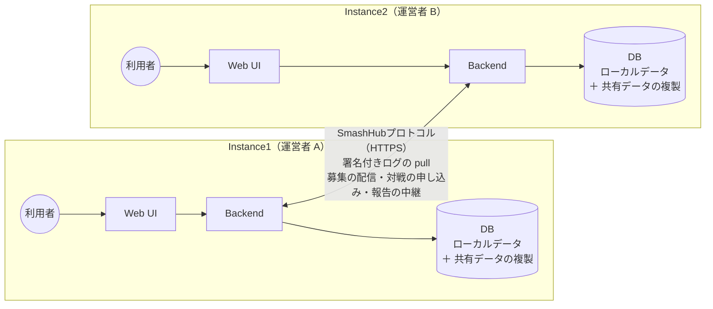
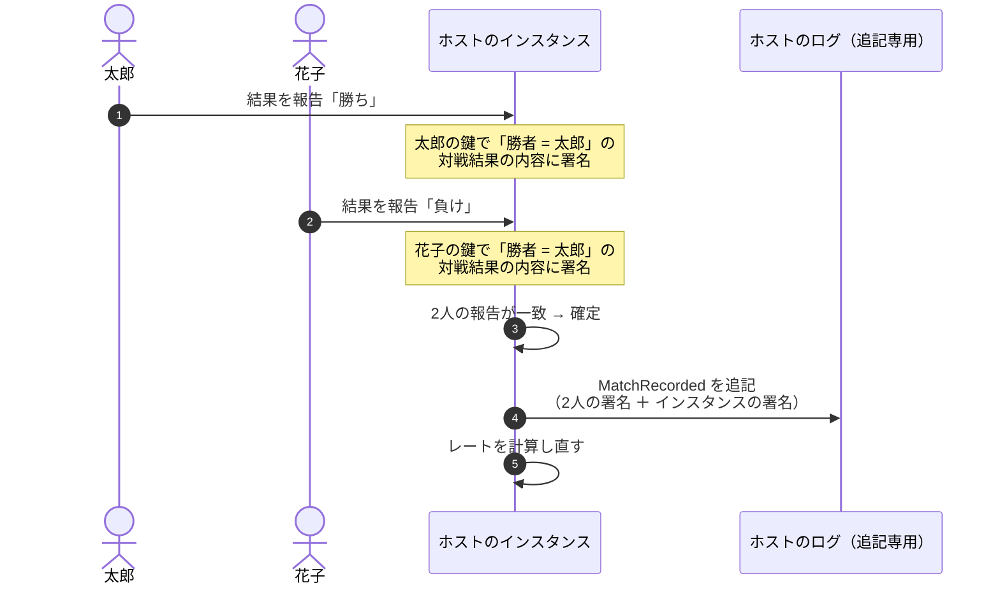
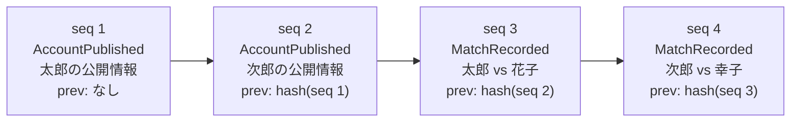
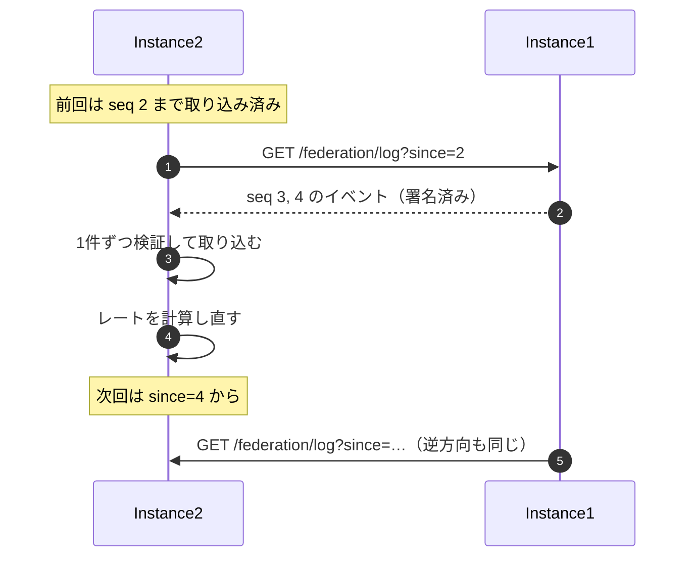
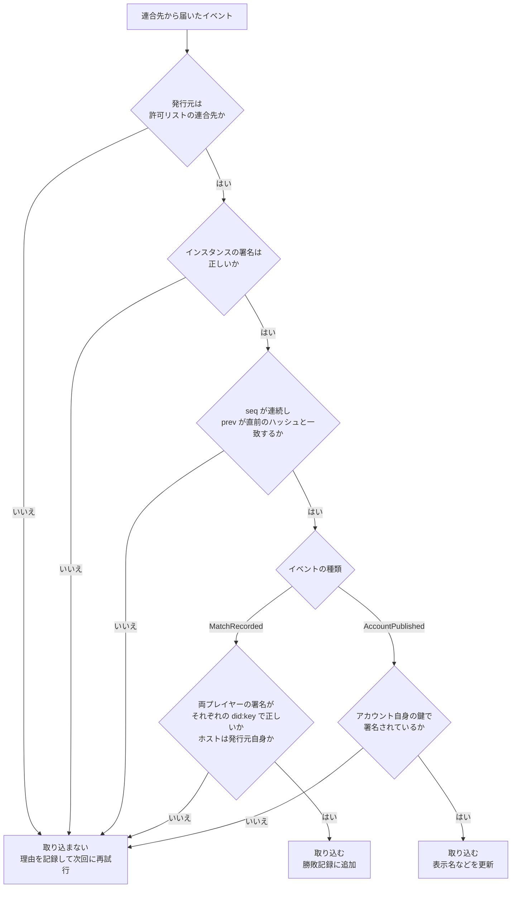
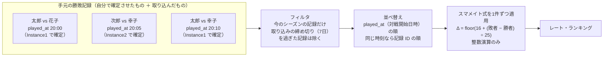
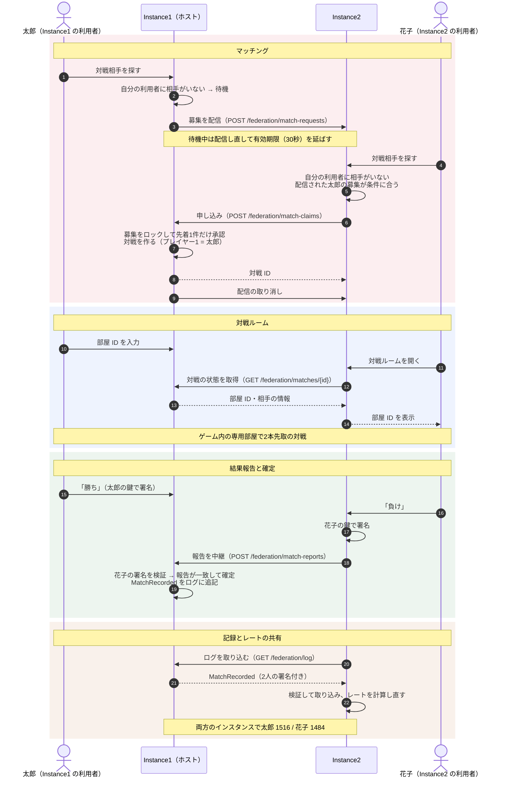
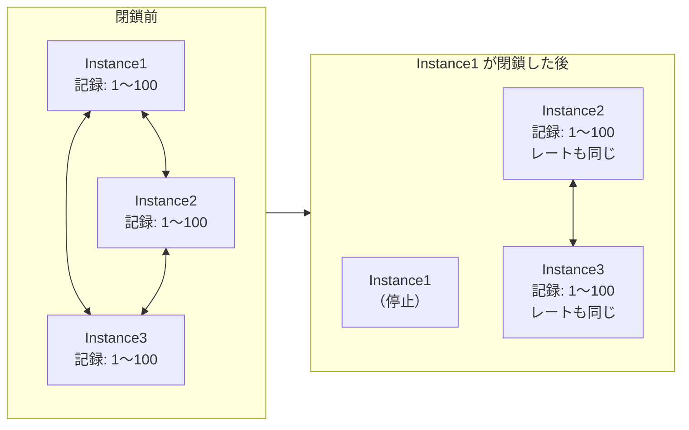

# 図解: 複数のインスタンスが勝敗記録とレートを共有する仕組み

> ステータス: **Draft**。現在の実装（Instance1・Instance2 の2台構成で動作確認済み）に基づく説明資料です。仕様の正は [SmashHubプロトコル](federation.md) です。

SmashHub では、独立した運営者が立てた複数のインスタンス（サーバー）が、**署名付きの勝敗記録をお互いに複製し合い**、それぞれが **同じ計算式でレートを計算し直す** ことで、どのインスタンスでも同じ戦績・同じレートを表示します。中央のサーバーはありません。

この仕組みで解決したいのは、次の3つです（→ [ビジョン](../vision.md)）。

| 課題 | この仕組みでの解決 |
|---|---|
| 1つのサイトが閉鎖すると、サービスも記録も消える | 記録を全インスタンスに複製する（→ 3・6） |
| サイトが乱立すると記録とレートがサイトごとに分かれ、サイトによって強さの水準がずれる | 全インスタンスが同じ記録から同じ計算式で **1つのレート（SmashHubレート）** を計算する（→ 4） |
| 利用者の少ないサイトでは、募集しても対戦相手が見つからない | 対戦募集をインスタンス間で配り合い、**別のインスタンスの利用者ともマッチングする**（→ 5） |

この資料では、その仕組みを次の順に図で説明します。

1. 全体像 — 何を共有し、何を共有しないか
2. 記録の作り方 — 両プレイヤーの署名とログ
3. 記録の共有 — pull 同期と検証
4. レートの共有 — 同じ記録から同じレートになる理由
5. インスタンスをまたぐ対戦 — 別のインスタンスの人と対戦する流れ
6. インスタンスが閉鎖したとき

---

## 1. 全体像

各インスタンスは自分の利用者だけを受け付け、自分の DB を持ちます。インスタンス同士は **SmashHubプロトコル** で通信します。

| データ | 例 | 共有するか |
|---|---|---|
| ローカルデータ | ログインの識別子ハッシュ、セッション、署名鍵（暗号化） | **しない**（そのインスタンスだけが持つ） |
| 一時データ | マッチング待ちの募集、進行中の対戦 | 必要な相手とだけ、その場限り |
| **共有データ** | アカウントの公開情報（ID・表示名）、**確定した勝敗記録** | **する**（全インスタンスに複製） |
| 派生データ | **レート**・ランキング | 共有しない。各インスタンスが共有データから **計算し直す** |

ポイントは、**レートそのものは送り合わない** ことです。送り合うのは「誰と誰が戦ってどちらが勝ったか」という署名付きの事実だけで、レートは各インスタンスがその事実から計算します。

---

## 2. 記録の作り方: 両プレイヤーの署名とログ

### 2.1 対戦が確定するまで

- 「太郎の勝ち」と「花子の負け」は **同じ内容（勝者 = 太郎）への署名** になります。報告が一致したときだけ、2人分の署名がそろいます。
- 報告が食い違ったまま 24時間たった対戦や、2人とも「中止」と報告した対戦は、記録を作りません（レートも変わりません）。
- アカウントの ID は、そのアカウントの公開鍵から作った `did:key` です。**ID さえあれば誰でも署名を確かめられます。**

### 2.2 ログの構造

各インスタンスは、自分が確定させた記録を **追記専用ログ** に順番に書きます。

| 仕組み | 守るもの |
|---|---|
| 各イベントにインスタンスの署名 | 発行元のなりすまし・内容の改ざん |
| `prev` に直前のイベントのハッシュ（ハッシュチェーン） | 途中のイベントの差し替え |
| `seq` の連番 | 途中のイベントの抜け落ち |
| `MatchRecorded` の中に両プレイヤーの署名 | インスタンスによる勝敗の書き換え |

ログは書き換えも削除もしません。取り消しが必要な場合は、取り消しのイベントを追記します（例: 記録のホストが発行する `MatchVoided`。→ [SmashHubプロトコル](federation.md) の「12.2 MatchVoided」）。

---

## 3. 記録の共有: pull 同期と検証

### 3.1 定期的に取りに行く

各インスタンスは、連合先のログを **自分から定期的に取りに行きます**（pull）。相手が一時的に止まっていても、復帰後に続きから取り直せば追いつけます。

### 3.2 取り込む前に必ず検証する

取り込む側は、**送ってきたインスタンスを信用せずに**、次の順で確かめます。1つでも失敗したら、そのイベント以降は取り込みません。

この検証により、悪意のあるインスタンスがいても、

- 他のインスタンスが作った記録を書き換えられない（署名が合わなくなる）
- 対戦していない人の勝敗を勝手に作れない（その人の鍵で署名できない）
- 他人のアカウントを名乗れない（アカウント自身の署名が必要）

ことが保証されます。

---

## 4. レートの共有: 同じ記録から同じレートになる理由

レートは、各インスタンスが **自分の手元に集まった勝敗記録** から計算します。計算の手順を全インスタンスで揃えているため、記録の集合が同じなら、どこで計算しても結果は同じになります。

| 結果がずれる原因 | 対策 |
|---|---|
| 記録が届く順番がインスタンスごとに違う | 届いた順ではなく **対戦開始日時の順** に並べてから計算する |
| 何日も後に届いた古い記録で、過去のレートが変わり続ける | ホストがログに書いた日時と対戦開始日時の差が **7日を超える記録は計算に含めない**（どのインスタンスでも同じ値で判定できる） |
| 浮動小数点の計算誤差 | **整数演算だけ** で計算する |
| 相手のインスタンスが申告するレートの詐称 | 申告値は使わず、**自分で記録から計算した値** を使う（マッチングの判定も同じ） |

対戦直後は、まだ届いていない記録がある可能性があるため、そのときのレートは「暫定」です。通常は数秒で全インスタンスに行き渡るため、実際にはすぐに一致します（ローカルの2台構成では2秒間隔で取り込み）。

---

## 5. インスタンスをまたぐ対戦

Instance1 の太郎と Instance2 の花子が対戦する流れです。**先に待っていた側のインスタンスがホスト** になり、対戦の進行と記録の確定を担当します。

| 役割 | ホスト（Instance1） | 相手側のホーム（Instance2） |
|---|---|---|
| 対戦の状態（部屋 ID・報告） | 持つ（正） | 持たない。必要なときにホストから取得する |
| 花子の署名鍵 | 持たない | 持つ（花子の報告に署名する） |
| 記録の確定・ログへの追記 | する | しない（ホストのログから取り込む） |
| 報告の受け付け | 花子の分は、花子のホームからの中継だけを受け付ける | 花子の報告をホストへ中継する |

- インスタンス間のリクエストには **インスタンスの署名** を付け、相手を許可リスト（`PEERS`）で限定しています。
- 対戦記録を作れるのはホストだけです。他のインスタンスから記録そのものを送り込む API はありません。
- 自分のインスタンス内に条件に合う相手がいれば、インスタンスをまたがずにマッチします（その記録も同じようにログ経由で他のインスタンスへ共有されます）。

---

## 6. インスタンスが閉鎖したとき

記録は全インスタンスに複製されているため、1つのインスタンスがなくなっても、勝敗記録とレートは残ります。

- Instance2・Instance3 は、Instance1 が確定させた記録も含めて全記録を持っているため、**戦績もランキングもそのまま** です。
- 記録には両プレイヤーの署名が付いているので、Instance1 がいなくなった後でも、記録が本物かどうかを誰でも確かめられます。
- Instance1 の利用者が別のインスタンスで続けるための **アカウントの引っ越し**、閉鎖したインスタンスの記録を他のインスタンス経由で新しい参加者に渡す **再配布** は今後の実装です（→ [ロードマップ](../roadmap.md) Phase 3）。

---

## 実装と検証の状況

| 項目 | 状況 |
|---|---|
| 署名付きの勝敗記録・追記専用ログ・pull 同期・検証 | 実装済み |
| 記録からのレート計算（スマメイト式・締め切り7日） | 実装済み |
| 記録の無効化（`MatchVoided`。ホストだけが対戦から7日以内に発行） | 実装済み |
| インスタンスをまたぐ対戦（募集の配信・申し込み・状態の取得・報告の中継） | 実装済み |
| 2台構成での一連の流れの検証 | `make test-e2e`（CI でも実行）で、両インスタンスのレートの一致まで確認 |
| ログのスナップショット（出力と、スナップショットからのレートの再計算・突き合わせ） | 実装済み（→ [SmashHubプロトコル](federation.md) の「8.3 スナップショット」） |
| ログの再配布・アカウントの引っ越し | 未実装（→ [ロードマップ](../roadmap.md)） |

ローカルで試す方法は [CONTRIBUTING.md の「開発環境」](../../CONTRIBUTING.md#開発環境) を参照してください（`make up` で Instance1: http://localhost:8080 と Instance2: http://localhost:8090 が起動します）。
