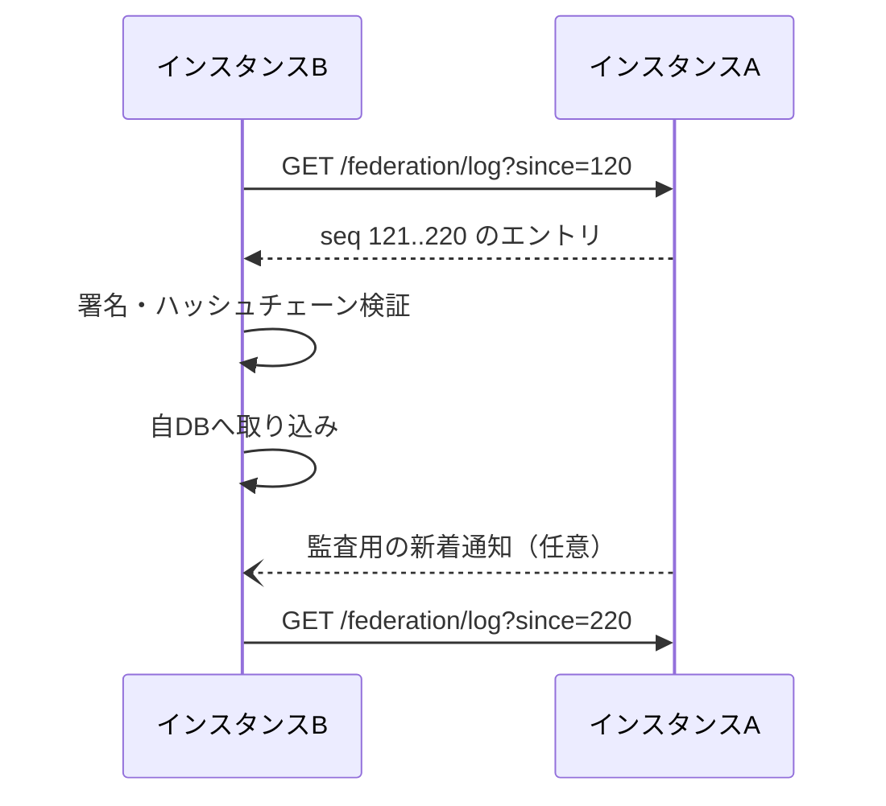
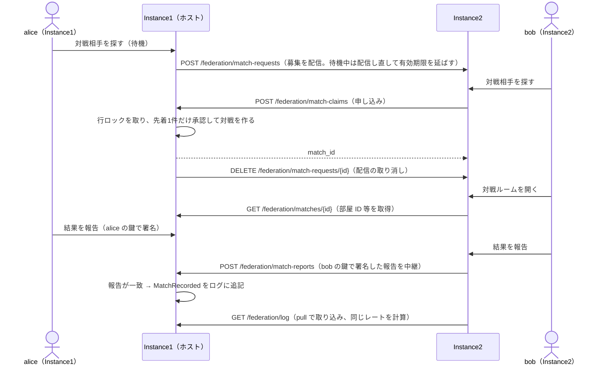

# 連合プロトコル

> ステータス: **Draft**（議論中）。ワイヤーフォーマットと API は最小実装時に確定します。全体の流れを図で知りたい場合は [図解](federation-walkthrough.md) を参照してください。独自プロトコルとすることは [ADR 0006](../adr/0006-custom-federation-protocol.md) で決定済みです。

Smash-hub の連合プロトコルは、個別のサイトやインスタンスがそれぞれ独自の UI を持ちながらも、同じ対戦事実と同じレーティング計算ルールを共有できるようにするための仕様です。Smash-hub のソフトウェアを使うインスタンスだけでなく、このプロトコルを独自に実装した他のサイトも参加できます（既存のサイト向けの入門は [既存の対戦サイトのための連合プロトコル入門](federation-for-existing-sites.md)）。

> [!NOTE]
> 連合には **営利・非営利を問わず参加できます**（[ADR 0007](../adr/0007-federation-open-to-commercial-sites.md)）。ただし参加には [運用者の約束事](../operations/server-covenant.md)（任天堂の利用許可のない素材を使わない・記録を改ざんしない・利用者の個人情報を連合で共有しない 等）への同意が必要です。各運営者の営利活動や、それによる任天堂株式会社その他の権利者の権利の侵害について、本プロトコルおよび Smash-hub プロジェクトは責任を負いません。

本プロトコルの目的は、各インスタンスが自分の DB だけに依存して「自分のレートが正しい」と主張するのではなく、署名付きの対戦記録を共有し、誰でも同じ手順でレーティングを再計算できるようにすることです。

## 1. 目標

1. 記録を失わない
   - 1つのインスタンスが閉鎖しても、対戦記録と公開アカウント情報が他インスタンスに残るようにする。

2. 改ざんや欠落を検知できる
   - 受信した記録が本物か、途中で欠落していないかを検証できるようにする。

3. 実装と運用を簡潔にする
   - 個人運営の小さなサーバーでも実装しやすく、障害時に復旧しやすい構造にする。

4. オフラインに強い
   - 相手インスタンスが一時的に止まっていても、復帰後に差分を取り直せるようにする。

5. 記録とレートを分断させない
   - 対戦記録がサイトごとに閉じず、すべての参加インスタンスが同じ記録を共有し、同じ計算式で1つのレート（連合レート）を計算できるようにする。サイトによって強さの水準がずれる（同じレートでも比べられない）ことを防ぐ。

6. 利用者の少ないインスタンスでもマッチングできる
   - 対戦募集をインスタンス間で配り合い、別のインスタンスの利用者とも対戦できるようにする（→ 11.4）。小さなインスタンスでも、連合全体の利用者を相手に対戦相手を探せる。

## 2. 基本の考え方

Smash-hub の連合は、単純な「サイト同士のデータ同期」ではなく、署名付きの追記専用ログを扱う構造を採用します。

各インスタンスは自分が受け付けた出来事をイベントとして記録し、連番とハッシュチェーンを持たせます。これにより、途中で削除や改ざんがあった場合に検出できます。

```text
インスタンスAのログ
seq=1  InstancePublished   (Aの公開鍵・名称・連合ポリシー)  prev=∅      sig=A
seq=2  AccountPublished   (alice のアカウント ID・公開鍵・表示名) prev=h(1)   sig=A
seq=3  MatchRecorded      (alice vs bob, 両者署名付き)       prev=h(2)   sig=A
seq=4  MatchRecorded      (...)                              prev=h(3)   sig=A
seq=5  MatchVoided        (無効化イベント)                   prev=h(4)   sig=A
```

- seq: インスタンスごとの連番
- prev: 直前のイベントのハッシュ
- sig: インスタンスの秘密鍵で署名した署名
- MatchRecorded には、両プレイヤーの署名が含まれるため、インスタンス署名とは独立に検証できる

## 3. 非目的

本プロトコルは次を目的としません。

- SNS の投稿や通知の標準化
- フロントエンド UI の標準化
- プロフィールやメッセージの共有を前提としたソーシャルグラフ
- サイトごとの収益モデルや課金の扱い（プロトコルは関与しない。Smash-hub プロジェクト自身は非営利）
- 一人の運営者が全てのデータを管理する中央集権モデル
- 個人情報の共有・管理（本プロトコルは個人情報を扱わない → 4.4）

本プロトコルは「事実を共有し、評価を再計算できるようにする」ための仕組みです。表示やコミュニティ運営は各サイトの責務です。

## 4. 共有される事実

連合の対象は、サイト固有のレーティング値ではなく、共有可能な事実そのものです。

- アカウントの公開情報
  - アカウント ID（公開鍵から導出する。引っ越しても変わらない）
  - ハンドル（`@name@instance` 形式の表示用の住所。引っ越すと変わる）
  - 表示名
  - 公開鍵
  - ホームインスタンス
- 確定した対戦記録
  - 対戦日時（played_at）
  - 参加者（`players`: アカウント ID のみ）
  - 使用キャラクター（`picks`: ゲームごとのファイター ID。参加者とは別の項目にする → [ファイター ID](../domain/fighters.md)）
  - 勝敗
  - 対戦ルール（Ruleset の ID とバージョン）
  - 署名
- 無効化イベント
  - 記録が誤りである場合やモデレーションで除外する場合の事由
- 仮名化イベント
  - アカウント削除に伴い、公開情報を削除したこと
- インスタンス公開情報
  - インスタンス名
  - 公開鍵
  - ホームページ
  - 連合ポリシー

これらはすべて、サイトごとの差分ではなく、誰でも検証可能な「共有された事実」として扱います。

> [!IMPORTANT]
> **本プロトコルは個人情報を取り扱いません。** 連合で共有するのは上の事実だけです（→ 4.4）。

### 4.1 アカウント ID とハンドル

アカウントの同一性は、ハンドルではなく **公開鍵から導出したアカウント ID**（Ed25519 公開鍵の `did:key`。→ [ADR 0008](../adr/0008-account-id-did-key.md)）で表します。ハンドルはホームインスタンスが変わると変わる「住所」にすぎないため、対戦記録やレート計算では使いません。これにより、アカウントを別のインスタンスへ移しても過去の対戦記録と同一人物として結びつきます。

### 4.2 対戦記録に入れない情報

対戦記録は署名後に変更できないため、**後から変更・削除されうる情報を含めません**。

- 表示名・ハンドル・プロフィールは含めず、アカウント ID だけを参照する（表示名は `AccountPublished` の最新の値を引いて表示する）
- 利用者の個人情報・外部プロバイダーの情報は含めない（[データ保護](../security/data-protection.md)）

アカウントが削除された場合は `AccountPseudonymized` を配信し、各インスタンスはそのアカウントの表示名・ハンドルなどの公開情報を削除します。対戦記録はアカウント ID だけを持つため、相手のレートの整合性を保ったまま仮名化された状態で残ります。

### 4.3 アカウントの本人性（他人の ID を名乗れないこと）

アカウント ID は公開鍵から導出するため、連合全体で調整しなくても重複しません。そのうえで、**アカウントに関するイベントはアカウント自身の鍵でも署名** し、インスタンスが他人のアカウントを名乗ったり、勝手に書き換えたりできないようにします（自己証明型）。

| イベント | インスタンス署名に加えて必要な署名 |
|---|---|
| `AccountPublished` | アカウントの鍵（アカウント ID が示す公開鍵で検証できること） |
| `AccountKeyRotated` | 旧い鍵、またはリカバリーキー |
| `AccountMoved` | アカウントの鍵、またはリカバリーキー |
| `AccountPseudonymized` | アカウントの鍵、またはリカバリーキー（運営者による削除の場合はホームインスタンスの署名と理由） |

- 同じアカウント ID について内容の食い違うイベントが届いた場合は、アカウントの鍵で正しく署名されたものだけを採用します。
- 鍵の更新（`AccountKeyRotated`）以降は、新しい鍵で署名されたイベントだけを有効とします。
- 当初は利用者の鍵をホームインスタンスが預かるため、悪意あるホームインスタンスはそのアカウントの署名を作れます。この制約と対策は [脅威モデル](../security/threat-model.md) の「3.5 悪意ある運営者」を参照してください。
- 「1人の人間が複数のアカウントを持たないこと」はプロトコルでは担保しません（個人情報を持たない方針のため）。レーティングの不正対策で抑えます（[レーティング](../domain/rating.md) の「7. 不正対策」）。

### 4.4 個人情報を扱わない

本プロトコルは個人情報を取り扱いません。

- **個人情報を入れる項目を持たない** — イベント・API のリクエスト・レスポンスのどこにも、次の情報を入れる項目はありません。
  - 氏名・住所・電話番号・生年月日・メールアドレス・パスワード
  - 外部プロバイダー（Discord / Google 等）の利用者 ID・ユーザー名・アバター・トークン
  - 識別子ハッシュ
  - 利用者の IP アドレス・アクセスログ
  - フレンドコード・外部 SNS のアカウントなどの連絡先
- **アカウントは公開鍵と表示名だけで表す** — アカウントは、公開鍵から導出したアカウント ID と、利用者が自分で決めた表示名だけで表します（→ 4.1）。アカウント ID から、外部プロバイダーのアカウントや実在の人物はたどれません（→ 13）。
- **実装は個人情報を連合に出さない** — 実装は、上の情報を、仕様にない項目として追加することも含めて、イベントやインスタンス間のリクエストに含めてはいけません。
- **表示名には注意を表示する** — 表示名は利用者が自由に入力するため、利用者が自分で個人情報を書き込む可能性があります。各サイトは入力画面で注意を表示し、連絡先などを書かないよう案内します（[データ保護](../security/data-protection.md)）。
- **サイトの中の情報はプロトコルの範囲外** — 各サイトがサイトの中で保持する情報（ログインのための情報など）はプロトコルの範囲外で、各運営者が責任を持って管理します（[運用者の約束事](../operations/server-covenant.md) の「3. 利用者の保護」）。Smash-hub のソフトウェアを使うインスタンスは、サイトの中でも個人情報を保持しません（[データ保護](../security/data-protection.md)）。

## 5. イベントモデル

### 5.1 共通ヘッダ

すべてのイベントは、共通ヘッダを持ちます。

```json
{
  "type": "MatchRecorded",
  "version": 1,
  "instance_id": "https://a.example",
  "seq": 123,
  "prev": "sha256_hex_of_previous_event",
  "created_at": "2026-10-26T10:00:00Z",
  "payload": { "...": "..." },
  "sig": "base64_signature_of_canonical_json"
}
```

定義:

- type: イベント種別
- version: スキーマのバージョン
- instance_id: 発行したインスタンスの識別子
- seq: インスタンスごとの単調増加番号
- prev: 直前のイベントのハッシュ
- created_at: イベントが発行された時刻
- payload: 実データ
- sig: instance private key で署名した canonical JSON

### 5.2 イベント種別

| イベント | 内容 |
|---|---|
| InstancePublished | インスタンスの公開鍵・名称・連合ポリシー |
| AccountPublished | アカウント ID・公開鍵・表示名・ホームインスタンス |
| AccountKeyRotated | アカウントの鍵更新 |
| AccountMoved | アカウント移行（ホームインスタンス・ハンドルの変更） |
| AccountPseudonymized | アカウント削除に伴う仮名化（公開情報の削除） |
| MatchRecorded | 確定した対戦記録 |
| MatchVoided | 対戦記録の無効化（対象は記録 ID で指す → 12） |
| InstanceClosing | インスタンス閉鎖の通知 |

記録は削除せず、取り消しは新しいイベントの追記で表現します。つまり、無効化は「古いデータの消去」ではなく「新しい事実の追加」です。

## 6. 署名と検証

### 6.1 署名対象

イベントの署名対象は、イベントヘッダと payload を正規化した JSON の文字列です。

正規化のルールは次のとおりとします。

- UTF-8 で処理する
- オブジェクトのキーは昇順に並べる
- 不要な空白や改行を除去する
- 数値は JSON の数値としてそのまま扱う
- 文字列表現は一貫した形式で扱う

これにより、アプリケーションごとに署名対象が揺れないようにします。

### 6.2 署名アルゴリズム

最低限の初期候補として、Ed25519 を採用することを想定します。

- インスタンス署名: インスタンス秘密鍵
- アカウント署名: アカウント秘密鍵（アカウントに関するイベントと、対戦の結果報告に使う → 4.3）
- 対戦記録の署名: 両プレイヤーの署名（payload 内）と、ホストインスタンスの署名（イベントヘッダの sig）

### 6.3 検証順序

インスタンスがイベントを受信した際には、次の順で検証します。

1. インスタンス署名が正しいこと
2. prev がハッシュチェーンとして連続していること
3. seq が前回受信済みのイベントと連続していること
4. MatchRecorded の場合、両プレイヤーの署名が、それぞれの公開鍵で正しいこと
5. アカウントに関するイベントの場合、アカウントの鍵（またはリカバリーキー）の署名が正しいこと（→ 4.3）
6. インスタンスが連合ポリシー上で拒否対象ではないこと
7. Ruleset の ID とバージョンが受け入れ可能であること

検証に失敗したイベントは受理せず、理由をログへ残します。運営者は失敗したイベントを確認して、連合ポリシーや対戦記録の妥当性を調べられるようにします。

## 7. 追記専用ログ

各インスタンスは、受理したイベントを追記専用ログとして保持します。

- 1度書いたイベントは削除しない
- 更新や上書きは行わない
- 差し替えは prev ハッシュで検出できる
- 途中の欠落は連番のギャップで検出できる

これにより、ログの整合性と再構築性を確保します。

```text
seq=1  InstancePublished ...
seq=2  AccountPublished ...
seq=3  MatchRecorded ...
seq=4  MatchVoided ...
```

このログはバックアップやスナップショットの元データとして利用でき、インスタンスの閉鎖時にも、他インスタンスがデータを再構築できるようにします。

## 8. 同期方式

### 8.1 Pull を基本とする

インスタンス間の同期は Pull を基本とし、受信側が必要な範囲だけ取得する方式を採用します。



- 受信側が止まっていても、復帰後に since から差分を取得すれば追いつける
- 新着があっても、同期の発火タイミングは受信側が管理する
- プッシュ通知は遅延・欠落のリスクがあるため、補助的に扱う

### 8.2 再配布

インスタンスBがAから受け取ったイベントを、Cに再配布することを許可します。これにより、インスタンスAのイベントが複数の経路で広がっても、途中の追跡が可能になります。

ただし、再配布時に以下を保持します。

- 元のインスタンス署名
- 元の prev と seq
- 元の payload
- 受信時の検証結果

再配布仕様は「元データを改変する」ものではなく、「検証済みデータをそのまま転送する」ことを前提にします。

### 8.3 スナップショット

新規参加インスタンスや長期間停止していたインスタンス向けに、過去のイベント全体をダンプしたスナップショットを配布できるようにします。

- 例: `GET /federation/snapshot?season_id=S1`
- スナップショットには、公開アカウント・対戦記録・無効化イベントなどが含まれる
- スナップショット自体も署名付きで配布できるようにする

## 9. 連合ポリシー

各インスタンスは、連合相手を管理するためのポリシーを持ちます。

- allowlist: 許可リスト
- blocklist: 拒否リスト
- default_policy: permit / deny

連合ポリシーは、インスタンスごとに異なる政策を持てるようにします。

- 悪質なインスタンスや偽装インスタンスを排除できる
- レーティング計算に使う記録の範囲を制御できる
- 運営者が自分の信頼境界を定義できる

なお、拒否したインスタンスの記録は取り込まないため、連合ポリシーがインスタンスごとに大きく違うと、インスタンスによって見えるレートがずれます。レートは連合全体で1つ（連合レート）であることを目指すため、参加インスタンスは [運用者の約束事](../operations/server-covenant.md) に基づく共通の拒否リストを使うことを推奨します（→ [レーティング](../domain/rating.md) の「6. 連合レート」）。

## 10. レーティングとの関係

レーティングは、インスタンスの内部DBが持つ値ではなく、共有された対戦記録から再計算される派生データです。

そのため、レート計算の前提は次のとおりです。

- シーズンは played_at で判定する（シーズンの開始・終了日時は全インスタンス共通）
- 無効化イベントを除外する
- **取り込みの締め切り**: ホストインスタンスがログに追記した日時（イベントヘッダの `created_at`。ホストの署名対象）と played_at の差が **7日** を超える記録はレート計算に含めない（記録自体は保存する）
- 対戦記録は played_at の昇順で並べ、同時刻の場合は記録 ID（→ 12）の昇順で安定順を定める
- レート計算のバージョンを明示する
- 対戦直後は届いている記録から計算した **暫定レート** を表示し、played_at から 7日経過した範囲を **確定レート** とする

スマメイト式は対戦ごとに逐次更新するため、締め切りがないと、遅れて届いた記録によって過去のレートがいつまでも変わり得ます。締め切りの判定にはホストが署名した日時を使うため、どのインスタンスでも取り込む記録の集合が一致し、記録が届いた順番に依存せず同じレートを再計算できます。詳細は [レーティング](../domain/rating.md) の「4. 決定性を守るための約束」に従います。

> レーティング計算は「運営者が決めた値」ではなく、「共有された対戦事実に対して誰でも同じ手順で再現される値」であるべきです。

## 11. 最小 API

| API | 認証 | 実装 | 用途 |
|---|---|---|---|
| `GET /federation/instance` | なし（公開） | ✅ | インスタンスの公開情報 |
| `GET /federation/log` | なし（公開） | ✅ | 追記専用ログの差分（pull 同期） |
| `POST /federation/match-requests` | インスタンス署名 | ✅ | 対戦募集の配信（Phase 4） |
| `DELETE /federation/match-requests/{id}` | インスタンス署名 | ✅ | 配信した募集の取り消し（Phase 4） |
| `POST /federation/match-claims` | インスタンス署名 | ✅ | ホストへの対戦の申し込み（Phase 4） |
| `GET /federation/matches/{id}` | インスタンス署名 | ✅ | 進行中の対戦の状態（参加者のホームインスタンスだけ取得できる。Phase 4） |
| `POST /federation/match-reports` | インスタンス署名 | ✅ | 結果報告の中継（Phase 4） |
| `GET /federation/accounts` | なし（公開） | 未実装 | 参照用（ログから導出） |
| `GET /federation/snapshot` | なし（公開） | 未実装 | スナップショット（→ 8.3） |

### 11.1 GET /federation/instance

インスタンスの公開情報を返します。`instance_id` は連合先から到達できるベース URL で、`PEERS`（許可リスト）に書く値と一致させます。`public_key` はインスタンスの Ed25519 公開鍵（base64）で、受信側は初回に取得して固定します。

```json
{
  "instance_id": "https://a.example",
  "name": "A instance",
  "public_key": "base64_public_key"
}
```

### 11.2 GET /federation/log

自インスタンスのログを、`since` の次の seq から返します（`limit` は既定 100・最大 500）。`events` の各要素は、署名済みイベントの正規化 JSON そのものです。

```json
{
  "instance_id": "https://a.example",
  "events": [ { "type": "AccountPublished", "seq": 1, "...": "..." } ]
}
```

受信側は 6.3 の順で検証し、成功したイベントだけを取り込みます。検証に失敗した場合はそのイベント以降を取り込まず、理由を記録して次回に再試行します。現在の実装では、自インスタンスが発行したイベントだけを配信します（再配布 → 8.2 は未実装）。

### 11.3 インスタンス間リクエストの署名

`/federation/instance` と `/federation/log` 以外の API は、送信元インスタンスの鍵で署名したリクエストだけを受け付けます。

| ヘッダー | 内容 |
|---|---|
| `X-Smash-Hub-Instance` | 送信元のインスタンス ID（許可リストにあること） |
| `X-Smash-Hub-Date` | 送信日時（RFC 3339）。受信側の時刻と 5分以上ずれていたら拒否（再送攻撃の対策） |
| `X-Smash-Hub-Signature` | 次の文字列への Ed25519 署名（base64）: `メソッド` `\n` `パスとクエリ` `\n` `日時` `\n` `本文の SHA-256（16進）` |

### 11.4 インスタンスをまたぐ対戦（Phase 4）



- **募集の配信**: 待機中の募集（ID・アカウント ID・1戦目のファイター・レート差の条件・申告レート・作成日時）を連合先へ配信します。受信側は 30秒で失効させ、配信元は待機中の状態確認のたびに配信し直します。
- **申し込み**: 自インスタンスに条件に合う相手がいなければ、配信された募集のうち **自分より先に作られたもの** に申し込みます（先に待っていた側がホストになり、双方が同時に申し込み合うのを防ぐ）。
- **レートの判定**: 申告されたレートは使わず、各インスタンスが対戦記録から計算したレートで条件を判定します。
- **承認**: ホストは募集に行ロックを取り、待機中で条件を満たす場合だけ先着1件を承認します。二重にマッチしません。
- **状態の取得**: ホストは、プレイヤー2のホームインスタンスからの要求にだけ対戦の状態（部屋 ID を含む）を返します。

### 11.5 POST /federation/match-reports（Phase 4）

インスタンスをまたぐ対戦で、プレイヤーの **結果報告（署名付き）をホームインスタンスからホストインスタンスへ中継する** ための API です。

- 送信できるのは、対戦の当事者のホームインスタンスだけ（インスタンス署名付きのリクエストで検証する）
- 入力は、対戦 ID・アカウント ID・報告（`win` / `lose` / `cancel`）・プレイヤーの署名
- プレイヤーの署名の対象は、その報告が示す勝者を `winner` とした **対戦結果の内容**（`MatchRecorded` の payload から `signatures` を除いたもの。→ 12）の正規化 JSON です。「プレイヤー1の勝ち」と「プレイヤー2の負け」は同じ内容への署名になるため、報告が一致すれば2人の署名がそろいます。中止の報告には署名しません
- ホストは署名を検証し、両者の報告が一致した時点で対戦を確定し、**自分のログに** `MatchRecorded` として追記する

**対戦記録（`MatchRecorded`）を作れるのは、その対戦のホストインスタンスだけです。** 他のインスタンスから対戦記録そのものを受け取って登録する API は設けません。他のインスタンスはホストのログを pull して取り込みます。これにより、記録の発行元が常にホストのログに一意に定まり、外部から記録を注入されることを防ぎます。

### 11.6 AccountPublished の payload

```json
{
  "account_id": "did:key:z6MkAlice...",
  "display_name": "alice",
  "home_instance": "https://a.example",
  "account_sig": "base64_account_sig"
}
```

`account_sig` は `account_sig` を除いた payload の正規化 JSON への、アカウント自身の鍵での署名です（→ 4.3）。アカウント登録時とプロフィール変更時に発行します。

## 12. 例: MatchRecorded

```json
{
  "type": "MatchRecorded",
  "version": 1,
  "instance_id": "https://a.example",
  "seq": 42,
  "prev": "abc123...",
  "created_at": "2026-10-26T11:04:00Z",
  "payload": {
    "match_id": "match_20261026_001",
    "played_at": "2026-10-26T10:30:00Z",
    "ruleset": "standard-1on1@1",
    "players": [
      { "account_id": "did:key:z6MkAlice..." },
      { "account_id": "did:key:z6MkBob..." }
    ],
    "picks": [
      { "game": 1, "characters": ["mario", "fox"] },
      { "game": 2, "characters": ["mario", "pikachu"] }
    ],
    "winner": 0,
    "host_instance": "https://a.example",
    "signatures": [
      { "account_id": "did:key:z6MkAlice...", "sig": "base64_sig_alice" },
      { "account_id": "did:key:z6MkBob...", "sig": "base64_sig_bob" }
    ]
  },
  "sig": "base64_instance_sig"
}
```

- `players` はプレイヤーの識別だけを持つ（アカウント ID）。順番はプレイヤー1（部屋を立てた側）、プレイヤー2 の順。`winner` は `players` の添字
- `picks` は使用キャラクターを **プレイヤーとは別の項目** としてゲームごとに持つ。`characters` の並びは `players` と同じ順番。値は **ファイター ID**（`mario` のような英小文字の識別子。対応表は [ファイター ID](../domain/fighters.md)）。日本語の表示名や画像は持たない
- `picks` には少なくとも1戦目（`game: 1`）を含める。2戦目以降は、ゲームごとの記録を実装したら含める
- 表示名は含めない（→ 4.2）
- ホストの署名はイベントヘッダの `sig`（ホストインスタンスの署名）で兼ねる

### 12.1 記録 ID

**記録 ID** は、対戦記録を連合全体で一意に識別する値です。

- **計算方法** — 両プレイヤーが署名する対戦結果の内容（payload から `signatures` を除いたものの正規化 JSON。→ 11.5）の SHA-256 を、小文字の16進（64文字）で表します。プレイヤーの署名を検証するときと同じバイト列なので、記録 ID のために別の正規化は要りません。
- **署名とログの位置は含めない** — プレイヤーの署名や、イベントヘッダの値（`seq`・`created_at` 等）は含めません。そのため、同じ対戦結果なら、どのインスタンスで計算しても、再配布された記録でも同じ記録 ID になります。
- **記録の識別** — 受信側は、記録 ID が同じ記録を同じ記録として1件だけ保存します。`match_id` はホストが決める値で、連合全体で一意とは限りません。そのため、記録の識別には使いません（別のホストが同じ `match_id` を使っても、`host_instance` が違うので記録 ID は衝突しません）。
- **並び順と無効化** — レート計算で同時刻の記録を並べる順番（16進の文字列の昇順）と、`MatchVoided` が無効化する記録の指定に使います。

## 13. セキュリティと運用の原則

- 秘密鍵は適切に保護し、DB から分離して管理する
- 公開鍵は誰でも検証可能な形で提供する
- 外部認証（Discord / Google）は **ホームインスタンスへのログインのためだけ** に使い、連合の中でのアカウントの同一性は鍵に基づくアカウント ID で表す（[認証](../security/authentication.md)）。外部プロバイダーのアカウントと連合上の ID は結びつけない
- サイトやインスタンスは、連合ポリシーに従って信頼関係を管理する
- 連合に参加する前に、[運用者の約束事](../operations/server-covenant.md) に同意する（営利・非営利は問わない）

## 14. 既存プロトコルとの関係

対戦記録の連合は独自プロトコルで行い、ActivityPub・AT Protocol は採用しません。比較と理由は [ADR 0006](../adr/0006-custom-federation-protocol.md) を参照してください。SNS との連携（戦績の告知など）は、将来 ActivityPub で補完することを検討します。

## 15. 今後の拡張

- 鍵の更新・失効手順
- インスタンスの移行とアカウント移行
- 連合ポリシーのバージョン管理
- 部分レプリケーション
- サブセット取得（期間やシーズン単位）
- 署名の互換性と新規アルゴリズム対応

## 16. 未解決の論点

- [ ] 共通の拒否リストの運用方法（誰が管理し、どう配布するか。インスタンスごとに拒否リストが違うと連合レートがずれるため）
- [ ] イベントのシリアライズ形式を厳密に定義する
- [ ] 署名アルゴリズムの最終決定（Ed25519 を第一候補）
- [ ] 連合ポリシーのデータ形式を定義する
- [ ] 既存 HTTP API と新規 API の命名規約を揃える
- [ ] スナップショットの圧縮・再配布方式を決める

## 17. 結論

Smash-hub の連合プロトコルは、各インスタンスが自分の DB に閉じた「独自レート」を持つのではなく、共通の事実と検証可能な記録を共有し、同じ計算手順でレーティングを再計算できる基盤として設計します。

これにより、各サイトは次のような役割を分けられます。

- インスタンス: 事実の収集と共有
- 実装者: 検証とレーティング計算
- UI: 表示とコミュニティ形成
- 連合: 互換性と信頼境界の確立

本プロトコルの狙いは、単なるサイトアプリケーションの連携ではなく、「レーティングの共通基盤」を作ることです。複数の代替サイトがあっても、同じ事実の集合と同じ計算法があれば、各サイトが自分の強みを出しながら同じ土台の上で共存できます。参加するサイトは営利・非営利を問いませんが、[運用者の約束事](../operations/server-covenant.md) に同意し、自らの運営について責任を負います。