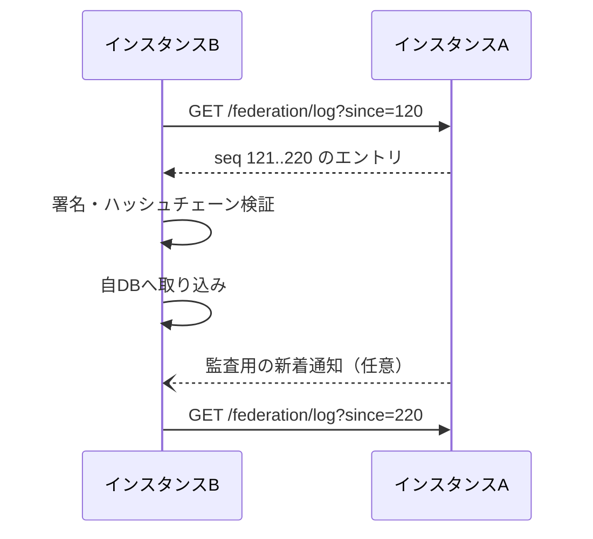

# 連合プロトコル

> ステータス: Draft（議論中）。ワイヤーフォーマットと API は最小実装時に確定する。

Smash-hub は、個別のサイトやインスタンスがそれぞれ独自の UI を持ちながらも、同じ対戦事実と同じレーティング計算ルールを共有できるようにするための連合仕様です。

本プロトコルの目的は、各インスタンスが自分の DB だけに依存して「自分のレートが正しい」と主張するのではなく、署名付きの対戦記録を共有し、誰でも同じ手順でレーティングを再計算できるようにすることです。

## 1. 目標

1. 記録を失わない
   - 1つのインスタンスが閉鎖しても、対戦記録と公開アカウント情報が他インスタンスに残るようにする。

2. 改ざんや欠落を検知できる
   - 受信した記録が本物か、途中で欠落していないかを検証できるようにする。

3. 実装と運用を簡潔にする
   - 個人運営の小さなサーバーでも実装しやすく、障害時に復旧しやすい構造にする。

4. オフラインに強い
   - 相手インスタンスが一時的に止まっていても、復帰後に差分を取り直せるようにする。

## 2. 基本の考え方

Smash-hub の連合は、単純な「サイト同士のデータ同期」ではなく、署名付きの追記専用ログを扱う構造を採用します。

各インスタンスは自分が受け付けた出来事をイベントとして記録し、連番とハッシュチェーンを持たせます。これにより、途中で削除や改ざんがあった場合に検出できます。

```text
インスタンスAのログ
seq=1  InstancePublished   (Aの公開鍵・名称・連合ポリシー)  prev=∅      sig=A
seq=2  AccountPublished   (@alice の公開鍵・表示名)          prev=h(1)   sig=A
seq=3  MatchRecorded      (alice vs bob, 両者署名付き)       prev=h(2)   sig=A
seq=4  MatchRecorded      (...)                              prev=h(3)   sig=A
seq=5  MatchVoided        (無効化イベント)                   prev=h(4)   sig=A
```

- seq: インスタンスごとの連番
- prev: 直前のイベントのハッシュ
- sig: インスタンスの秘密鍵で署名した署名
- MatchRecorded には、両プレイヤーの署名が含まれるため、インスタンス署名とは独立に検証できる

## 3. 非目的

本プロトコルは次を目的としません。

- SNS の投稿や通知の標準化
- フロントエンド UI の標準化
- プロフィールやメッセージの共有を前提としたソーシャルグラフ
- サイトごとの収益モデルや課金
- 一人の運営者が全てのデータを管理する中央集権モデル

本プロトコルは「事実を共有し、評価を再計算できるようにする」ための仕組みです。表示やコミュニティ運営は各サイトの責務です。

## 4. 共有される事実

連合の対象は、サイト固有のレーティング値ではなく、共有可能な事実そのものです。

- アカウントの公開情報
  - アカウント ID
  - 表示名
  - 公開鍵
  - ホームインスタンス
- 確定した対戦記録
  - 対戦日時
  - 参加者
  - 勝敗
  - スコア
  - 対戦ルール
  - 署名
- 無効化イベント
  - 記録が誤りである場合やモデレーションで除外する場合の事由
- インスタンス公開情報
  - インスタンス名
  - 公開鍵
  - ホームページ
  - 連合ポリシー

これらはすべて、サイトごとの差分ではなく、誰でも検証可能な「共有された事実」として扱います。

## 5. イベントモデル

### 5.1 共通ヘッダ

すべてのイベントは、共通ヘッダを持ちます。

```json
{
  "type": "MatchRecorded",
  "version": 1,
  "instance_id": "https://a.example",
  "seq": 123,
  "prev": "sha256_hex_of_previous_event",
  "created_at": "2026-10-26T10:00:00Z",
  "payload": { "...": "..." },
  "sig": "base64_signature_of_canonical_json"
}
```

定義:

- type: イベント種別
- version: スキーマのバージョン
- instance_id: 発行したインスタンスの識別子
- seq: インスタンスごとの単調増加番号
- prev: 直前のイベントのハッシュ
- created_at: イベントが発行された時刻
- payload: 実データ
- sig: instance private key で署名した canonical JSON

### 5.2 イベント種別

| イベント | 内容 |
|---|---|
| InstancePublished | インスタンスの公開鍵・名称・連合ポリシー |
| AccountPublished | アカウント ID・公開鍵・表示名・ホームインスタンス |
| AccountKeyRotated | アカウントの鍵更新 |
| AccountMoved | アカウント移行 |
| MatchRecorded | 確定した対戦記録 |
| MatchVoided | 対戦記録の無効化 |
| InstanceClosing | インスタンス閉鎖の通知 |

記録は削除せず、取り消しは新しいイベントの追記で表現します。つまり、無効化は「古いデータの消去」ではなく「新しい事実の追加」です。

## 6. 署名と検証

### 6.1 署名対象

イベントの署名対象は、イベントヘッダと payload を正規化した JSON の文字列です。

正規化のルールは次のとおりとします。

- UTF-8 で処理する
- オブジェクトのキーは昇順に並べる
- 不要な空白や改行を除去する
- 数値は JSON の数値としてそのまま扱う
- 文字列表現は一貫した形式で扱う

これにより、アプリケーションごとに署名対象が揺れないようにします。

### 6.2 署名アルゴリズム

最低限の初期候補として、Ed25519 を採用することを想定します。

- インスタンス署名: インスタンス秘密鍵
- アカウント署名: アカウント秘密鍵
- 対戦記録の署名: 両プレイヤーの署名とホストインスタンスの署名

### 6.3 検証順序

インスタンスがイベントを受信した際には、次の順で検証します。

1. インスタンス署名が正しいこと
2. prev がハッシュチェーンとして連続していること
3. seq が前回受信済みのイベントと連続していること
4. MatchRecorded の場合、両プレイヤーの署名が、それぞれの公開鍵で正しいこと
5. インスタンスが連合ポリシー上で拒否対象ではないこと
6. ルールバージョンや season_id が受け入れ可能であること

検証に失敗したイベントは受理せず、理由をログへ残します。運営者は失敗したイベントを確認して、連合ポリシーや対戦記録の妥当性を調べられるようにします。

## 7. 追記専用ログ

各インスタンスは、受理したイベントを追記専用ログとして保持します。

- 1度書いたイベントは削除しない
- 更新や上書きは行わない
- 差し替えは prev ハッシュで検出できる
- 途中の欠落は連番のギャップで検出できる

これにより、ログの整合性と再構築性を確保します。

```text
seq=1  InstancePublished ...
seq=2  AccountPublished ...
seq=3  MatchRecorded ...
seq=4  MatchVoided ...
```

このログはバックアップやスナップショットの元データとして利用でき、インスタンスの閉鎖時にも、他インスタンスがデータを再構築できるようにします。

## 8. 同期方式

### 8.1 Pull を基本とする

インスタンス間の同期は Pull を基本とし、受信側が必要な範囲だけ取得する方式を採用します。



- 受信側が止まっていても、復帰後に since から差分を取得すれば追いつける
- 新着があっても、同期の発火タイミングは受信側が管理する
- プッシュ通知は遅延・欠落のリスクがあるため、補助的に扱う

### 8.2 再配布

インスタンスBがAから受け取ったイベントを、Cに再配布することを許可します。これにより、インスタンスAのイベントが複数の経路で広がっても、途中の追跡が可能になります。

ただし、再配布時に以下を保持します。

- 元のインスタンス署名
- 元の prev と seq
- 元の payload
- 受信時の検証結果

再配布仕様は「元データを改変する」ものではなく、「検証済みデータをそのまま転送する」ことを前提にします。

### 8.3 スナップショット

新規参加インスタンスや長期間停止していたインスタンス向けに、過去のイベント全体をダンプしたスナップショットを配布できるようにします。

- 例: `GET /federation/snapshot?season_id=S1`
- スナップショットには、公開アカウント・対戦記録・無効化イベントなどが含まれる
- スナップショット自体も署名付きで配布できるようにする

## 9. 連合ポリシー

各インスタンスは、連合相手を管理するためのポリシーを持ちます。

- allowlist: 許可リスト
- blocklist: 拒否リスト
- default_policy: permit / deny

連合ポリシーは、インスタンスごとに異なる政策を持てるようにします。

- 悪質なインスタンスや偽装インスタンスを排除できる
- レーティング計算に使う記録の範囲を制御できる
- 運営者が自分の信頼境界を定義できる

なお、ポリシーが厳しすぎると、あるインスタンスから見えるレートと別インスタンスから見えるレートがズレる可能性があります。そのため、本プロトコルでは「対象の範囲」を明示し、レートスコープを計算時に扱えるようにします。

## 10. レーティングとの関係

レーティングは、インスタンスの内部DBが持つ値ではなく、共有された対戦記録から再計算される派生データです。

そのため、レート計算の前提は次のとおりです。

- 記録の集合は season_id でフィルタする
- 無効化イベントを除外する
- 対戦記録は played_at の昇順で並べる
- 同時刻の場合は記録 ID で安定順を定める
- レート計算のバージョンを明示する
- 記録が届いた順番に依存しない

これにより、同じ記録集合から同じインスタンスでも同じレートを再計算できるようにします。

> レーティング計算は「運営者が決めた値」ではなく、「共有された対戦事実に対して誰でも同じ手順で再現される値」であるべきです。

## 11. 最小 API

最小実装では、次の API を定義する。

### 11.1 GET /federation/instance
インスタンスの公開情報を返します。

```json
{
  "instance_id": "https://a.example",
  "name": "A instance",
  "public_key": "base64_public_key",
  "homepage_url": "https://a.example",
  "federation_policy": "https://a.example/policy"
}
```

### 11.2 GET /federation/log
差分ログを返します。

クエリ:
- since: 取得開始の seq
- limit: 取得件数上限
- include_unsupported: 省略時 false

```json
{
  "instance_id": "https://a.example",
  "from_seq": 120,
  "to_seq": 220,
  "events": [ ... ]
}
```

### 11.3 GET /federation/accounts
公開アカウント情報の一覧または差分を返します。

### 11.4 GET /federation/matches
特定条件の対戦記録を返します。

クエリ:
- season_id
- since
- account_id
- match_id

### 11.5 POST /federation/matches
新しい対戦記録をインスタンス間で共有するための入力 API です。通常は、あるインスタンスがローカルで対戦を確定し、連合ログに反映する際に利用します。

入力には少なくとも次が必要です。

- match payload
- playerA の署名
- playerB の署名
- host instance の署名

## 12. 例: MatchRecorded

```json
{
  "type": "MatchRecorded",
  "version": 1,
  "instance_id": "https://a.example",
  "seq": 42,
  "prev": "abc123...",
  "created_at": "2026-10-26T11:04:00Z",
  "payload": {
    "match_id": "match_20261026_001",
    "season_id": "S1",
    "played_at": "2026-10-26T10:30:00Z",
    "players": [
      {
        "account_id": "acct:alice@a.example",
        "display_name": "alice",
        "public_key_fingerprint": "fp_abc"
      },
      {
        "account_id": "acct:bob@b.example",
        "display_name": "bob",
        "public_key_fingerprint": "fp_def"
      }
    ],
    "winner": "playerA",
    "score": { "playerA": 2, "playerB": 1 },
    "rule_version": "smashemite-v1",
    "host_instance": "https://a.example",
    "signatures": {
      "playerA": "base64_sig_a",
      "playerB": "base64_sig_b",
      "host": "base64_sig_host"
    }
  },
  "sig": "base64_instance_sig"
}
```

## 13. セキュリティと運用の原則

- 秘密鍵は適切に保護し、DB から分離して管理する
- 公開鍵は誰でも検証可能な形で提供する
- アカウントの本人性は外部認証に委ねる
- サイトやインスタンスは、連合ポリシーに従って信頼関係を管理する
- 連合に参加する前に、インスタンス運用者の方針やコベナンツに同意する

## 14. 今後の拡張

- 鍵の更新・失効手順
- インスタンスの移行とアカウント移行
- 連合ポリシーのバージョン管理
- 部分レプリケーション
- サブセット取得（期間やシーズン単位）
- 署名の互換性と新規アルゴリズム対応

## 15. 未解決の論点

- [ ] イベントのシリアライズ形式を厳密に定義する
- [ ] 署名アルゴリズムの最終決定（Ed25519 を第一候補）
- [ ] 連合ポリシーのデータ形式を定義する
- [ ] 既存 HTTP API と新規 API の命名規約を揃える
- [ ] スナップショットの圧縮・再配布方式を決める

## 16. 結論

Smash-hub の連合プロトコルは、各インスタンスが自分の DB に閉じた「独自レート」を持つのではなく、共通の事実と検証可能な記録を共有し、同じ計算手順でレーティングを再計算できる基盤として設計します。

これにより、各サイトは次のような役割を分けられます。

- インスタンス: 事実の収集と共有
- 実装者: 検証とレーティング計算
- UI: 表示とコミュニティ形成
- 連合: 互換性と信頼境界の確立

本プロトコルの狙いは、単なるサイトアプリケーションの連携ではなく、「レーティングの共通基盤」を作ることです。複数の代替サイトが乱立しても、同じ事実の集合と同じ計算法があれば、各サイトが自分の強みを出しながら同じ土台の上で競争・共存できるようになります。