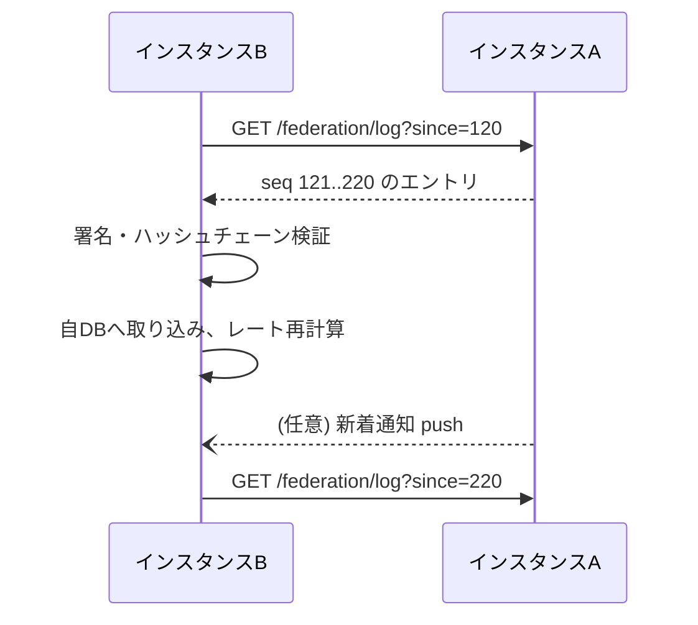

# 連合プロトコル

> ステータス: **Draft**（議論中）。ワイヤーフォーマットや具体的な API は技術選定後に確定します。

インスタンス同士が **永続共有データ（アカウントの公開情報・確定した対戦記録）** を共有するための仕組みです。

## 1. 目標

1. **記録を失わない** — 1つのインスタンスが消えても、記録が他のインスタンスに残る。
2. **改ざん・欠落を検知できる** — 届いた記録が本物か、途中の記録が抜けていないかを検証できる。
3. **実装と運用が単純** — 個人運営の小さなサーバーでも動き、障害時に状態を追いやすい。
4. **オフラインに強い** — 相手インスタンスが一時的に止まっていても、復帰後に追いつける。

## 2. 基本の考え方: 署名付き追記専用ログ

各インスタンスは、自分が受け付けたイベントを **追記専用ログ（append-only log）** として持ちます。

```
インスタンスAのログ
seq=1  AccountPublished   (@alice の公開鍵・表示名)        prev=∅      sig=A
seq=2  AccountPublished   (@bob の公開鍵・表示名)          prev=h(1)   sig=A
seq=3  MatchRecorded      (alice vs bob, 両者署名入り)     prev=h(2)   sig=A
seq=4  MatchRecorded      ...                              prev=h(3)   sig=A
```

- `seq`: インスタンスごとの連番。他インスタンスは「どこまで受け取ったか」を `seq` で管理する。
- `prev`: 直前のエントリのハッシュ（ハッシュチェーン）。途中の削除や差し替えを検知できる。
- `sig`: インスタンスの署名鍵による署名。
- 中身の対戦記録自体にも両プレイヤーの署名が入っているため、インスタンスの署名とは独立に検証できる。

### 2.1 イベント種別（案）

| イベント | 内容 |
|---|---|
| `InstancePublished` | インスタンスの公開鍵・名称・連合ポリシー |
| `AccountPublished` | アカウント ID・公開鍵・表示名・ホームインスタンス |
| `AccountKeyRotated` | アカウントの鍵更新（リカバリーキーで署名） |
| `AccountMoved` | ホームインスタンスの移行 |
| `AccountPseudonymized` | アカウント削除に伴う仮名化 |
| `MatchRecorded` | 確定した対戦記録 |
| `MatchVoided` | 対戦記録の無効化（両者合意・モデレーション） |
| `InstanceClosing` | 閉鎖予告と推奨移行先 |

記録は削除せず、取り消しも **新しいイベントの追記** で表現します（イベントソーシング）。

## 3. 複製の方式

### 3.1 Pull を基本とする



- 各インスタンスは連合先のログを定期的に取得します（pull）。新着通知（push）は遅延短縮のための補助です。
- pull 方式なら、受信側が止まっていても復帰後に `since` から取り直すだけで追いつけます。
- **他インスタンスのログも再配布します。** B は A から受け取ったエントリ（A の署名付き）を、C に対してそのまま提供できます。これにより A が消えた後でも、C は B から A のログを取得できます。

### 3.2 スナップショット

- 新しく参加するインスタンスや、長期間止まっていたインスタンス向けに、ログ全体の **スナップショット（一括ダンプ）** を提供します。
- スナップショットは静的ファイルとして配布できる形式にし、インスタンスを持たない人でも記録のアーカイブを保持・公開できるようにします。

## 4. 検証

エントリを取り込む前に、受信側は次を検証します。

1. インスタンス署名が、そのインスタンスの公開鍵で正しいこと
2. `prev` がハッシュチェーンとして連続していること（欠落・差し替えがないこと）
3. `MatchRecorded` の場合、両プレイヤーの署名が、各アカウントの（その時点で有効な）公開鍵で正しいこと
4. 送信元インスタンスが連合ポリシー上で拒否されていないこと

検証に失敗したエントリは取り込まず、理由を記録して運営者が確認できるようにします。

## 5. 連合ポリシー

- 各インスタンスは連合先を **許可リスト方式**（初期の推奨）または **拒否リスト方式** で管理します。
- 連合への参加には [サーバー運用者の約束事](../operations/server-covenant.md) への同意を求めます。
- 拒否したインスタンスの記録は取り込まず、レート計算にも使いません。そのため、**インスタンスごとに見えるレートが異なる** ことがあり得ます（→ [レーティング](../domain/rating.md)）。

## 6. 既存プロトコルとの関係

| 候補 | 長所 | 懸念 |
|---|---|---|
| ActivityPub | Mastodon 等で実績、エコシステムが大きい | 記録の完全複製・欠落検知の仕組みを持たない。配信モデルが「投稿の通知」向き |
| AT Protocol | 署名付きリポジトリ、アカウント移行の思想が近い | 仕様が大きく、スマブラ用途に必要な部分の切り出しが必要 |
| 独自（本ドキュメントの案） | 必要最小限で理解しやすい | 自前で仕様・実装を保守する必要がある |

**当面の方針（案）:** 対戦記録の複製は本ドキュメントの独自プロトコルで最小限に実装し、SNS との連携（プロフィールや対戦結果の告知を Mastodon 等から見られるようにする）は将来 ActivityPub で補完する。最終判断は ADR で行います。

## 7. 未解決の論点

- [ ] エントリのシリアライズ形式と正規化（署名対象のバイト列を一意にする方法）
- [ ] 署名アルゴリズム（Ed25519 を第一候補）
- [ ] インスタンス鍵の更新・失効手順
- [ ] ログの再配布時に、元インスタンスと再配布インスタンスの食い違いを検出した場合の扱い
- [ ] 規模が大きくなった場合の部分複製（期間・シーズン単位など）
