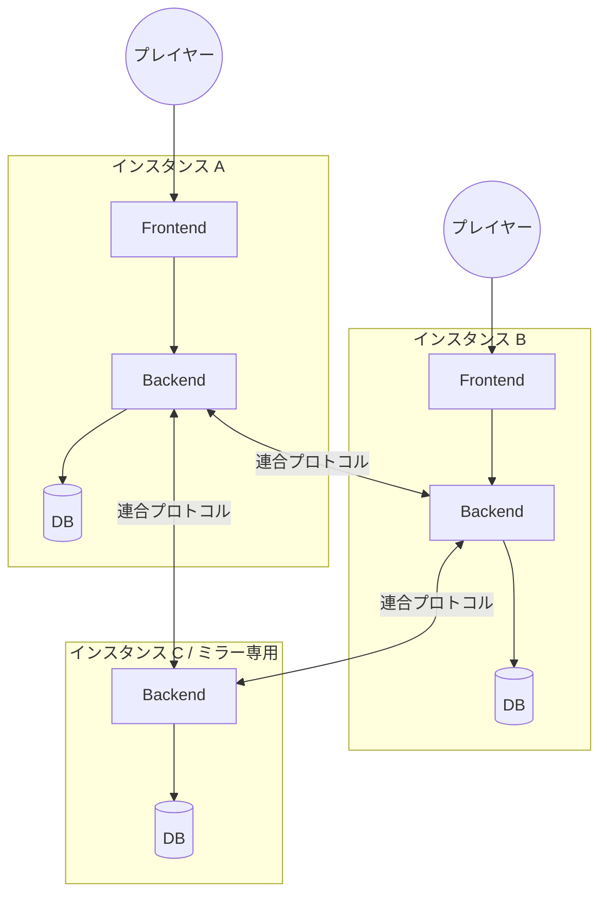
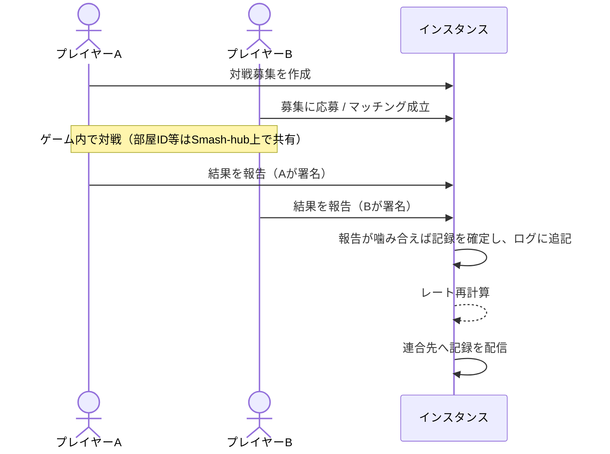

# アーキテクチャ概要

> ステータス: **Draft**（議論中）。確定した判断は [ADR](../adr/README.md) に記録します。

## 1. 全体像

Smash-hub は、独立した運営者が立てる複数の **インスタンス（サーバー）** が連携して1つの対戦ネットワークを形作る **連合型（federated）** システムです。

| 構成要素 | 役割 |
|---|---|
| Frontend | プレイヤー向け Web UI。自分のインスタンスの Backend とだけ通信する |
| Backend | アカウント管理・対戦募集・結果報告・レーティング・連合を担う |
| DB | アカウント情報（インスタンスローカル）と対戦記録（連合で共有）を保持 |
| ミラー専用インスタンス | 利用者を受け付けず、記録の保全のみを行う軽量な構成（任意） |

## 2. データの3分類

分散システムの設計で最も重要なのは「どのデータを、どこまで共有するか」です。Smash-hub ではデータを3つに分けます。

| 分類 | 例 | 置き場所 | 共有 |
|---|---|---|---|
| **ローカルデータ** | 識別子ハッシュ（外部認証との紐づけ）、署名鍵（暗号化）、セッション、通知設定 | ホームインスタンスのみ | しない |
| **一時データ** | 対戦募集、マッチング待ち、チャット | 募集を出したインスタンス | 必要な相手とだけ、その場限り |
| **永続共有データ** | アカウントの公開情報（ID・公開鍵・表示名）、確定した対戦記録 | 連合内の全インスタンス | **する（複製）** |

- **個人情報はどの分類にも含めません。** ログインは外部の認証プロバイダーに任せます（→ [認証](../security/authentication.md)、[データ保護](../security/data-protection.md)）。
- **レーティングはどこにも「保存の正」がありません。** 永続共有データである対戦記録から計算される **派生データ** です（→ [レーティング](../domain/rating.md)）。
- 永続共有データは小さく保ちます。1件の対戦記録は 1KB 程度を想定しており、100万件でも 1GB 程度です。これにより「全インスタンスが全記録を持つ」完全複製が現実的になります。

## 3. 信頼のモデル

連合では、他のインスタンスの運営者を無条件には信頼できません。Smash-hub は「運営者を信頼しなくても記録の正しさを検証できる」ことを目指します。

### 3.1 アカウント ID と鍵

- 各アカウントは **署名鍵ペア** を持ち、アカウント ID は公開鍵から導出します（例: `did:key` 方式を検討中）。
- 表示用には `@name@instance.example` 形式のハンドルを使いますが、これはホームインスタンスが変わると変わる「住所」であり、アカウントの同一性は鍵に基づく ID で判断します。
- 当初は鍵をホームインスタンスが管理します（利用者が鍵を意識しなくてよいように）。
- アカウント作成時に **リカバリーキー** を発行し、利用者が手元に保管します。ホームインスタンスが突然消えても、リカバリーキーで別インスタンス上にアカウントを復元できます（→ ロードマップ Phase 3）。

### 3.2 対戦記録の署名

- 対戦記録は **対戦した両プレイヤーの署名** がそろって初めて「確定」します。両プレイヤーがそれぞれ結果を報告し、報告が噛み合った時点で両者の署名がそろいます。24時間で噛み合わなければ確定せず、記録も作りません（→ [対戦ルール](../domain/match-rules.md)）。
- 署名済みの記録は、どのインスタンスを経由して届いても内容が改ざんされていないことを検証できます。
- 加えて、記録を最初に受け付けたインスタンスが自身の署名を付け、ログに追記します（→ [連合プロトコル](federation.md)）。

### 3.3 インスタンス間の信頼

- 署名で守れるのは「改ざん」までです。「架空のアカウント同士の架空の対戦（自作自演）」は署名だけでは防げません。
- そのため、インスタンス単位の **連合ポリシー（許可リスト/拒否リスト）** と、[サーバー運用者の約束事](../operations/server-covenant.md) への同意を連合参加の条件とします。
- レート操作対策は [レーティング](../domain/rating.md) の「不正対策」で扱います。

## 4. 主要なユースケースの流れ

### 4.1 同一インスタンス内の対戦

### 4.2 インスタンスをまたぐ対戦（Phase 4 以降）

募集を出したインスタンスが対戦の **ホスト** となり、結果報告の受付と確定を担当します。相手プレイヤーはホームインスタンス経由で結果報告（署名）を送ります。

### 4.3 インスタンス閉鎖時

1. 閉鎖するインスタンスは閉鎖予告を連合へ配信する（予告機能は Phase 3）。
2. 利用者は別インスタンスへアカウントを移行する。
3. 閉鎖後も、そのインスタンスで確定した記録は他インスタンスに複製済みのため失われない。
4. 予告なく消えた場合でも、記録は複製済み、アカウントはリカバリーキーで復元できる。

## 5. 未解決の論点

- [ ] アカウント ID の方式（`did:key` / `did:plc` 類似の方式 / 独自）
- [ ] 既存プロトコル（ActivityPub / AT Protocol）をどこまで採用するか（→ [連合プロトコル](federation.md)）
- [ ] 全記録の完全複製をいつまで続けられるか（規模が大きくなった場合の部分複製）
