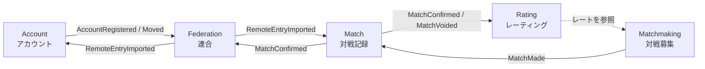
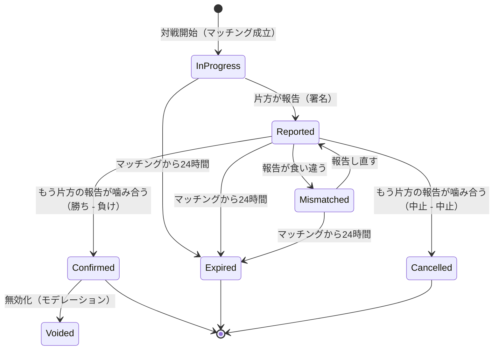

# ドメインモデル

> ステータス: **Draft**。

## 1. ユビキタス言語

ドキュメント・Issue・コードで同じ言葉を同じ意味で使います。コード上の名前は「英語名」列に合わせます。

| 用語 | 英語名 | 意味 |
|---|---|---|
| インスタンス | Instance | 1人（または1組）の運営者が運営する Smash-hub のサーバー |
| ホームインスタンス | Home Instance | アカウントが所属し、ログインするインスタンス |
| 連合 | Federation | インスタンス同士が記録を共有し合う関係の全体 |
| 連合先 | Peer | 記録をやり取りする相手のインスタンス |
| アカウント | Account | プレイヤーの同一性。鍵に基づく ID（Ed25519 公開鍵の did:key）で識別する |
| ハンドル | Handle | `@name@instance` 形式の表示用の住所。移行すると変わる |
| 外部 ID | External Identity | 外部認証プロバイダーのアカウントとの紐づけ。識別子ハッシュとしてのみ保持する |
| 識別子ハッシュ | Identifier Hash | プロバイダーの利用者 ID をインスタンスごとのペッパーで HMAC した値 |
| リカバリーキー | Recovery Key | ホームインスタンスが消えてもアカウントを復元するための、利用者が保管する鍵 |
| 対戦募集 | Match Request | 「対戦相手を探す」で作られる、マッチング待ちの募集。一時データ |
| マッチング | Matchmaking | マッチング条件に合う募集同士を自動で結びつけて対戦を成立させること |
| 対戦 | Match | 成立した1回の対戦（1つ以上のゲームからなる。例: BO3） |
| ゲーム | Game | 対戦の中の1試合。標準ルールでは 3ストック・7分の1試合 |
| ルール | Ruleset | ストック数・時間・ステージ選択方式などの対戦条件。標準ルールは [対戦ルール](match-rules.md) |
| 拒否ステージ | Stage Ban | 相手のファイターごとに事前に設定する、対戦したくないステージ |
| ファイター ID | Fighter ID | 対戦記録でファイターを表す英小文字の識別子（例: `mario`）。対応表は [ファイター ID](fighters.md)。一度割り当てた ID は変えない |
| ファイター変更 | Fighter Change | 2戦目以降に、直前のゲームの敗者だけが使用ファイターを変えること |
| スイッチ | Fighter Switch | 相手の1戦目のファイターに応じて、自分の1戦目のファイターを自動で切り替える設定 |
| マッチング条件 | Matchmaking Preference | 連戦・接続方法・レート差など、マッチングする相手の条件 |
| ブロック | Block | 特定の相手とマッチしないようにすること（シーズン中10人まで） |
| 対戦マナーの目安 | Conduct Stats | 報告しなかった回数・中止の回数・報告が食い違ったまま終わった回数 |
| ホスト | Host | 対戦の結果受付と確定を担当するインスタンス（先に募集していた側＝プレイヤー1のインスタンス） |
| 結果報告 | Result Report | 各プレイヤーが対戦結果（勝ち / 負け / 対戦中止）を申告し署名すること。両プレイヤーがそれぞれ行う |
| 報告の食い違い | Report Mismatch | 両者の報告が噛み合わない状態（「勝ち - 勝ち」等）。報告し直すまで確定しない |
| 対戦中止 | Cancellation | 対戦が成立しなかったこと。レートは変動しない |
| 期限切れ | Expired | マッチングから24時間たっても報告が噛み合わなかった状態。レート変動なしで終了する |
| 確定 | Confirmed | 両プレイヤーの報告（署名）が噛み合った状態。以後、対戦記録として連合で共有される |
| 対戦記録 | Match Record | 確定した対戦の、両者署名付きの不変なデータ |
| 記録 ID | Record ID | 対戦記録を連合全体で一意に識別する値。両プレイヤーが署名した対戦結果の内容の SHA-256（→ [連合プロトコル](../architecture/federation.md) の「12.1 記録 ID」） |
| 無効化 | Void | 確定済みの記録をレート計算から除外すること（記録自体は消さない） |
| レート | Rating | 対戦記録から算出されるプレイヤーの強さの推定値 |
| 暫定レート | Provisional Rating | 届いている記録から即時に計算したレート |
| 確定レート | Finalized Rating | `played_at` から7日以上経過し、以後変わらなくなったレート |
| シーズン | Season | ランキングを区切る期間。シーズンごとにレートを集計し、開始時は全員1500 |
| 連合レート | Federated Rating | 連合で共有されたすべての対戦記録から計算する、連合全体で1つのレート。インスタンスごとのレートは設けない |
| 対戦募集の配信 | Match Request Announcement | 待機中の募集を連合先に配ること。別のインスタンスの利用者とのマッチングに使う |
| 申し込み | Match Claim | 配信された募集に対して、ホストへ対戦を申し込むこと |
| ログ | Log | インスタンスごとの署名付き追記専用イベント列 |
| ミラー | Mirror | 利用者を受け付けず、記録の保全だけを行うインスタンス |
| 静的アーカイブ | Static Archive | 連合先のログを pull・検証し、静的ファイルとして公開したもの。インスタンスを持たない人でも記録の保全に参加できる（GitHub Actions 等で作る） |

## 2. 境界づけられたコンテキスト

| コンテキスト | 責務 | データの性質 |
|---|---|---|
| **Account** | 登録・外部認証との紐づけ・プロフィール・鍵・移行・削除 | 識別子ハッシュ・セッションはローカル、公開情報は共有。個人情報は持たない |
| **Matchmaking** | 対戦募集・マッチング・対戦相手との情報共有・マッチング条件・拒否ステージ・ブロック | 募集は一時データ、設定はホームインスタンスのローカルデータ |
| **Match** | 結果報告・中止・期限切れ・確定・無効化 | 確定後は永続共有データ |
| **Rating** | 対戦記録からのレート算出・ランキング | 派生データ（いつでも再計算できる） |
| **Federation** | ログ管理・複製・検証・連合ポリシー | 永続共有データの運び手 |

将来追加を検討するコンテキスト: **Moderation**（通報・利用停止・インスタンス間のモデレーション連携）、**Tournament**（大会）。

## 3. 主要な集約

### 3.1 Match（対戦）の状態遷移

- `Confirmed` になった時点で **対戦記録（Match Record）** が生成され、ログに追記されます。
- `Confirmed` 以前の状態はホストインスタンスのローカルな状態であり、連合では共有しません。`Cancelled`・`Expired` はレートに影響せず、「対戦マナーの目安」の集計にのみ使います。
- 進行のルールの詳細は [対戦ルール](match-rules.md) を参照してください。

### 3.2 対戦記録（Match Record）の内容

対戦記録の項目は、連合で共有する形（`MatchRecorded` の payload）として [連合プロトコル](../architecture/federation.md) の「12. 例: MatchRecorded」に定義しています。要点は次のとおりです。

- `players`（プレイヤーの識別。アカウント ID のみ）と `picks`（ゲームごとの使用キャラクター）を別の項目にする
- 表示名など後から変更・削除されうる情報は入れない
- 勝者は `players` の添字で表し、両プレイヤーの署名を持つ

## 4. 未解決の論点

現在はありません。対戦ルールに関する論点は [対戦ルール](match-rules.md) を参照してください。
