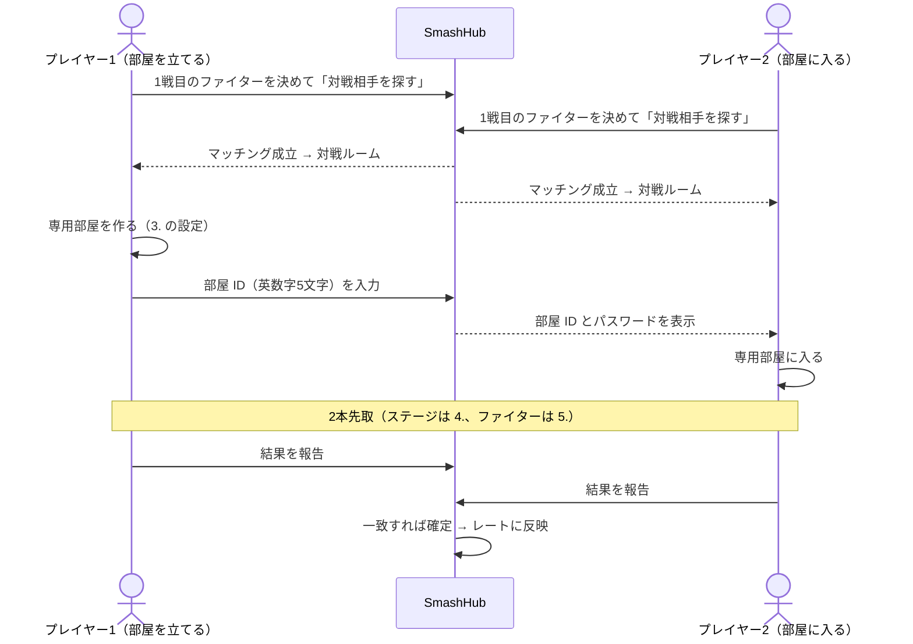

# 対戦ルール

> ステータス: **Draft**。SmashHub の **標準ルール（Ruleset）** です。スマメイトのレーティング対戦ルールを踏襲し、スマメイト終了後にそのルールを引き継いだコミュニティの運用（スマッチ）も参考にしています。

## 0. 概要

| 項目 | 内容 |
|---|---|
| 対象 | レーティング対戦（1on1 のみ。チーム戦は扱わない） |
| 形式 | 2本先取（BO3）、3ストック・7分 |
| ステージ | 1戦目はゲーム内の抽選、2・3戦目は直前の敗者が選ぶ。拒否ステージあり |
| ファイター | 1戦目はマッチング前に決める。2・3戦目は直前の敗者だけが変更できる |
| 結果 | 両者がそれぞれ報告し、一致したら確定してレートに反映 |

- ステージ名・ファイター名はテキストでのみ扱います（[運営ポリシー](../policy.md)）。
- レートの計算方法は [レーティング](rating.md) を参照してください。

## 1. 参加の前提

1. SmashHub のアカウントを持っている（[認証](../security/authentication.md)）。
2. プロフィールにメインファイターを登録している。
3. このルールの理解度確認（ルールチェック）に全問正解している。

## 2. 勝敗

- 1回の **対戦** は最大3 **ゲーム** で、先に2ゲームを取った側がその対戦の勝者になる。
- レートが動くのは対戦単位。1ゲーム終わった時点では報告しない。

## 3. 専用部屋

部屋を立てる側（プレイヤー1）は、次の設定で専用部屋を作る。

| 設定項目 | 値 | 補足 |
|---|---|---|
| ルール | ストック制・3ストック・7分 | |
| ステージギミック | オフ | |
| アイテム | オフ | |
| スピリッツ | オフ | 能力値やふっとび・硬直が変わるため |
| チャージ切りふだ | オフ | |
| 入室制限 | だれでも | |
| パスワード | `1122` | 全員共通。対戦ルームにも表示する |
| 部屋の人数 | 2人 | 対戦相手以外が入れないようにする |

- 観戦者は入れない。関係のない人が入ってきたら退出させる。
- ゲーム内の名前は SmashHub の表示名にそろえる。そろえられない場合はプロフィールの「ゲーム内の名前」に登録しておく（対戦相手に表示される）。表示と明らかに違う名前の人が入ってきたら、対戦相手ではない可能性があるので退出させる。

## 4. ステージ

### 4.1 ステージ一覧

| ステージ | 1戦目 | 2・3戦目 |
|---|:-:|:-:|
| 終点 | ✓ | ✓ |
| 戦場 | ✓ | ✓ |
| 小戦場 | ✓ | ✓ |
| ポケモンスタジアム2 | ✓ | ✓ |
| ホロウバスティオン | ✓ | ✓ |
| 村と街 | ✓ | ✓ |
| すま村 | | ✓ |

- **終点化・戦場化**: 他のステージを終点化・戦場化したものは、それぞれ「終点」「戦場」として扱う（選ぶときも、拒否するときも同じ）。
- **ホロウバスティオン**: 追加コンテンツを持っていなくても参加できる。持っていない人は自分では選ばず、相手が選んだときはそのステージで対戦する。

### 4.2 ステージの決め方

| ゲーム | 決め方 | 選択肢から除くもの |
|---|---|---|
| 1戦目 | 両者がゲーム内でステージを1つずつ選び、**ゲームの抽選結果に従う**（「おまかせ」は使わない）。SmashHub 側では抽選しない | 両者の拒否ステージ（自分の拒否ステージも自分で選べない） |
| 2・3戦目 | **直前のゲームの敗者** が選ぶ。勝者はゲーム内で「おまかせ」にする。敗者はこだわりがなくても必ずどれかを選ぶ | 勝者側の拒否ステージ |

- 2・3戦目は、それまでに使ったステージを再び選んでもよい。

### 4.3 拒否ステージ

- 4.1 の7ステージから、**対戦相手のファイターごとに最大2つ** を事前に登録できる（例:「終点」と「戦場」の両方でもよい）。相手が「おまかせ」で来た場合の組み合わせも登録できる。
- マッチングが成立すると、両者の拒否ステージと選べるステージが対戦ルームに表示される。**マッチング待ちの間と対戦中は変更できない。**
- 2・3戦目に敗者がファイターを変える場合は、対戦ルームで変更後のファイターを選ぶと、それに対応する相手の拒否ステージが表示される。
- 拒否ステージで始まってしまったときは、気づいた時点ですぐ自滅してそのゲームを無効にし、同じファイターのままステージを選び直す。開始から5秒を過ぎても両者が続けていれば、そのステージに合意したものとする。
- 負けた後・劣勢になった後に「拒否ステージだった」と言い出すことは認めない。

## 5. ファイター

### 5.1 選び方

- どのファイターも使用できる。Mii ファイターの技とコスチュームは自由。
- 1戦目のファイターは **マッチングの前に** SmashHub で選び、対戦ルームに表示されたファイターで1戦目を戦う。
- 2・3戦目にファイターを変えられるのは **直前のゲームの敗者だけ**。勝者は同じファイターを使い続ける。

### 5.2 「おまかせ」で選んだ場合

- 1戦目を「おまかせ」にした人は、ゲーム内のファイター選択でも「おまかせ」を選ぶ。その人に対しては、相手の拒否ステージ設定のうち「おまかせ」用の組み合わせが使われる。
- 2戦目以降は、1戦目でランダムに決まったファイターを使ったものとみなす。
  - 1戦目に勝った場合: そのファイターを使い続ける（再び「おまかせ」は不可）。
  - 1戦目に負けた場合: 別のファイターに変えても、もう一度「おまかせ」にしてもよい。

### 5.3 スイッチ（1戦目のファイターの自動切り替え）

- 「相手の1戦目がこのファイターなら、自分はこのファイターに変える」という組み合わせを最大50件登録できる。
- 切り替えは、相手がマッチング前に選んだファイターを見て1回だけ行う。相手側がスイッチした結果には反応しない。
- 元のファイターと同じファイターや、実質的に同じファイター同士（ピーチとデイジー、シモンとリヒター、サムスとダークサムス）への切り替えは行わない。
- スイッチが働いた対戦は、対戦ルームにその旨が表示される。

## 6. 判定

| 状況 | 判定 |
|---|---|
| 時間切れで、残りストックに差がある | ゲームの判定どおり、ストックが多い側の勝ち |
| 時間切れで、残りストックが同じ | **時間切れの時点で % が低い側の勝ち**。% が高い側はサドンデスで自分から負ける |
| 時間切れで、ストックも % も同じ | ゲームのサドンデスで決める |
| 最後のストック同士の相打ちでサドンデスになった | ゲームのサドンデスで決める |
| ゲーム中に回線が切れた | その対戦は中止（レート変動なし）→ 7.3 |

## 7. 対戦の進め方と報告

### 7.1 手順

1. 「対戦相手を探す」を押したとき、条件に合う相手が先に待っていればその相手の部屋に入る側（プレイヤー2）になり、いなければ部屋を立てる側（プレイヤー1）になる。
2. プレイヤー2は、部屋 ID が入力されるまで入室できない。プレイヤー1は部屋を作り直したら新しい部屋 ID に更新する。
3. 入れない・始められないといった連絡は、対戦ルームのメッセージで行う。

### 7.2 結果の報告

| 両者の報告 | 結果 |
|---|---|
| 勝ち ／ 負け | **確定**。レートに反映する |
| 中止 ／ 中止 | **中止**。レートは動かない |
| 勝ち ／ 勝ち、負け ／ 負け など | **食い違い**。確定しない。メッセージで確認し、間違えた側が報告し直す |
| マッチングから24時間たっても一致しない | **期限切れ**。レートは動かずに終了する |

- 報告では、勝ち・負け・中止に加えて、ゲームごとのファイター（2〜3ゲーム分、両者の分）を **任意で** 入力できる。両者の入力が一致したときだけ対戦記録に含め、一致しなければ1戦目だけを記録する。ファイターの入力は確定の条件にしない（[ADR 0010](../adr/0010-game-picks-in-report.md)）。ゲームごとの勝敗とステージは入力しない。
- ゲームごとのファイターは、5. のルール（1戦目はマッチングで選んだファイター、2・3戦目に変えられるのは直前の敗者だけ）に沿っているか確かめる。ゲームごとの勝敗は入力しないため、報告した対戦の勝者から考えられる勝敗の並び（2ゲームなら勝者の2連勝、3ゲームなら勝者が1戦目か2戦目で負けた2通り）のどれかと矛盾しないことを確かめる。
- 報告は決着後すぐに行う。勝ったときはゲームの結果画面を撮影しておくと、もめたときの確認に役立つ。
- 未報告・中止・食い違いのまま終わった回数は「対戦マナーの目安」としてユーザーページに表示する。食い違ってもすぐ報告し直して確定すれば数えない。回数は **シーズンごとにリセット** する。

### 7.3 対戦の中止

中止にしてよいのは次の場合だけです。中止した対戦ではレートは動きません。

| 中止してよい場合 | 進め方 |
|---|---|
| 相手と連絡が取れず、**5分** ほど待っても始められない | 待っている側が中止にする |
| 自分の事情で続けられなくなった | 始める前なら相手に伝えて中止にする。対戦中なら、状況に応じて自分から「負け」を報告する |
| 遅延がひどく、まともに操作できない（海外からの接続を含む） | 相手に伝えて合意したうえで中止にする。対戦中なら自滅するなどで意思を示す |
| ゲーム中に回線が切れた | 中止にする |

次のような中止は認めません。

- 理由を伝えずに中止する
- 相手のファイターやレートを見て中止する
- マッチング条件（8.1）で避けられたはずの相手（連戦・無線・配信者など）だったことを理由に、マッチング後に中止する
- 相手が動画化を許可していないことを理由に中止する
- 負けそうになって回線を切ることを繰り返す

## 8. 対戦の設定

### 8.1 マッチング条件

| 設定 | 選べるもの | 両者の設定が違うとき |
|---|---|---|
| 連戦 | 許可する / 直近 1・3・5・12・24・48時間に当たった相手とは当たらない | 長い時間のほうを使う |
| 接続方法 | 有線（無線の相手も可）/ 有線（無線の相手は不可）/ 無線 | 「不可」としている側に合わせる |
| レート差 | 制限なし / ±50 / ±100 / ±150 / ±200（探すときに選ぶ） | 狭いほうを使う。「制限なし」は ±200 から始め、1分待つごとに広げる |

- 接続方法は事実どおりに設定する（無線なのに有線と設定しない）。

### 8.2 配信と動画化

| 設定 | 選べるもの |
|---|---|
| 配信 | 対戦を配信する / 配信しないが、配信者との対戦は受ける / 配信者とは対戦しない |
| 動画化 | 許可 / 不許可 / 要相談（意思表示のみ。マッチングには影響しない） |

- 配信する人は必ず「対戦を配信する」にする。配信者であることは対戦相手の対戦ルームに表示され、「配信者とは対戦しない」人とは当たらない。
- 「配信者との対戦は受ける」は、相手の配信やそのアーカイブに映ることを了承する設定。
- 設定せずに配信すると **無断配信** として通報の対象になる。
- 動画化をめぐる当事者間のトラブルに、インスタンス運営者は関与しない。

### 8.3 ブロック

- 今後当たりたくない相手をブロックできる。**1シーズンに10人まで** で、そのシーズン中は解除できない。

## 9. 禁止事項とマナー

### 9.1 禁止事項

| 禁止事項 | 内容 |
|---|---|
| 改造・チート | 改造した本体・ソフト（遅延を減らす改造を含む）、チートツールの使用。SmashHub 上のすべての対戦が対象 |
| 不正な入力機器 | 連射・マクロ・自動操作ができる機器や機能、遅延を減らす改造をした機器。1回の操作が1回の入力になるものなら、社外品や自作品（基板交換したものを含む）は使ってよい |
| 八百長 | わざと負ける、負けを報告してレートを渡す、レートを下げるために負けるなど |
| 虚偽の報告 | 負けたのに勝ちと報告する、決着したのに中止と報告するなど |
| 虚偽の通報 | 嫌がらせ目的や示し合わせての通報 |
| 晒し | 相手の名前・ユーザーページ・対戦ルームの画面などを SNS に載せて非難すること |
| 暴言・挑発 | トラブルがあっても暴言は禁止。ブロックと通報を使う |

### 9.2 マナー

- 相手は人間です。丁寧な言葉づかいを心がける。
- 始める前と終わった後にあいさつする。黙って抜けない。
- 結果は早めに報告する。
- 困ったことは SNS ではなく通報で運営者に伝える。

## 10. 通報とモデレーション

### 10.1 通報

- 相手のユーザーページから、状況を書いて通報できる。証拠のスクリーンショットを **3枚まで** 添付できる。添付は運営者だけが見られ、対応が終わったら削除する（[データ保護](../security/data-protection.md)）。
- 通報したことや通報者が誰かは、相手に知らせない。

### 10.2 判断の基準

- 判断は各インスタンスの運営者が行う。通報内容・添付・対戦ルームの記録・ほかの通報を突き合わせて判断する。
- 1件の通報だけで制限することは原則としてない。ただし、SmashHub 上にはっきりした証拠が残っている場合は1件でも対応する。
- 改造・不正な入力機器は、本人の発言や配信・動画など明確な証拠がある場合だけ対応する。疑いだけでは制限しない。

### 10.3 対応の段階

段階はプロジェクト共通で定めます。各段階の期間や、何回で次の段階に進むかは各インスタンスの利用規約で定めます。

| 段階 | 内容 | 主な対象 |
|---|---|---|
| 注意 | 運営者から注意する。記録には残すが制限はしない | 軽い違反、双方に原因がある場合 |
| イエローカード | 警告。重なると利用制限の対象になる | 認められない中止、無断配信、虚偽の報告・通報、晒し |
| レッドカード | レーティング対戦の利用停止（期間付きまたは無期限） | 八百長、改造・チート、不正な入力機器、悪質または繰り返しの違反 |

- 八百長と判断した対戦は無効化（`MatchVoided`）する。
- インスタンスをまたいだ制限の共有は、ロードマップ Phase 4 のモデレーション連携で扱う。
- 対応に納得できない場合は、インスタンスの問い合わせ窓口に申し立てられる。

## 11. SmashHub での扱い

| ルール | 実装上の扱い |
|---|---|
| ルールの識別 | 標準ルールに ID とバージョンを付け、対戦記録に含める。変更時はバージョンを上げ、シーズンの区切りで切り替える |
| ルールの範囲 | 当面（Phase 1〜4）は標準ルールの対戦だけを扱う。インスタンス独自のルールは Phase 5 の大会機能とあわせて検討する |
| 結果報告 | 両者の報告をそれぞれの **署名** として扱い、一致した時点で対戦記録として確定・連合へ配信する。期限切れ・中止の対戦は連合に配信しない |
| ステージ | 抽選・選択はゲームと両者に任せ、記録しない |
| 拒否ステージ | ホームインスタンスのローカルデータ。対戦中だけホストと相手に開示し、連合では共有しない |
| マッチング条件・配信設定・ブロック・スイッチ | ホームインスタンスのローカルデータ。インスタンスをまたぐ対戦（Phase 4）では、必要な範囲だけホストに渡す |
| 対戦マナーの目安 | 対戦をホストしたインスタンスが集計する。インスタンスをまたいだ集計は Phase 4 で検討する |
| ゲームごとの記録 | ゲームごとのファイターだけを、両者の入力が一致したときに対戦記録に含める。ゲームごとの勝敗は記録しない（[ADR 0010](../adr/0010-game-picks-in-report.md)） |
| レート | 対戦（BO3）単位で更新する。ゲームごとのファイターはレート計算に使わない（[レーティング](rating.md)） |

## 12. 未解決の論点

- [ ] ルールチェックの設問の内容（Phase 1 の実装時に決める）
