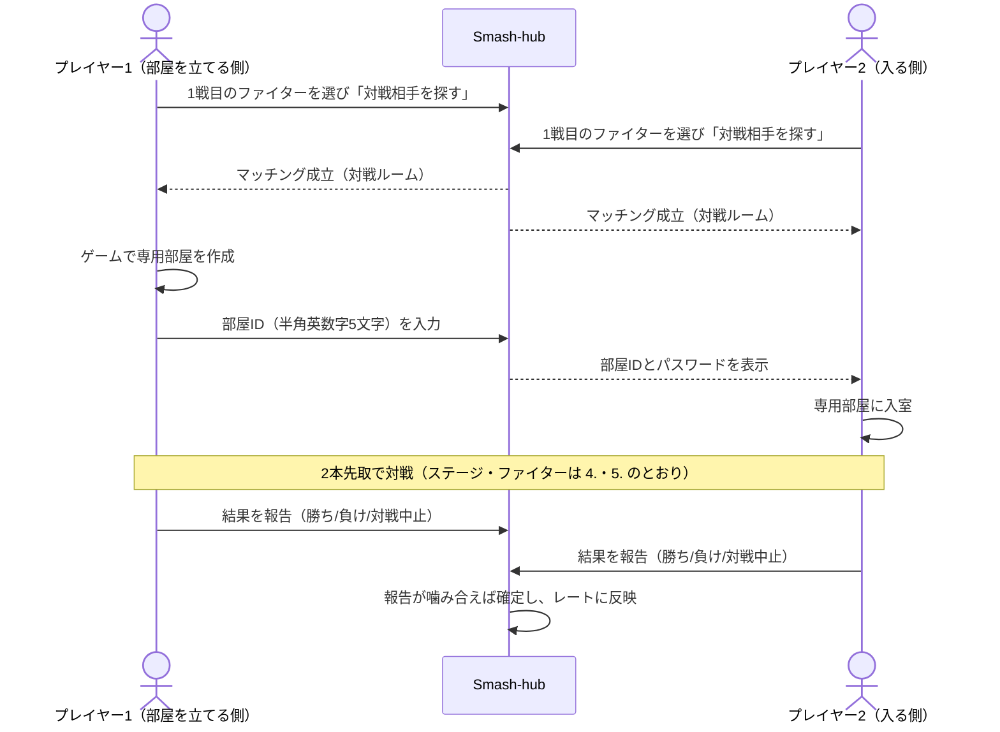

# 対戦ルール

> ステータス: **Draft**。レーティング対戦のルールは **スマメイトのレーティング対戦ルールを踏襲** し、スマメイト閉鎖後に同ルールを引き継いだサービス（スマッチ）のルールを参考に具体化しています。

- 対象は **1on1（シングルス）のみ** です。2on2（チーム戦）は扱いません。
- ステージ名・ファイター名はテキストでのみ扱います（[運営ポリシー](../policy.md)）。
- このルールを Smash-hub の **標準ルール（Ruleset）** とします（→ 9. Smash-hub での実装の扱い）。

## 1. 参加条件

- アカウントを登録している（外部プロバイダーでのログイン → [認証](../security/authentication.md)）
- プロフィールでメインファイターを設定している
- ルールチェック（このルールの理解度確認の設問）に全問正解している

## 2. 勝敗の定義

**2本先取（BO3）** です。先に2ゲーム勝ったプレイヤーがその対戦の「勝ち」、先に2ゲーム負けたプレイヤーが「負け」です。1ゲームだけで報告しないでください。

## 3. 専用部屋の設定

| 項目 | 設定 |
|---|---|
| ルール | ストック制 / ストック 3 / 制限時間 7:00 |
| ステージギミック | なし |
| アイテム | なし |
| スピリッツ | なし（攻撃力・防御力などが変わり、ふっとびや硬直にも影響するため） |
| チャージ切りふだ | なし |
| 入室制限 | だれでも |
| パスワード | あり（`1122`。全員共通。対戦ルームにも表示する） |
| 部屋の人数 | 2人（無関係の人が入らないようにするため） |

- 観戦者を故意に入れない。無関係の人が入った場合はすぐに退出させる。
- ゲーム内の名前は Smash-hub の表示名と同じにする。違う名前を使う場合はプロフィールの「ゲーム内の名前」に登録する（対戦ルームで相手に表示される）。入室した相手の名前が明らかに違う場合は、無関係の人の可能性があるため退出させる。

## 4. ステージ

### 4.1 使用できるステージ

| ステージ | 1戦目 | 2・3戦目 |
|---|---|---|
| 終点 | ○ | ○ |
| 戦場 | ○ | ○ |
| 小戦場 | ○ | ○ |
| ポケモンスタジアム2 | ○ | ○ |
| ホロウバスティオン | ○ | ○ |
| 村と街 | ○ | ○ |
| すま村 | — | ○ |

- 「終点」「戦場」は、他のステージを **終点化・戦場化したもの** として選んでもよい。拒否ステージも同じ扱い（「終点」を拒否した場合は終点化したステージも拒否）。
- ホロウバスティオン（追加コンテンツ）を持っていない人も参加できる。持っていない人は自分では選べないため、他のステージを選ぶ。相手が選んだ場合はそのステージで対戦する（部屋を立てる側・入る側のどちらでも同じ）。

### 4.2 1戦目

**Smash-hub ではステージを抽選しません。ゲームのステージ選択機能に従います。**

1. お互いが、双方の拒否ステージを除いた1戦目のステージから、戦いたいステージをゲーム内で選ぶ（「おまかせ」は選ばない）。
2. ゲーム内の抽選で決まったステージで対戦する。
3. 自分の拒否ステージを自分も選べないのは、抽選になる1戦目だけ。

### 4.3 2・3戦目

1. **直前のゲームの敗者が** 、相手の拒否ステージを除いた2・3戦目のステージから選ぶ。敗者は、どのステージでも構わない場合でも必ず選ぶ。
2. 勝者はゲーム内で「おまかせ」を選ぶ。
3. 前のゲームで使ったステージを再び選んでもよい。

### 4.4 拒否ステージ

- 対戦相手が使うファイターごとに、対戦したくないステージを **2つまで** 事前に設定できる（4.1 の7ステージから。「終点＋戦場」のような組み合わせも可）。
- 相手が「おまかせ」を選んだ場合に使う拒否ステージも設定できる（→ 5.2）。
- 自分と相手の拒否ステージ、選べるステージはマッチング後に対戦ルームに表示する。**マッチング中・対戦中は変更できない。**
- 2・3戦目に直前の敗者がファイターを変える場合、対戦ルームで使うファイターを選ぶと、そのファイターに対する相手の拒否ステージを確認できる。
- 負けた後や不利になった後に「拒否ステージが選ばれた」と申し立てることは禁止。
- 誤って拒否ステージを選んでしまった場合は、すぐに自滅してそのゲームをノーカウントとし、同じファイターで選び直して再戦する。お互いが開始5秒を過ぎても戦い続けた場合は、そのステージで合意したものとみなす。

## 5. 使用ファイター

### 5.1 基本

- 全ファイター使用可能。Mii ファイターは技構成・見た目自由。
- **1戦目のファイターは、対戦相手が決まる前に** Smash-hub 上で選ぶ。1戦目は必ず、対戦ルームに表示された1戦目のファイターを使う。
- 2戦目以降、**勝者はファイターを変更できない**。直前のゲームの敗者のみ変更できる。

### 5.2 おまかせ（ランダム）

- 1戦目のファイターに「おまかせ」を選んだ人は、1戦目にゲームのファイター選択で「おまかせ」を選ぶ。相手の拒否ステージは、相手の設定の「おまかせ」の行を使う。
- 2戦目以降は、おまかせで出たファイターを使ったものとして扱う。
  - 1戦目に勝った場合は、そのファイターのまま戦う（もう一度「おまかせ」は選べない）。
  - 負けた場合は、他のファイターに変えても、もう一度「おまかせ」を選んでもよい（拒否ステージは相手の設定の「おまかせ」の行を使う）。

### 5.3 1戦目のファイターのスイッチ

- 相手の1戦目のファイターに応じて、自分の1戦目のファイターを自動で切り替える設定ができる（最大50件）。
- 切り替えは、相手が最初に選んだファイターに対して1回だけ行う。相手のスイッチ後のファイターには反応しない。
- 最初に選んだファイターと同じファイター、およびダッシュファイター等の実質的に同じファイター（ピーチとデイジー、シモンとリヒター、サムスとダークサムス）には切り替わらない。
- 切り替わった対戦は、対戦ルームに「スイッチ」と表示する。

## 6. サドンデス

- 時間切れの時点でストックが多いプレイヤーがいれば、ゲームの判定どおりそのプレイヤーの勝ち。
- ストックが同じでサドンデスになった場合は、**時間切れの時点で % が少なかったプレイヤーの勝ち** とする。% が多かったプレイヤーは自発的に負ける。
- 同じ % の場合、および最後のストック同士で同時に撃墜されてサドンデスになった場合は、ゲームに従いサドンデスで決着をつける。

## 7. 対戦の流れ・結果報告・中止

### 7.1 対戦の流れ

- 条件に合う募集があればその部屋に参加し（プレイヤー2）、なければ自分が募集側（プレイヤー1）になる。
- プレイヤー1は、部屋を立て直した場合は新しい部屋 ID に更新する。部屋 ID を入力するまで相手は参加できない。
- 入室できない場合は対戦ルームのメッセージで連絡する。

### 7.2 結果報告

- 決着がついたら、**両プレイヤーがそれぞれ** 結果（勝ち / 負け / 対戦中止）を報告する。
- **報告が噛み合った時点で確定** し、レートに反映する（「勝ち - 負け」なら対戦成立、「中止 - 中止」なら中止）。
- 「勝ち - 勝ち」「負け - 負け」など噛み合わない場合は確定しない。間違えた方が報告し直す。まず対戦ルームのメッセージで相手と確認する。
- **マッチングから24時間たっても報告が噛み合わない対戦は、レート変動なしで自動的に終了する。**
- 報告しなかった回数・対戦中止の回数・報告が食い違ったまま終わった回数は「対戦マナーの目安」としてユーザーページに表示する（食い違ってもすぐに報告し直して決着すれば数えない）。回数は **シーズンごとにリセット** する。
- 勝った場合は、ゲームの結果画面のスクリーンショットを撮っておくと、トラブル時の確認が確実になる。

### 7.3 対戦中止

対戦中止（レート変動なし）は、次の場合にのみ選ぶ。

| 状況 | 扱い |
|---|---|
| 目安 **5分** たっても対戦を始められず、相手と連絡が取れない | 待たされた側が中止できる |
| 自分の都合で対戦できなくなった | 対戦前に相手に伝えて中止する。対戦中の場合は、状況によっては自ら「負け」を選ぶ |
| 遅延がひどく満足に操作できない（海外からの接続を含む） | 相手に伝えて合意のうえ中止する。対戦中の場合は速やかに自滅するなど意思を示す |
| ゲーム中に回線が切断された | 中止とし、レート変動なし |

次のような **身勝手な中止は禁止** です。

- 理由を伝えない中止
- 相手のファイターやレートを理由にした中止
- マッチング条件（→ 8.1）で避けられた対戦（連戦・相手が無線・相手が配信者など）を、マッチング後に中止すること
- 相手が動画化を許可していないことを理由にした中止

回線切断を意図的に繰り返して負けを避ける行為は禁止です。中止の回数は「対戦マナーの目安」に表示され、悪質な場合は通報の対象になります。

## 8. 対戦の設定

### 8.1 マッチング条件

プロフィールの「対戦設定」で、マッチングする相手の条件を選べる。

| 設定 | 選択肢 | 2人の設定が異なる場合 |
|---|---|---|
| 連戦 | 連戦を許可する / 1・3・5・12・24・48時間以内に対戦した相手とはマッチしない | 長いほうの時間を使う |
| 接続 | 有線（無線の相手を許可する）/ 有線（無線の相手を許可しない）/ 無線 | 許可しない側の設定を優先する |
| レート差 | 制限なし / ±50 / ±100 / ±150 / ±200（「対戦相手を探す」時に選ぶ） | 狭いほうを使う。「制限なし」は ±200 から始め、待つ1分ごとに広げる |

- 接続方法は正しく申告する。無線なのに有線と申告することは禁止。

### 8.2 配信・動画化

| 設定 | 内容 |
|---|---|
| 配信 | 「対戦を配信する」/「配信しない（配信者との対戦を許可する）」/「配信者との対戦を許可しない」 |
| 動画化 | 許可する / 許可しない / 要相談（意思表示のための設定で、マッチングには影響しない） |

- 対戦を配信する場合は、必ず「対戦を配信する」を選ぶ。相手の対戦ルームに配信者であることを表示する。「配信者との対戦を許可しない」を選んだ人とはマッチしない。
- 「配信しない（配信者との対戦を許可する）」は、配信者の配信とそのアーカイブに映ることを許可する設定。
- 「対戦を配信する」を選ばずに配信することは **無断配信** で、通報の対象。
- 動画化をめぐるトラブルにはインスタンス運営者は関与しない。

### 8.3 ブロック

- 今後マッチしたくない相手をブロックできる。**シーズン中に10人まで**、シーズン終了まで解除できない。

## 9. Smash-hub での実装の扱い

| ルール | Smash-hub での扱い |
|---|---|
| ルールの識別 | このルールを標準ルール（Ruleset）とし、ID とバージョンを付けて対戦記録に含める。ルールを変更したらバージョンを上げ、シーズンの区切りで切り替える |
| ルールの定義者 | 標準ルールはプロジェクト共通で定義する。**当面（Phase 1〜4）は標準ルールの対戦のみ** を扱い、インスタンス独自ルール（大会・ローカルルール）は Phase 5 の大会機能とあわせて検討する |
| 結果報告 | 両プレイヤーの報告をそれぞれの **署名** として扱う。報告が噛み合った（両者の署名がそろった）時点で対戦記録として確定し、連合に配信する。24時間で噛み合わない対戦は確定せず、連合にも配信しない |
| 1戦目のステージ | Smash-hub は抽選せず、ゲーム内で決まったステージを記録する |
| 拒否ステージ | ホームインスタンスのローカルデータとし、対戦の進行中にだけホストインスタンスと相手に開示する。連合では共有しない |
| マッチング条件・配信設定・ブロック・スイッチ | ホームインスタンスのローカルデータ。インスタンスをまたぐ対戦（Phase 4）では、マッチングに必要な範囲だけをホストインスタンスに渡す |
| 対戦マナーの目安 | 対戦をホストしたインスタンスが集計する。インスタンスをまたいだ集計は Phase 4 で検討する |
| レートの単位 | レートは **対戦（BO3）単位** で更新する。ゲーム単位の勝敗は記録するがレート計算には使わない（→ [レーティング](rating.md)） |
| シーズン | シーズンごとにレートを集計し、シーズン開始時のレートは 1500 とする |

## 10. 禁止事項とモデレーション

### 10.1 禁止事項

- **改造・チート** — 改造した本体・ソフト（低遅延化を含む）やチートツールを使った対戦。Smash-hub 上のすべての対戦が対象。
- **不正なコントローラー** — 連射・マクロ（1回の操作で複数の入力）・自動操作ができるコントローラーや機能、低遅延化の改造をしたコントローラー。ボタン・スティックの1回の操作がそのまま1回の入力になるものであれば、社外品や自作のコントローラー（基板を交換したものを含む）は使用可能。
- **八百長** — わざと負ける、負けを報告してレートを渡す、レートを下げる目的で意図的に負けるなど。
- **虚偽の報告** — 負けたのに「勝ち」、決着したのに「対戦中止」など。
- **虚偽の通報** — 気に入らない相手を困らせるための通報、示し合わせた通報など。
- **晒し行為** — 相手の名前・ユーザーページ・対戦ルームの画面などを SNS に載せて責めること。困った時は SNS に書く前に運営者に通報する。
- **暴言・煽り** — トラブルが起きても暴言は禁止。冷静に対戦をなかったことにし、必要ならブロック・通報を使う。

### 10.2 マナー

- 対戦相手は CPU ではなく人間。失礼のない言葉遣いを心がける。
- 対戦前後に挨拶をする。無言で退出しない。
- 結果は速やかに報告する。

### 10.3 通報とモデレーション

- ルール違反を受けた場合は、相手のユーザーページから通報する。状況を詳しく書き、証拠としてスクリーンショットを **3枚まで** 添付できる。添付は **運営者だけが閲覧でき、対応完了後に削除する**（→ [データ保護](../security/data-protection.md)）。
- 通報したことや通報者は相手に伝えない。
- 通報の判断は各インスタンスの運営者が行う。通報内容・スクリーンショット・対戦ルームの記録・他の通報を合わせて判断し、原則として1件の通報だけで利用制限はしない（サイト内にはっきりした証拠が残っている場合を除く）。
- 改造・不正なコントローラーは、本人の発言や配信・動画などはっきりした証拠がある場合にのみ制限する。疑いだけでは制限しない。
- 違反の程度に応じて、次の **プロジェクト共通の段階** で対応する。各段階の具体的な期間や、イエローカードが何枚でレッドカード相当とするかは、各インスタンスの運営者が利用規約で定める。

| 段階 | 内容 | 主な対象の例 |
|---|---|---|
| 注意 | 運営者からの注意。記録には残すが制限はしない | 軽い違反、双方に原因がある場合（煽られて理由を伝えずに中止した等） |
| イエローカード | 警告。累積すると利用制限の対象になる | 身勝手な中止、無断配信、虚偽の報告、虚偽の通報、晒し行為 |
| レッドカード | レーティング対戦の利用停止（期間または無期限） | 八百長、改造・チート、不正なコントローラー、悪質または繰り返しの違反 |

- 八百長と判断した対戦は無効化（`MatchVoided`）する。
- インスタンスをまたいだ制限の共有は、ロードマップ Phase 4 のモデレーション連携で扱う。
- 制限に納得できない場合は、インスタンスの問い合わせ窓口から申し立てられる。

## 11. 未解決の論点

- [ ] ルールチェック（このルールの理解度確認の設問）の内容（Phase 1 の実装時に決める）
