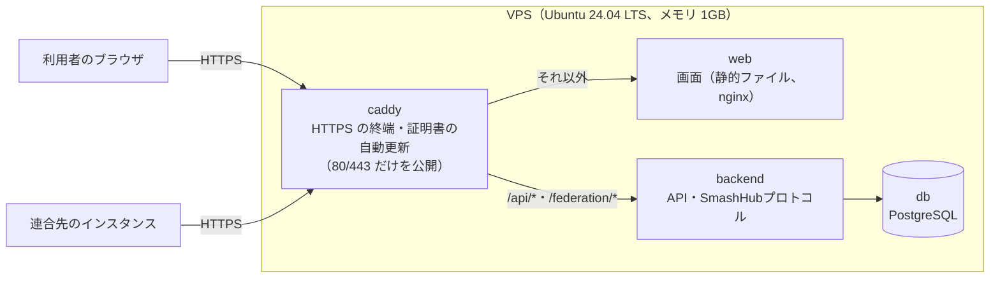

# インスタンスの立て方（本番）

> ステータス: **Draft**。技術者向けの手順書です。デプロイ方式は [ADR 0009](../adr/0009-deployment-vps-startup-script.md) に沿います。

SmashHub の公開インスタンスを、国内 VPS（メモリ 1GB）に立てる手順です。構成とスクリプトはリポジトリの [`deploy/`](../../deploy/) にあります。

今の手順では、ドメイン・インスタンス名・Discord アプリの値・管理者は **サーバー上の設定ファイルを SSH で編集して** 設定します。ADR 0009 で決めた、技術者でない運営者向けの **ブラウザのセットアップ画面・管理画面**（更新・バックアップのダウンロード・通知）は今後の予定で、まだありません（→ [12. 今後の予定](#12-今後の予定)）。

## 1. 全体の構成



| サービス | 内容 | メモリの上限 |
|---|---|---|
| caddy | リバースプロキシ（[Caddy](https://caddyserver.com/)、Apache-2.0）。HTTPS の証明書（Let's Encrypt 等）を自動で取得・更新する | 128MB |
| web | `frontend/` のイメージ。画面の静的ファイルを配信する | 64MB |
| backend | `backend/` のイメージ。起動時に DB のマイグレーションを自動で実行する | 192MB |
| db | PostgreSQL 17。1GB の VPS 向けに控えめな設定にしている | 320MB |

- 外に公開するのは caddy の 80/443 だけです。backend と DB は外から直接つながりません。
- 公開済みのコンテナイメージはまだないため、**サーバー上でリポジトリからイメージをビルド** します。1GB の VPS でもビルドできるよう、セットアップスクリプトがスワップ（2GB）を作り、backend と web を1つずつビルドします。

### 接続元の IP アドレスの扱い

backend は、レート制限とアクセスログに接続元の IP アドレスを使います（[データ保護](../security/data-protection.md)。アクセスログの保持期間は初期値 14日）。

- caddy は `/api/*` と `/federation/*` を web を通さずに backend へ直接流し、caddy が見た接続元のアドレスを `X-Real-IP` に入れます。利用者が送ってきた `X-Real-IP`・`X-Forwarded-For` は caddy が上書きするため、偽装できません。
- backend は caddy の後ろにだけ置き、`CLIENT_IP_HEADER=X-Real-IP` で caddy が付けた値を読みます。
- caddy のアクセスログは出しません。caddy 自身の動作ログ（警告・エラー）からも IP アドレスを消しています。IP アドレスを含むログは、保持期間を管理できる backend の DB にだけ残します。
- セキュリティヘッダー（CSP・HSTS 等）は caddy がすべての応答に付けます。

## 2. 必要なもの

- 国内 VPS（メモリ 1GB 以上、Ubuntu 24.04 LTS）。手順書の対象は次の2つです（料金は 2026年10月時点の目安。最新の料金は各社の公式サイトで確認してください）。

  | 事業者 | プラン | 月額の目安（税込） |
  |---|---|---|
  | さくらのVPS | 1GB | 807〜990 円 |
  | ConoHa VPS | 1GB | 763 円（1か月契約） |

- 独自ドメイン（本番では推奨。→ [3.](#3-ドメインを決める)）
- Discord のアカウント（ログインに使う Discord アプリを作るため）
- SSH クライアント（設定ファイルの編集に使う）

## 3. ドメインを決める

連合では、インスタンスは URL（インスタンス ID）と署名鍵で識別されます（[SmashHubプロトコル](../architecture/federation.md)）。URL が変わると連合先から見て別のインスタンスになるため、**本番では最初から独自ドメインを使ってください。**

1. ドメイン（例: `smash-hub.example.com`）を用意します。
2. VPS を作ったら（→ [4.](#4-vps-を用意してセットアップスクリプトを実行する)）、DNS に **A レコード** を1つ追加し、そのドメインを VPS のグローバル IPv4 アドレスに向けます。
   - **AAAA レコード（IPv6）は追加しないでください。** Docker の標準の設定では、IPv6 での接続は接続元のアドレスが Docker 内部のアドレスに置き換わり、レート制限とアクセスログが正しく働きません。
3. DNS が反映されると、caddy が自動で HTTPS の証明書を取得します（反映まで数分〜数時間かかることがあります）。

### 試すだけの場合（試用のドメイン）

ドメインを用意しなくても、セットアップスクリプトは VPS のグローバル IP アドレスから試用のドメイン（`<IP アドレス>.sslip.io`。例: `203-0-113-10.sslip.io`）を作って起動します。DNS の設定は要りません。

- 試用のドメインは IP アドレスに結びつくため、**試用のインスタンスは連合に参加させません**（[ADR 0009](../adr/0009-deployment-vps-startup-script.md#ドメインと-https)）。試用のドメインのまま `PEERS` を設定すると、`smash-hub` コマンドは起動を拒否します。
- 本番にするときは独自ドメインに切り替えてから連合に参加してください。試用中に作ったアカウント・対戦記録は、インスタンスの URL が変わるため連合では別のインスタンスのものになります。本番の前に作り直す（→ [9.3](#93-最初からやり直す)）ことを勧めます。
- 試用のドメインの名前解決には外部のサービス（sslip.io）を使います。

## 4. VPS を用意してセットアップスクリプトを実行する

セットアップスクリプト [`deploy/setup.sh`](../../deploy/setup.sh) は、次のことを行います。何度実行しても同じ結果になり（冪等）、既にある設定ファイル・秘密情報・データは上書きしません。

- OS のセキュリティ更新の自動適用（unattended-upgrades）。再起動が必要な更新は 04:30 に自動で再起動します（コンテナは自動で起動し直します）
- タイムゾーンを Asia/Tokyo に設定
- スワップ（2GB）の作成
- ファイアウォール（ufw）で 22/tcp・80/tcp・443/tcp・443/udp だけを許可
- Docker Engine と Compose plugin の導入（Docker の公式リポジトリから）
- リポジトリの取得（`/opt/smash-hub/repo`）
- 秘密情報のランダム生成（`/opt/smash-hub/secrets.env`）と、設定ファイルのひな形（`/opt/smash-hub/smash-hub.env`）の作成
- 毎日の DB のバックアップ（systemd timer。→ [9.](#9-バックアップと復元)）
- 起動（初回はイメージのビルドに 10分ほどかかります）

スクリプトの出力に秘密情報は出しません。

### 4.1 スタートアップスクリプトとして指定する（推奨）

VPS の申込画面で OS に **Ubuntu 24.04 LTS** を選び、スタートアップスクリプトに `deploy/setup.sh` の中身をそのまま貼り付けます（URL を指定できる場合は `https://raw.githubusercontent.com/tacky0612/smash-hub/main/deploy/setup.sh`）。スクリプトは書き換えずにそのまま使います。

- **さくらのVPS**: スクリプトを「マイスクリプト」として登録し、OS のインストール時にそのスクリプトを選びます。
- **ConoHa VPS**: サーバーの追加画面の「スタートアップスクリプト」に、テキストで入力するか URL を指定します。

VPS 事業者のファイアウォール（さくらのVPS の「パケットフィルター」、ConoHa VPS の「セキュリティグループ」等）を使っている場合は、**80 番と 443 番のポート（Web）** を許可してください。許可しないと HTTPS の証明書を取得できません。

起動後、スクリプトの進み具合は SSH で接続して確認できます（cloud-init で実行された場合は `/var/log/cloud-init-output.log`）。

### 4.2 SSH で手動実行する

既に Ubuntu 24.04 LTS の VPS がある場合は、SSH で接続して実行します。

```sh
curl -fsSLO https://raw.githubusercontent.com/tacky0612/smash-hub/main/deploy/setup.sh
sudo bash setup.sh
```

スクリプトの先頭の変数は環境変数で上書きできます。

| 変数 | 初期値 | 内容 |
|---|---|---|
| `SMASH_HUB_REF` | `main` | 取得するブランチまたはリリースタグ |
| `SMASH_HUB_DOMAIN` | （空） | ドメイン。空なら試用のドメインを作る |
| `SMASH_HUB_HOME` | `/opt/smash-hub` | インストール先 |
| `SWAP_SIZE` | `2G` | スワップの大きさ |
| `AUTO_REBOOT_TIME` | `04:30` | OS の更新で自動で再起動する時刻（空なら自動で再起動しない） |

例: `sudo SMASH_HUB_DOMAIN=smash-hub.example.com bash setup.sh`

> SSH のポートを 22 番から変えている場合は、スクリプトを実行する前に `sudo ufw allow <ポート>/tcp` で許可してください。ufw を有効にしたときに接続できなくなります。

## 5. 設定ファイルを編集する

SSH で接続し、設定ファイル `/opt/smash-hub/smash-hub.env` を編集します（root だけが読み書きできます）。

```sh
sudo nano /opt/smash-hub/smash-hub.env
```

| 設定 | 内容 |
|---|---|
| `DOMAIN` | インスタンスのドメイン（`https://` は付けない）。インスタンス ID は `https://<DOMAIN>` になる |
| `INSTANCE_NAME` | インスタンス名（画面に表示される） |
| `DISCORD_CLIENT_ID` / `DISCORD_CLIENT_SECRET` | Discord アプリのクライアント ID とクライアントシークレット（→ [6.](#6-discord-ログインを設定する)） |
| `ADMIN_ACCOUNT_IDS` | 管理者のアカウント ID（`did:key:...`）。複数ならカンマ区切り（→ [7.](#7-管理者を設定する)） |
| `OPERATOR_CONTACT` | 運営者への問い合わせ先（利用規約・画面に表示され、公開される） |
| `PEERS` | 連合先のインスタンスの URL（カンマ区切り。→ [11.](#11-連合に参加する)） |
| `TERMS_FILE` | インスタンス独自の利用規約のファイル（任意。→ [5.1](#51-独自の利用規約を置く)） |
| `SOURCE_CODE_URL` | 改変したソースコードで運営する場合の公開先（AGPL-3.0 第13条。初期値はこのリポジトリ） |
| `BACKUP_KEEP` | DB のバックアップを残す数（初期値 14） |
| `SMASH_HUB_REF` | `smash-hub update` で取得するブランチまたはリリースタグ |

編集したら、設定を確かめてから反映します。

```sh
sudo smash-hub check     # 設定を検証する
sudo smash-hub restart   # 設定を反映して起動し直す
```

`APP_ENV=production`・`COOKIE_SECURE=true`・開発用ログインの無効化・`INSTANCE_URL`・`PUBLIC_BASE_URL`・Discord のリダイレクト URI は、`DOMAIN` から [`deploy/compose.yaml`](../../deploy/compose.yaml) が自動で設定します。

### 5.1 独自の利用規約を置く

設定しなければ、プロジェクト共通の利用規約のひな形（[`backend/internal/platform/terms/default.md`](../../backend/internal/platform/terms/default.md)）を表示します。ひな形の `{{instance_name}}` はインスタンス名に、`{{contact}}` は `OPERATOR_CONTACT` に置き換わります。インスタンス独自の利用規約を使う場合は、ひな形をコピーして編集し、次のようにします。

1. `/opt/smash-hub/custom/terms.md` に利用規約を置きます（`/opt/smash-hub/custom/` はコンテナの `/etc/smash-hub/custom/` に読み取り専用でマウントされます）。
2. 設定ファイルに `TERMS_FILE=/etc/smash-hub/custom/terms.md` を書きます。
3. `sudo smash-hub restart` で反映します。

利用規約の本文を変えると版が変わります。登録済みの利用者には、次に画面を開いたときに新しい利用規約への同意を求めます（同意するまでは対戦相手を探せません）。

## 6. Discord ログインを設定する

利用者は Discord のアカウントでログインします。Discord アプリを作り、クライアント ID とクライアントシークレットを設定ファイルに書きます。手順は [Discord アプリの作成](discord-app.md) にあります。

- リダイレクト URI: `https://<DOMAIN>/api/auth/discord/callback`（完全一致）
- スコープ: `identify` のみ

設定するまでは、誰もログインできません（本番では開発用ログインは無効です）。

## 7. 管理者を設定する

管理者は、アカウント ID（Ed25519 公開鍵の did:key。→ [ユビキタス言語](../domain/README.md)）で指定します。

1. 自分のインスタンスに Discord でログインし、アカウントを登録します。
2. 自分のアカウント ID を確認します。画面の「設定」の「アカウント ID」に `did:key:...` が表示されます。
3. 設定ファイルの `ADMIN_ACCOUNT_IDS=` にそのアカウント ID を書きます。
4. `sudo smash-hub restart` で反映します。画面のメニューに「管理」が表示され、通報の確認・処分・対戦の無効化ができるようになります（→ [対戦ルール](../domain/match-rules.md) の「10. 通報とモデレーション」）。

## 8. 日々の操作

`smash-hub` コマンド（[`deploy/smash-hub.sh`](../../deploy/smash-hub.sh)）で操作します。どれも `sudo` を付けて実行します。

| コマンド | 内容 |
|---|---|
| `smash-hub start` | 起動する |
| `smash-hub stop` | 停止する（データは消えない） |
| `smash-hub restart` | 設定ファイルを読み直して起動し直す |
| `smash-hub status` | 各サービスの状態を表示する |
| `smash-hub logs [サービス]` | ログを表示する（例: `smash-hub logs backend`。`Ctrl+C` で終わる） |
| `smash-hub update [参照]` | 更新する（→ [8.1](#81-更新する)） |
| `smash-hub backup` | DB のバックアップを今すぐ取る |
| `smash-hub restore <ファイル>` | バックアップから DB を復元する（→ [9.2](#92-復元する)） |
| `smash-hub snapshot` | ログのスナップショットを書き出す（→ [9.4](#94-ログのスナップショット)） |
| `smash-hub check` | 設定ファイルを検証する |

VPS を再起動しても、SmashHub は自動で起動します。

コンテナのログ（`smash-hub logs`）は、サービスごとに 10MB × 3 ファイルまで保存し、古いものから消えます。

### 8.1 更新する

```sh
sudo smash-hub update          # 設定ファイルの SMASH_HUB_REF（初期値 main）の最新に更新する
sudo smash-hub update v0.2.0   # 指定したリリースタグに更新する
```

`update` は次の順に行います。

1. DB のバックアップを取る
2. リポジトリを取得し、指定したブランチ・タグに切り替える
3. イメージをビルドし直し（caddy・PostgreSQL のイメージも最新にする）、起動し直す。DB のマイグレーションは backend が起動時に自動で実行する

更新の前に、リリースノートで互換性のない変更がないか確認してください。OS のセキュリティ更新は自動で適用されますが、SmashHub 本体の更新は自動では行いません（自動更新・管理画面からの更新は今後の予定です）。

## 9. バックアップと復元

### 9.1 バックアップ

- 毎日 03:30 ごろ（systemd timer `smash-hub-backup.timer`）、DB のバックアップを `/opt/smash-hub/backups/smashhub-<日時>.dump`（`pg_dump` のカスタム形式）に作ります。
- **新しいものから 14個**（`BACKUP_KEEP`）を残し、古いものは消します。更新（`smash-hub update`）の前に取ったバックアップも数に含めます。
- アクセスログ（IP アドレスを含む）と、ログインの途中で使う一時的なデータは **バックアップに含めません**。アクセスログの保持期間（14日）をバックアップで延ばさないためです（[データ保護](../security/data-protection.md)）。
- バックアップはサーバーの中にしかありません。サーバーごと失った場合に備えて、ときどき手元にコピーしてください。

  ```sh
  # 手元の PC で実行する（root でしか読めないため、一度コピーしてから取る）
  ssh <ユーザー>@<サーバー> 'sudo cat /opt/smash-hub/backups/smashhub-20261027-033012.dump' > smashhub-20261027-033012.dump
  ```

- バックアップの状態は `systemctl list-timers smash-hub-backup.timer` と `journalctl -u smash-hub-backup` で確認できます。

確定した対戦記録は連合先にも複製されているため、DB を失っても対戦記録は連合から取り戻せる見込みです（ログの再配布は未実装）。特に失うと困るのは、秘密情報（→ [10.](#10-秘密情報secretsenvの保管)）です。

### 9.2 復元する

```sh
sudo smash-hub restore /opt/smash-hub/backups/smashhub-20261027-033012.dump
```

今の DB の内容をすべて消してから復元します（確認に `yes` と入力します）。復元中はインスタンスを停止します。

別のサーバーに移す場合は、次の順に行います。秘密情報が元と違うと、インスタンスの署名鍵が変わって連合先から別のインスタンスになり、利用者もログインできなくなります。

1. 新しいサーバー（Ubuntu 24.04 LTS）に SSH で接続し、**`setup.sh` を実行する前に** 元のサーバーの `secrets.env` と `smash-hub.env` を `/opt/smash-hub/` に置きます（`sudo install -d /opt/smash-hub` のあと、権限は 600）。`setup.sh` は既にあるファイルを上書きせず、その秘密情報（DB のパスワードを含む）で起動します。スタートアップスクリプトは秘密情報を置く前に実行されてしまうため、移行では [4.2](#42-ssh-で手動実行する) の手順を使います。
2. `sudo bash setup.sh` を実行します。
3. バックアップのファイルを新しいサーバーにコピーし、`sudo smash-hub restore <ファイル>` で復元します。
4. DNS の A レコードを新しいサーバーの IP アドレスに向けます。

### 9.3 最初からやり直す

試用のインスタンスを捨てて作り直す場合は、データと秘密情報を消してからセットアップし直します。**この操作は元に戻せません。**

```sh
cd /opt/smash-hub/repo/deploy
sudo docker compose -f compose.yaml --env-file ../../smash-hub.env --env-file ../../secrets.env down -v
sudo rm /opt/smash-hub/secrets.env /opt/smash-hub/backups/*.dump
sudo bash setup.sh
```

### 9.4 ログのスナップショット

```sh
sudo smash-hub snapshot
```

インスタンスが保存しているログの全体（自インスタンスのログと、連合先から取り込んだログ）と、インスタンスが計算したレートを、`/opt/smash-hub/snapshots/smashhub-snapshot-<日時>.json` に書き出します（形式は [SmashHubプロトコル](../architecture/federation.md) の「8.3 スナップショット」）。

- 中身は `/federation/log` で公開しているイベントとレートだけで、個人情報や秘密情報は含みません。バックアップと違い、人に渡したり公開したりしてかまいません。
- **DB のバックアップの代わりにはなりません。** アカウントのログイン情報（識別子ハッシュ）や進行中の対戦は含まないため、スナップショットからインスタンスを復元することはできません。
- 古いスナップショットは自動では消しません。

スナップショットからレートを再計算し、インスタンスのレートと一致するかを確かめるには、Go が入っている手元の PC でリポジトリを取得して次を実行します。DB は不要です。

```sh
ssh <ユーザー>@<サーバー> 'sudo cat /opt/smash-hub/snapshots/smashhub-snapshot-20261027-033012.json' > snapshot.json
cd backend
go run ./cmd/server verify-snapshot -key https://<DOMAIN>=<公開鍵> snapshot.json
```

- 署名・連番・ハッシュチェーン・プレイヤー署名を、連合先からの取り込みと同じ手順で検証し、レートを再計算します。一致すれば「再計算した結果はスナップショットのレートと一致しました」と表示します。食い違いがあれば、その内容を表示して終了コード 1 で終わります。
- `-key` には、`https://<DOMAIN>/federation/instance` の `public_key` を指定します（連合先の分も `-key` を繰り返して指定できます）。省略すると、スナップショットに書かれた鍵を信じて検証します。
- `-csv <ファイル>` を付けると、再計算した成績（アカウント ID・レート・対戦数・勝ち・負け）を CSV に書き出します。

## 10. 秘密情報（secrets.env）の保管

`/opt/smash-hub/secrets.env` には、セットアップスクリプトが生成した次の秘密情報があります。運営者が値を入力したり、目にしたりする必要はありません。

| 値 | 内容 | 失ったとき |
|---|---|---|
| `INSTANCE_PRIVATE_KEY` | インスタンスの署名鍵（Ed25519） | 連合先から別のインスタンスとして扱われる |
| `IDENTIFIER_PEPPER` | 識別子ハッシュのペッパー | 既存の利用者がログインできなくなる |
| `ACCOUNT_KEY_SECRET` | アカウントの署名鍵の暗号化鍵 | 利用者のアカウントの署名鍵を使えなくなる |
| `DB_PASSWORD` | DB のパスワード | DB に接続できなくなる |

- **`secrets.env` は、DB のバックアップとは別の場所に保管してください。** DB とペッパーの両方が漏れると、「特定の Discord ID の人がこのインスタンスにいるか」を確認できてしまいます（[データ保護](../security/data-protection.md)）。たとえば DB のバックアップは手元の PC、`secrets.env` はパスワードマネージャーに保管します。
- セットアップが終わったら一度、`sudo cat /opt/smash-hub/secrets.env` の内容を安全な場所に控えてください。チャット・Issue・スクリーンショットなどに貼らないでください。
- 漏れた場合は [インシデント対応](../security/incident-response.md#22-種類別の対応) に従ってください。

## 11. 連合に参加する

他のインスタンスと対戦記録・対戦募集を共有するには、連合先のインスタンスの URL を `PEERS` にカンマ区切りで書きます。

```sh
PEERS=https://smash-hub.example.org,https://other.example.net
```

- 連合は相互に設定します。相手の運営者にも、自分のインスタンスの URL（`https://<DOMAIN>`）を `PEERS` に追加してもらってください。
- 連合に参加する運営者は [サーバー運用者の約束事](server-covenant.md) に同意します。
- 試用のドメイン（`*.sslip.io` 等）のインスタンスは連合に参加させません（→ [3.](#試すだけの場合試用のドメイン)）。

## 12. 今後の予定

[ADR 0009](../adr/0009-deployment-vps-startup-script.md) の次のものは、まだありません。

- 初回起動時のブラウザのセットアップ画面（ワンタイムコード、ドメイン・Discord の値の入力、管理者の紐づけ）
- 管理画面（新しいリリースの通知とワンクリックの更新、バックアップと秘密情報のダウンロード、パスフレーズでの暗号化、ヘルスチェックと異常時の通知、閉鎖の手順）
- セキュリティ修正のリリースの自動適用
- 公開済みのコンテナイメージ（今はサーバー上でビルドする）
- ミラー・静的アーカイブの手順

## 13. 未解決の論点

- [ ] さくらのVPS・ConoHa VPS の実機で、スタートアップスクリプトとしての動作を確認する
- [ ] IPv6（AAAA レコード）に対応する（Docker の IPv6 の設定で接続元のアドレスを保つ）
- [ ] バックアップの暗号化と、サーバーの外への自動の退避
- [ ] リリースタグの運用（`SMASH_HUB_REF` の初期値を最新のリリースにする）
