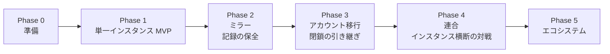

# ロードマップ

> ステータス: **Draft**。期間は目安です。コントリビューターの人数と状況に応じて見直します。

## 考え方: 「小さく始めて、記録だけは最初から分散に耐える形にする」

完全な分散システムを最初から作ろうとすると、公開までに時間がかかりすぎます。一方で、単一サーバーの普通のサイトとして作ってしまうと、後から分散化するときにデータを作り直すことになり、「記録を失わない」という約束が果たせません。

そこで Smash-hub は次の順序で進めます。

1. **データの形だけは初日から分散前提にする** — 鍵に基づくアカウント ID、両者署名の対戦記録、追記専用ログ、記録からの決定的なレート算出。
2. **機能は単一インスタンスで出す** — まず1台で「使える対戦レートサイト」として公開し、プレイヤーの居場所を早くつくる。
3. **分散は「記録の保全」から段階的に足す** — いちばん価値が大きく、いちばん単純な「他の人が記録のコピーを持つ」から始め、相互連携・アカウント移行・インスタンス横断の対戦へと広げる。

| フェーズ | 目安 | この時点でプレイヤーが得るもの | 分散の度合い |
|---|---|---|---|
| Phase 0 準備 | 〜2週間 | （なし。開発の土台） | — |
| Phase 1 MVP | 〜2か月 | 自動マッチング・結果報告・レートが使える | 1台。データ形式のみ分散対応 |
| Phase 2 ミラー | 〜1か月 | 「運営が止まっても記録は残る」保証 | 1台の本番 + 読み取り専用のミラー |
| Phase 3 移行 | 〜1か月 | 「別のインスタンスで続けられる」保証 | 複数のインスタンスが記録を相互保持 |
| Phase 4 連合 | 〜2か月 | 他インスタンスの人とも対戦できる | 完全な連合 |
| Phase 5 エコシステム | 継続 | 運営・開発の持続性 | — |

---

## Phase 0: 準備

**ゴール: 人が集まり、議論と開発を始められる状態をつくる。**

- [x] ドキュメント整備（README・ビジョン・ポリシー・設計・ロードマップ・対戦ルール・レーティング）
- [x] ライセンスの決定 → AGPL-3.0（[ADR 0003](adr/0003-license-agpl-3.0.md)）
- [ ] 技術者でない運営者でもデプロイできる方式の議論と決定 → ADR（[議論資料](operations/easy-deployment.md)、[#1](https://github.com/tacky0612/smash-hub/issues/1)）。**技術選定の前提になるため先に行う**
- [x] フロントエンド・バックエンドの技術選定 → React（SPA）/ Go / PostgreSQL（[ADR 0005](adr/0005-tech-stack.md)、[#2](https://github.com/tacky0612/smash-hub/issues/2)）
- [x] ドキュメントの CI（docs-check）
- [x] 開発環境のセットアップ手順（Docker Compose）、コードの CI（gofmt・vet・単体テスト・結合テスト・フロントエンドのビルド）
- [ ] 依存ルールの静的チェック（モジュール間の import 制約）
- [x] Issue / PR テンプレート、ラベル、Discussion の整備
- [x] 認証プロバイダーの決定（[ADR 0002](adr/0002-external-authentication-providers.md)）
- [x] Private vulnerability reporting・secret scanning・ブランチ保護の有効化
- [ ] 行動規範の連絡窓口の決定（[#3](https://github.com/tacky0612/smash-hub/issues/3)）
- [ ] 告知（コントリビューター募集）

**完了条件:** ライセンスと技術選定の ADR がマージされ、`main` で CI が動いている。

## Phase 1: 単一インスタンス MVP

**ゴール: 1台のインスタンスで、対戦相手を探して戦い、レートが動く。**

### 機能

> 実装の進み具合は [backend/README.md の「実装状況」](../backend/README.md#実装状況) を参照してください。

- [ ] Discord ログイン（OAuth 2.0 + PKCE、識別子ハッシュのみ保存）と登録（鍵ペアをサーバー側で生成・暗号化して保管）
- [ ] Google ログイン（任意で有効化）、複数プロバイダーの紐づけ
- [ ] セキュリティの基本対策（CSRF・CSP・レート制限・ログ保持期間）と[セキュリティポリシー](security/README.md)の適用
- [x] プロフィール（表示名・メインファイター等のテキスト情報）
- [ ] 自動マッチング（「対戦相手を探す」。レート差・連戦・接続方法のマッチング条件）
- [ ] [標準ルール](domain/match-rules.md)の進行（拒否ステージの表示、敗者のみのファイター変更、ゲームごとのステージ・ファイターの記録）
- [ ] 対戦ルーム（ゲーム内の部屋情報の共有）
- [ ] 両者による結果報告（噛み合えば両者署名で確定）、対戦中止、24時間での期限切れ
- [ ] 拒否ステージ・スイッチ・ブロック・配信/動画化の設定、対戦マナーの目安、ルールチェック
- [ ] スマメイト式によるレート算出（参照実装 + テストベクタ、暫定レート / 確定レート）
- [ ] 戦績・レート推移・ランキング
- [ ] 自分の対戦履歴のエクスポート
- [ ] 通報と、運営者による無効化・利用停止の最小限の管理画面
- [x] 非公式表示・ソースコードへのリンク（AGPL-3.0）
- [ ] ポリシー・利用規約の表示
- [ ] 正式な UI デザイン（サービスアイコン・Favicon・OGP・UX 向上のための画面構成の調整）。現在は動作検証用の仮 UI（[#10](https://github.com/tacky0612/smash-hub/issues/10)）

### 分散に向けた仕込み（この段階で必ずやる）

- [ ] アカウント ID を鍵ベースにする（ハンドルと分離）
- [ ] 確定した対戦記録を両者署名付きの不変データとして保存する
- [ ] 確定した記録をインスタンス署名付きの追記専用ログに書く
- [ ] レートを「ログから再計算できる派生データ」として実装する
- [ ] ログのダンプ（スナップショット）を出力できる

### やらないこと

- 他インスタンスとの通信、インスタンスをまたぐマッチング、アカウント移行

**完了条件:** 公開インスタンスが1つ稼働し、実際のプレイヤーが対戦・報告・レート確認をできる。スナップショットから別環境でレートを再計算し、本番と一致することを確認できる。

## Phase 2: ミラー（記録の保全）

**ゴール: 本番インスタンスが止まっても、対戦記録が他の誰かの手元に残る。**

分散の最初の一歩として、「読み取り専用で記録を複製するだけ」のインスタンスを実現します。通信は一方向（本番 → ミラー）で、実装も運用も最も単純です。

- [ ] 連合プロトコルのログ提供 API（`GET /federation/log?since=`）
- [ ] ミラーモード（利用者を受け付けず、ログを pull・検証・保存するだけ）
- [ ] 署名・ハッシュチェーンの検証と、検証失敗の記録
- [ ] ミラー上での戦績・ランキングの閲覧（読み取り専用）
- [ ] 静的ファイルとしてのアーカイブ公開（インスタンスを持たない人でも保全に参加できる）
- [ ] ミラー運用手順書

**完了条件:** プロジェクト外の運営者による独立したミラーが2つ以上稼働し、本番と同じレートを表示している。

## Phase 3: アカウント移行と閉鎖の引き継ぎ

**ゴール: どのインスタンスがなくなっても、プレイヤーは別のインスタンスで続けられる。**

- [ ] ミラーから「利用者を受け付けるインスタンス」への昇格（他インスタンスの記録を引き継いだ状態で開始できる）
- [ ] 双方向のログ複製（インスタンス同士が互いのログを保持・再配布）
- [ ] リカバリーキーの発行と、リカバリーキーによるアカウント復元
- [ ] アカウント移行（ホームインスタンスの変更、`AccountMoved`）
- [ ] 閉鎖予告（`InstanceClosing`）と推奨移行先の案内
- [ ] 鍵のエクスポート、鍵の更新（`AccountKeyRotated`）
- [ ] 連合ポリシー（許可リスト）と[運用者の約束事](operations/server-covenant.md)の確定

**完了条件:** テスト環境で「インスタンスを予告なく停止 → 利用者がリカバリーキーで別インスタンスに復元 → 過去の戦績とレートがそのまま見える」ことを確認できる。本番でも2つ以上のインスタンスが記録を相互保持している。

## Phase 4: 連合（インスタンス横断の対戦）

**ゴール: どのインスタンスに所属していても、誰とでも対戦できる。**

- [ ] インスタンス横断の対戦（ホストインスタンスでの報告受付、相手ホーム経由の署名）
- [ ] 新着通知（push）による遅延短縮
- [ ] 連合レートのランキング
- [ ] インスタンス間のモデレーション連携（通報の転送、問題インスタンスの拒否）
- [ ] インスタンスをまたぐ自動マッチング（マッチング条件・ブロックをホストへ必要な範囲で渡す）
- [ ] 複数インスタンスを立てた E2E テスト

**完了条件:** 3つ以上の独立した運営者のインスタンスが連合し、インスタンスをまたいだ対戦が日常的に行われている。

## Phase 5: エコシステム（継続）

**ゴール: 特定の開発者・運営者がいなくても続くプロジェクトにする。**

- [ ] ガバナンス（意思決定の方法、メンテナーの選出・交代）
- [ ] インスタンスの簡単な立ち上げ（コンテナイメージ、ワンコマンドのセットアップ）
- [ ] インスタンス一覧・参加ガイド
- [ ] SNS 連携（ActivityPub による戦績の告知等）の検討
- [ ] 大会機能・インスタンス独自ルールの検討（チーム戦は扱わない）
- [ ] 多言語対応

---

## リスクと対応

| リスク | 影響 | 対応 |
|---|---|---|
| 公開が遅れ、プレイヤーが他所に定着する | 利用者が集まらない | Phase 1 の範囲を絞り、早く公開する。分散は後から足す |
| 最初の運営者に負担が集中する（スマメイトと同じ構図） | プロジェクトが止まる | Phase 2 で早期にミラー運営者を増やし、Phase 5 のガバナンスを前倒しで議論する |
| 商標・著作物の扱いの問題 | 公開停止 | [運営ポリシー](policy.md) を厳格に運用。迷ったら使わない |
| レート操作・不正 | ランキングの信頼低下 | 両者署名、新規アカウントの扱い、連合ポリシー、モデレーション |
| 分散化で設計が複雑になりすぎる | 開発が進まない | 既存プロトコルを無理に全部採用せず、必要最小限の独自プロトコルから始める |
| 鍵の紛失 | アカウントを失う | 当初はサーバー保管 + リカバリーキー。利用者に鍵の管理を強いない |
| 外部認証プロバイダーの規約変更・停止 | ログインできなくなる | 複数プロバイダーの紐づけ、リカバリーキーでの紐づけ直し、パスキーの将来検討 |
