# 認証

> ステータス: **Draft**。プロバイダーの選定は [ADR 0002](../adr/0002-external-authentication-providers.md) で提案中です。

## 1. 方針

- **ログインは外部の認証プロバイダーに任せます。** インスタンスはパスワードを扱いません。
- **無料で使え、インスタンス運営者が自分で登録・設定できるプロバイダーを使います。** 運営者が有料契約をしたり、認証サーバーを運用したりする必要はありません。
- **プロバイダーから受け取る情報は最小限にし、個人情報は保存しません**（→ [データ保護](data-protection.md)）。
- **認証は「ホームインスタンスへのログイン」のためだけに使います。** 連合の中でのアカウントの同一性は鍵に基づくアカウント ID で表し、外部プロバイダーのアカウントとは結びつけません。

## 2. 採用するプロバイダー

| プロバイダー | 位置づけ | プロトコル | 要求するスコープ | 費用 |
|---|---|---|---|---|
| **Discord** | 第一候補（標準で有効） | OAuth 2.0 | `identify` のみ | 無料 |
| **Google** | 第二候補（任意で有効） | OpenID Connect | `openid` のみ | 無料 |

### 選定理由

- **Discord** — スマブラのコミュニティで広く使われており、多くの利用者がすでにアカウントを持っています。開発者登録とアプリ作成は無料で、利用者数による課金や上限がありません。`identify` スコープだけならメールアドレスを受け取りません。
- **Google** — Discord を使わない利用者の選択肢として用意します。標準の OpenID Connect で、`openid` スコープだけなら識別子（`sub`）以外の情報を受け取りません。無料で使えます。

### 採用しなかった選択肢

| 選択肢 | 採用しない理由 |
|---|---|
| X (Twitter) | API の利用条件・料金体系の変更が多く、無料で継続して使える保証が弱い。条件が安定すれば再検討する |
| 認証 SaaS（Auth0・Clerk・Firebase Authentication 等） | 無料枠はあるが、利用者数の上限や料金体系の変更にインスタンスが左右される。運営者ごとの契約が必要で、メールアドレス等の個人情報を SaaS 側に預ける構成になりやすい |
| 自前の認証基盤（Keycloak 等） | 運用負荷が大きく、個人運営の方針に合わない |
| パスワード認証 | パスワードを保持・保護する責任が運営者に生じ、メールアドレス等の連絡先も必要になる |

将来の候補として、外部サービスに依存しない **パスキー（WebAuthn）** を検討します（→ 8. 未解決の論点）。

## 3. ログインの流れ

ブラウザ側（静的配信のフロントエンド）にはトークンを渡さず、バックエンドがプロバイダーとやり取りします。

```mermaid
sequenceDiagram
  actor U as 利用者
  participant FE as Frontend
  participant BE as Backend（ホームインスタンス）
  participant P as 認証プロバイダー（Discord / Google）

  U->>FE: 「Discord でログイン」
  FE->>BE: GET /auth/discord/start
  BE->>BE: state・PKCE verifier を生成し一時保存
  BE-->>U: プロバイダーの認可画面へリダイレクト（scope=identify）
  U->>P: 同意
  P-->>BE: リダイレクト（認可コード, state）
  BE->>BE: state を検証
  BE->>P: 認可コード + PKCE verifier でトークン取得
  P-->>BE: アクセストークン（Google の場合は ID トークン）
  BE->>P: 利用者 ID の取得（Discord: /users/@me）
  P-->>BE: 利用者 ID ほか
  BE->>BE: 利用者 ID 以外を破棄、トークンも破棄
  BE->>BE: 識別子ハッシュを計算してアカウントを検索
  BE-->>U: セッション Cookie を発行してログイン完了
```

### 実装上の要件

- 認可コードフロー + PKCE（`S256`）を使う。インプリシットフローは使わない。
- `state` を必ず検証する。Google（OIDC）では `nonce`・`iss`・`aud`・署名・有効期限も検証する。
- リダイレクト URI は完全一致で登録する。
- プロバイダーのアクセストークン・リフレッシュトークンは **保存しない**。利用者 ID を取得したら直ちに破棄する。
- プロバイダーから受け取った利用者 ID 以外の情報（ユーザー名・アバター等）は **保存しない**。

## 4. アカウントとの紐づけ

### 4.1 新規登録

1. 外部プロバイダーでログインする。
2. 該当するアカウントがなければ登録画面に進む。
3. 利用者が **表示名を自分で決める**（プロバイダーのユーザー名は自動で引き継がない）。
4. ブラウザ内でリカバリーキーを生成し、利用者に保管してもらう。インスタンスには公開鍵だけを送る。
5. 利用規約・[運営ポリシー](../policy.md)（対戦記録が公開・複製されること）に同意して登録完了。

### 4.2 複数プロバイダーの紐づけ

1つのアカウントに Discord と Google の両方を紐づけられるようにします。片方のアカウントを失っても、もう片方でログインできます。

### 4.3 プロバイダーのアカウントを失った場合

紐づけたプロバイダーのアカウントをすべて失った場合は、**リカバリーキー** で本人であることを証明し、新しいプロバイダーのアカウントを紐づけ直します。

### 4.4 インスタンスの移行

識別子ハッシュはインスタンスごとに異なるため（→ [データ保護](data-protection.md)）、移行先のインスタンスでは改めて外部プロバイダーでログインし、リカバリーキー（または移行元で発行した移行トークン）でアカウントを引き継ぎます。

## 5. セッション

- セッションはサーバー側で管理する（セッション ID のみを Cookie に入れる）。
- Cookie は `HttpOnly`・`Secure`・`SameSite=Lax`、`__Host-` プレフィックスを付ける。
- 有効期限の初期値: 最終操作から 30日。ログアウト・アカウント削除・利用停止で即時失効させる。
- 利用者が自分のログイン中のセッションを一覧し、失効させられるようにする。

## 6. 複数アカウント対策との関係

個人情報を持たないため、「同じ人が複数のアカウントを作る」ことを完全には防げません。次の対策を組み合わせます。

- 同じプロバイダーアカウントで作れるアカウントは、1インスタンスにつき1つ。
- Discord の利用者 ID には作成日時が含まれるため、**ログイン時にだけ** そこからアカウントの作成時期を判定し、作成直後のアカウントでの登録を制限できるようにする（作成日時は保存しない）。
- レーティング側の対策（新規アカウントの扱い・ランキング掲載条件）と組み合わせる（→ [レーティング](../domain/rating.md)）。

## 7. 運営者の設定

インスタンス運営者は、利用するプロバイダーに自分でアプリを登録し、次の値を設定します（手順書は Phase 1 で整備します）。

| 設定 | 内容 |
|---|---|
| クライアント ID | 各プロバイダーで発行されたもの |
| クライアントシークレット | 同上。リポジトリ・ログに含めない |
| リダイレクト URI | `https://<インスタンスのドメイン>/auth/<provider>/callback` |
| 有効にするプロバイダー | Discord（標準）、Google（任意） |

## 8. 未解決の論点

- [ ] パスキー（WebAuthn）を外部サービスに依存しないログイン手段として追加するか
- [ ] 運営者向け管理機能に追加の認証（二要素）を求めるか
- [ ] プロバイダーの規約変更・サービス停止時の移行手順
