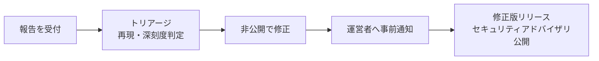

# インシデント対応

> ステータス: **Draft**。

## 1. ソフトウェアの脆弱性（開発プロジェクト）

報告の受付方法は [SECURITY.md](../../SECURITY.md) を参照してください。

| 段階 | 目安 |
|---|---|
| 受付の返信 | 3日以内 |
| トリアージ完了 | 7日以内 |
| 修正版リリース | 深刻度に応じて。公開は報告から最長 90日 |

- 深刻度は CVSS を参考に判定します。
- 連合に影響する脆弱性は、修正版のリリース前に、把握しているインスタンス運営者へ非公開で通知します。

## 2. インスタンスでのインシデント（運営者向け）

### 2.1 共通の初動

1. 被害の拡大を止める（必要ならメンテナンスモードにする、連合を一時停止する）。
2. 状況を記録する（いつ、何が起きたか、どの範囲か）。
3. 利用者と連合先へ告知する。
4. 原因を取り除き、復旧する。
5. 振り返りを行い、必要ならプロジェクトに Issue / 脆弱性報告を出す。

### 2.2 種類別の対応

| 事象 | 対応 |
|---|---|
| **インスタンス署名鍵の漏えい** | 新しい鍵を生成し、鍵の更新を連合に配信する。漏えい期間に署名されたログを連合先が再検証できるよう、期間を告知する |
| **KEK（署名鍵の暗号化鍵）の漏えい、または DB と KEK の両方の漏えい** | 影響する全アカウントの署名鍵を更新する（`AccountKeyRotated`）。利用者に告知する |
| **DB の漏えい（ペッパーは無事）** | 署名鍵は暗号化されているため直ちに悪用はされないが、念のため KEK を更新する。利用者に告知する |
| **ペッパーの漏えい** | ペッパーを更新し、全利用者に再ログイン時の紐づけ直しを案内する |
| **外部プロバイダーのクライアントシークレットの漏えい** | プロバイダーの管理画面でシークレットを再発行し、設定を更新する |
| **管理者アカウントの乗っ取り** | 全セッションを失効させ、管理者の紐づけを確認する。不正な無効化・利用停止を確認し、取り消す |
| **不正な対戦記録の大量発生** | 該当アカウント・該当インスタンスの記録を無効化（`MatchVoided`）し、連合先に通知する |

### 2.3 連合先が侵害された場合

- 該当インスタンスを連合ポリシーで一時的に拒否する。
- 侵害期間に取り込んだ記録を確認し、必要に応じてレート計算から除外する。
- 復旧後、該当インスタンスの鍵が更新されたことを確認してから連合を再開する。

## 3. 告知

- 利用者向け: インスタンス内のお知らせで告知する（メールアドレスを持たないため）。
- 連合先向け: 運営者の連絡窓口（[運用者の約束事](../operations/server-covenant.md)）へ連絡する。
- 個人情報を保持しない設計のため、通常は個人情報の漏えいには該当しない想定ですが、アクセスログ（IP アドレス）が含まれる場合は影響範囲として告知に含めます。
